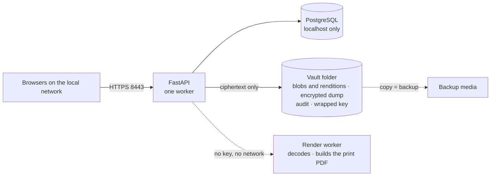

# DocVault

A document management application for a small office. It runs on one desktop computer, and
people use it from browsers on the local network. Every document is encrypted on disk. The
whole installation is a single folder, so a backup is a folder copy and recovery is a restore
onto new hardware.

> **Status: backend in progress.** The design documents in [`docs/`](docs/) are the specification.
> [`docs/17-implementation.md`](docs/17-implementation.md) records what is built and tested today.

---

## What it does

- Keeps a register of **entities**: people and organisations, each with typed ID numbers such as
  PAN, GSTIN, CIN, DIN, or passport.
- Stores **documents** against those entities. Each document has metadata and one or more
  immutable versions.
- **Classifies every document** into one of eight categories — identity, property, legal,
  corporate, financial, employment, insurance, other — and a specific type inside it, such as a
  PAN card or a share certificate. Each type carries a **sensitivity** level that decides how
  carefully the app treats it.
- Decides **who may do what** per document, with inheritance from the entity, groups, and
  audited admin overrides.
- **Encrypts every document** with AES-256-GCM under a key derived from a passphrase.
- **Shows documents on screen** and lets you clean up a scan — rotate, crop, straighten,
  brightness, contrast, grayscale — without changing the stored file.
- **Prints a selection**: one or many per page, 1, 2, 4, 6 or 9 per side, simplex or duplex, the
  paper size you choose. The server builds a print-ready PDF and the user prints it at their own
  desk. Printing is a separate permission from reading.
- Keeps a **tamper-evident audit trail** of every read, change, share, print, and deletion.
- Runs **entirely on the local network**. No cloud, no telemetry, no outbound traffic.

Formats: JPEG, PNG, PDF, and DOC/DOCX/ODT (converted once to PDF at upload).

## Stack

| Layer | Choice |
|---|---|
| Backend | Python 3.14, FastAPI 0.162, SQLAlchemy 2.1, Alembic 1.20 |
| Database | PostgreSQL 18.6, operator-managed, encrypted logical dumps |
| Frontend | React 19.3, TypeScript 7.0, Vite 8.3 |
| Storage | Local filesystem, content-addressed ciphertext, encrypted dumps |
| Platforms | Windows (production), Linux (development) |

Versions were checked against the live release channels on **2026-10-28**. The full list, the
reason for each choice, and the update rules are in
[`docs/02-architecture.md`](docs/02-architecture.md) §6.1–6.2.

## Documentation

| Start here | |
|---|---|
| [Documentation index](docs/README.md) | Reading order for each role |
| [Glossary](docs/glossary.md) | Every technical word, in plain language |
| [Overview](docs/00-overview.md) | Scope, people, key ideas |
| [Threat model](docs/01-threat-model.md) | What is defended, and what is not |
| [Classification](docs/13-classification.md) | Categories, document types, and sensitivity |
| [Vault format](docs/03-vault-format.md) | **The compatibility contract** |
| [Frontend and viewer](docs/11-frontend.md) | What every screen does |
| [Printing](docs/12-printing.md) | How a selection becomes sheets of paper |
| [Development setup](docs/14-development.md) | Run it on a laptop, test it, add AI tooling |
| [Production setup](docs/15-production-setup.md) | Install it for an office |
| [User guide](docs/16-user-guide.md) | File, find, share, and print documents |
| [Implementation status](docs/17-implementation.md) | What is built, tested, and next |
| [Decisions](docs/10-decisions.md) | Why each choice was made, and open questions |

## The design in one picture

## Design principles

1. **The folder is the backup.** There are no absolute paths except one re-pointable vault root.
2. **Encrypt content; be honest about the limits.** The passphrase is the real perimeter.
   Permissions are enforced by the application, not by cryptography.
3. **Fail closed.** An unknown format, a failed integrity check, a missing permission, or an
   unsuitable filesystem stops the operation instead of limping on.
4. **One rule, one place.** One permission check, one crypto module, one error format.
5. **Boring technology, small surface.** A handful of processes, no queues, no brokers, no
   cloud SDKs.
6. **The app does not invent structure.** No merging, no auto-grouping, no auto-pairing. It
   composes only the print grid, in the order the user gave it.

## Licence

See [LICENSE](LICENSE).
