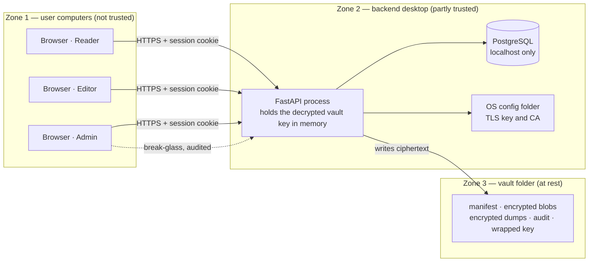

# 01 — Threat Model

> **In plain words:** This document answers three questions. What are we protecting? Who might
> attack it? And — just as important — what are we *not* protecting against?
>
> **Read this if:** you need to know whether a security claim is real, or you are deciding
> whether this design is good enough for your office.

---

## 1. What we are protecting

Listed by how much damage a loss would cause.

| # | Asset | Where it lives | If it is compromised |
|---|---|---|---|
| A-1 | Document content: scans of PAN cards, deeds, contracts | `vault/blobs/`, encrypted | Severe: identity theft, fraud, a data-protection breach |
| A-2 | ID values: PAN, Aadhaar, GSTIN | PostgreSQL, encrypted columns | Severe |
| A-3 | The vault master key (VMK) and the passphrase | Memory, `keys/kek.wrapped` | Catastrophic: decrypts everything |
| A-4 | The vault folder and database dump, which together are the backup | Filesystem, removable media | Total compromise if an attacker also has A-3 |
| A-5 | User credentials and sessions | PostgreSQL, cookies | Moderate: impersonation |
| A-6 | The audit trail | `vault/audit/` | Moderate: loss of accountability |
| A-7 | Metadata: which entity has which document | PostgreSQL | Moderate: reveals relationships |
| A-8 | Availability of the vault | Host, disk | Moderate: lost work, no access |

## 2. Who might attack it

| # | Attacker | What they can do | Realistic? |
|---|---|---|---|
| E-1 | Another user of the same desktop | Read local files, no admin rights | Yes |
| E-2 | A thief who takes the disk, laptop, or backup drive | Work offline, with unlimited time | Yes |
| E-3 | A legitimate user going beyond their permissions | Log in normally, curious or careless | **Yes — the main concern** |
| E-4 | Ransomware or everyday malware | Act as the user, reach the network | Yes |
| E-5 | Someone else on the office network | Reach the HTTPS port | Yes |
| E-6 | A malicious or pressured admin | Full application rights plus the passphrase | Partly; audit is the only control |
| E-7 | A nation-state or targeted coercion | Anything | **No** — out of scope |
| E-8 | A cloud provider or telemetry vendor | — | **No** — we call nothing |

## 3. Where trust changes

A **trust boundary** is a line where data moves from a less trusted place to a more trusted
one. Every boundary needs a control.

Three things to notice:

- **Zone 1 to Zone 2 is the only network boundary.** It must use TLS and authenticated
  sessions.
- **Zone 2 is only partly trusted.** Once the vault is unlocked, the backend can read every
  document. We harden it, but we do not pretend it is a sandbox.
- **Zone 3 is where encryption earns its keep.** Document bytes and database dumps are both
  ciphertext. What remains readable without the passphrase is limited and known: `manifest.json`
  (identity only), the audit log (who did what, by UUID), and the number, size, and timestamps of
  files. Everything that names a person, an entity, or a document is encrypted.

## 4. Three levels of threat

| Level | Scenario | Defence | Covered? |
|---|---|---|---|
| **T1** | A colleague pokes around the shared PC, or a curious user opens the wrong document | Login, permissions, OS file permissions | Yes |
| **T2** | A laptop or backup drive is stolen and the disk is imaged offline | AES-256-GCM at rest, key wrapped by the passphrase | **Yes** |
| **T3** | The host is compromised *while unlocked*, or an admin turns malicious | — | **No.** The keys must be in memory to work |

> **Say this to stakeholders plainly:** T2 is the promise. T3 is out of scope. Any system that
> claims T3 without a hardware security module is misleading you.

## 5. STRIDE: a checklist of attack types

STRIDE is a standard list of six attack categories. For each one, the table names the control
and where it is specified.

| Threat | Example | Control | Spec |
|---|---|---|---|
| **S**poofing | An attacker reuses a stolen session cookie | Opaque 32-byte tokens, hashed at rest, TLS only, `HttpOnly` and `SameSite=Strict`, idle and absolute expiry, revoke on password change | `07` §2 |
| **T**ampering | A user edits a blob or a database row to change a document | GCM authentication tag; content address recomputed during verify; hash-chained audit | `03` §5, `05` §4 |
| **R**epudiation | "I never downloaded that PAN card" | Append-only audit with actor, action, object, IP, timestamp, and chain hash | `04` §9 |
| **I**nformation disclosure | A reader guesses document IDs and learns which exist from search counts | One `visible_documents()` check on every read path; single-use download tickets; no blob paths in responses | `06` §6, `07` §5.2 |
| **D**enial of service | Someone floods the login page and locks the office out | Per-user and per-IP throttling with back-off; time-based limits instead of account lockout | `07` §8 |
| **E**levation of privilege | An editor grants themselves access to a document | Permission checks on every permission change; no self-grants; no grant above your own level; purge is admin-only | `06` §5 |
| **Supply chain** | A compromised PyPI or npm package steals documents | Pinned lockfiles, hash-checked installs, vendored wheels, no outbound network, review of crypto and database dependencies | `08` §9 |
| **Insider misuse** | An admin reads a document unrelated to their work | Break-glass requires a written reason; every content read is audited; auditors review | `06` §9, `09` §11 |

## 6. Specific risks and how we handle them

### R-1 — Sensitive data leaking through metadata
Titles, filenames, and ID numbers are as sensitive as content.
**Response:** encrypt those columns and use blind indexes for exact lookup (`05` §5–6).
Filenames are never written to the filesystem.

### R-2 — Deletion that does not really delete
Unlinking a file on an SSD, a copy-on-write filesystem, or a backup does not erase it.
**Response:** v1 overwrites the file with random bytes, then unlinks it, and **states clearly
that this is not cryptographic erasure**. The real control is backup retention. See ADR-011 —
this replaced an earlier "crypto-shred" idea, deliberately trading erasure for blobs that can
be read without the database.

### R-3 — Restoring a stale backup
If you restore a week-old database dump but keep the current blob folder, some documents lose
their metadata (orphans) and some metadata points at missing files (dangling rows).
**Response:** the `verify` job finds and reports both. The recovery runbook treats this as
normal, not exceptional (`08` §5.1).

### R-4 — Two backends writing one vault
Two processes writing the same vault would corrupt state and key files.
**Response:** a `.lock` file holding an instance ID and a heartbeat every 5 seconds. A
heartbeat older than 30 seconds counts as dead. Taking over requires an explicit `--force`
(`03` §2.1).

### R-5 — Network filesystems
Atomic rename, `fsync`, and file locking are unreliable over SMB, NFS, and container bind
mounts.
**Response:** refuse to open a vault on a network path or inside a container mount (`03` §7).

### R-6 — Truncating the end of the audit log
A hash chain detects edits in the middle, but not deletion of the newest entries.
**Response:** a monthly closure record anchored into the next month, plus the audit head hash
stored in each database dump. The remaining risk is documented; a weekly offline anchor is
recommended.

### R-7 — Traces left in the browser
Downloads land in the user's Downloads folder, and browsers cache responses.
**Response:** `Cache-Control: no-store`, `Content-Disposition: attachment`, no inline PDF
viewing in v1, and a warning in the UI. Cleaning up the client machine is the user's job.

### R-8 — The backup drive is part of the threat model
The backup is a full copy of the vault. If it sits next to the key, the key hierarchy is
pointless.
**Response:** the wrapped key is *inside* the vault by design, for portability. So **the
passphrase is the only thing protecting a stolen backup.** We never store the passphrase in the
vault, and the sealed copy is physical, not digital. This is also why dumps are encrypted: a
readable dump would hand over the ACL graph and the user list without the passphrase.

### R-8a — The operating system backs up the database behind our back
The database is operator-managed and may live on a disk that Windows Backup, File History, or a
disk-imaging tool copies on its own schedule. Those copies ignore our retention rules and the
vault entirely.
**Response:** the PostgreSQL data directory must be excluded from OS-level backup jobs; the vault
is the supported backup path (`08` §3). Encrypted columns mean such a copy still does not expose
document content, but it would expose plaintext structural fields. `docvault doctor` reports the
data directory location so the operator can check the exclusion.

### R-9 — A lost passphrase cannot be recovered
There is no recovery key, because a recovery key would be a second way in.
**Response:** two custodians, a sealed physical copy, a documented `rotate-passphrase`
procedure, and a written statement that losing every copy means permanent loss (`08` §7).

### R-10 — A compromised dependency
**Response:** pinned versions with hash-checked installs, a committed lockfile, and a rule that
no new dependency enters the crypto, vault, or database code without a written justification.
No obfuscated or single-maintainer packages in the crypto path.

### R-11 — Paper leaves the boundary
A printed page is an uncontrolled copy. So is a photograph of the screen, and so is the PDF the
browser holds for the few seconds before printing it. Nothing in this system can recall paper.

**Response:** accept it, and stop implying otherwise. `print` is a separate capability so the
office can grant viewing without granting copies (`06` §2). Every job is audited with document
IDs and sheet counts (`12` §12). The viewer overlays the user's identity on screen by default
(R-7). The threat model states plainly that `print` is a policy control, not a technical
boundary: anyone with `read` can already download the bytes and print them elsewhere.

### R-12 — The image and PDF decoders are now the largest attack surface
Before the viewer, the backend only looked at magic bytes. It now feeds untrusted JPEG, PNG, and
PDF bytes into C decoders. A malicious file could be an attempt to execute code on the host that
holds the vault key — which is the whole system.

**Response:**

| Control | Detail |
|---|---|
| Separate process | Decoding runs in a worker with **no vault key**, no database credentials, and no network |
| Resource limits | 512 MB memory, 120 s CPU per job, bounded input dimensions (`12` §11) |
| No shell, no temp files | Input is passed in memory and output returned in memory |
| Pinned decoders | `Pillow` and `pypdfium2` are patched within 7 days of any advisory |
| No PDF scripting | PDFs containing JavaScript, launch actions, or embedded files are rejected at upload with `415` |
| No LibreOffice at print time | Office files are converted **once** at ingest, in the same sandbox (`10` ADR-038) |
| Pure Python where possible | Page assembly uses `pypdf`; rasterisation happens only when a recipe forces it |

The residual risk is real and accepted: a zero-day in a decoder could compromise the worker. The
goal is that compromising the worker does not hand over the vault, because the worker never holds
the key. A worker restart is cheap; a key is not.

## 7. Compliance notes for India (DPDP Act 2023)

This is not legal advice, but the design should not make compliance harder than it needs to be.

| Requirement | How the design helps |
|---|---|
| Purpose limitation | Each document type carries a `purpose` note, and access is logged per document |
| Data minimisation | Only identifiers actually needed; no bulk-scraping fields |
| Storage limitation | Retention months per document type, a purge workflow, and a legal-hold exception |
| Accuracy | Identifier `verified_at` and `verified_by` fields; corrections create history |
| Security safeguards | Encryption at rest, permissions, audit trail, access logging |
| Breach notification | The audit log supplies the who, what, and when for a report |
| Data-principal rights | Entity → documents → versions lookup supports access and correction requests |
| Consent | Outside the software: that is the office's process, not the application's |

## 8. Security rules to test, not assume

1. No document byte reaches disk unencrypted, including temporary files, rendered pages, and
   print output. Uploads stream through encryption into `vault/tmp/` and are renamed into place
   only after the tag is verified. A rendition is a `DVC1` blob or nothing. A print PDF exists in
   memory and in the user's browser, never on disk.
2. No user-supplied string is ever used as part of a path.
3. Every read path — list, search, count, export, download, preview, rendition, print — uses the
   same permission check.
4. A non-admin cannot learn that a document exists if they cannot read it.
5. No code path can modify the audit log. It is append-only by construction and verified by
   hash on read.
6. Losing the database alone never loses content, because blobs describe themselves. Losing the
   folder never exposes content, because it is ciphertext.
7. The backend starts only after the passphrase unwraps the vault key and the manifest
   fingerprint matches.
8. No database dump is written to disk unencrypted, and no dump is accepted on restore without a
   valid tag on every chunk and a valid final-chunk flag.
9. The only plaintext dump that ever exists is the restore scratch file in `vault/tmp/`, and it
   is deleted whether the restore succeeds or fails.
10. The render worker can reach no key material. Killing it loses nothing but queued work.
11. Deleting every rendition row and every rendition blob loses no document and no history.

## 9. What we deliberately do not do

- Protect against a compromised host while the vault is unlocked.
- Protect against a user who holds the passphrase.
- Resist coercion: no duress passwords, no hidden volumes.
- Hide metadata: someone with filesystem access can see how many blobs exist, roughly how big
  they are, and when they were written.
- Erase content that was already copied into an earlier backup.
- Keep tenants apart: this is one organisation's vault, not a shared service.
