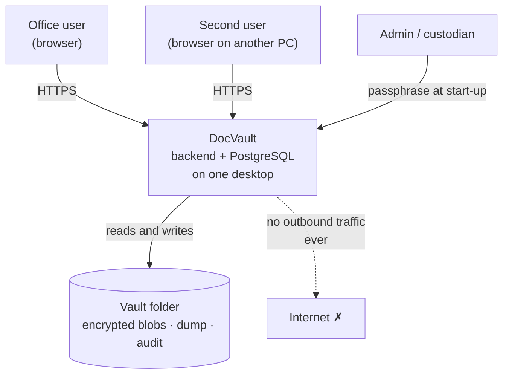
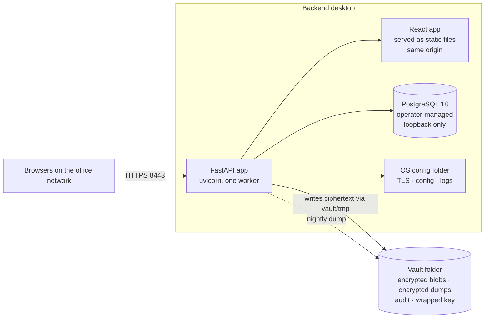
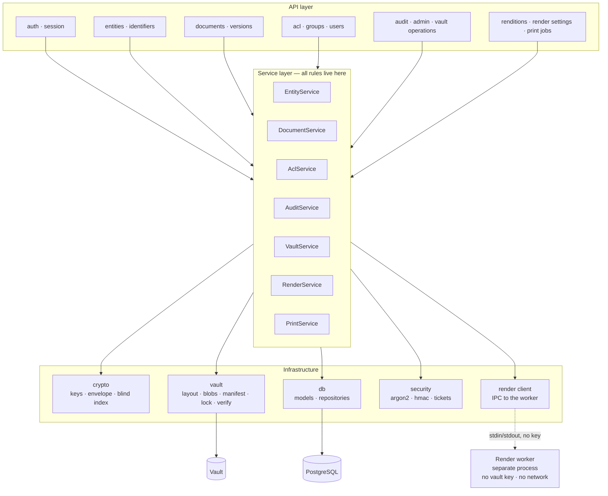
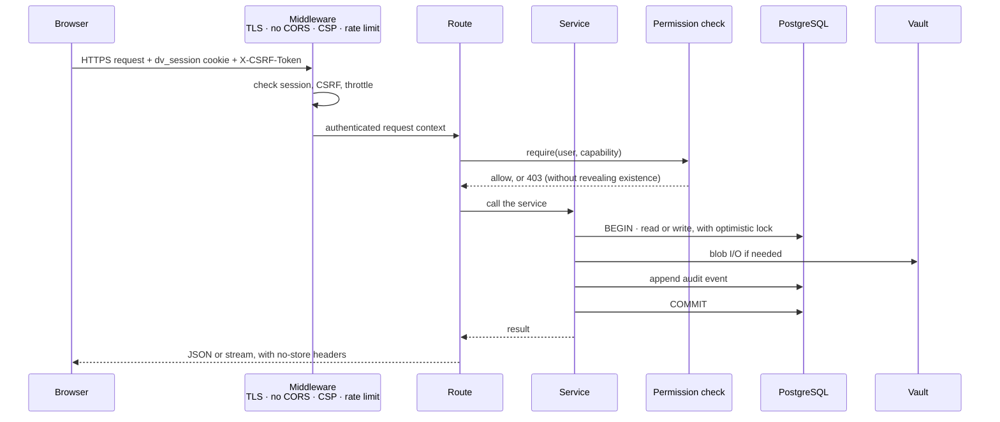
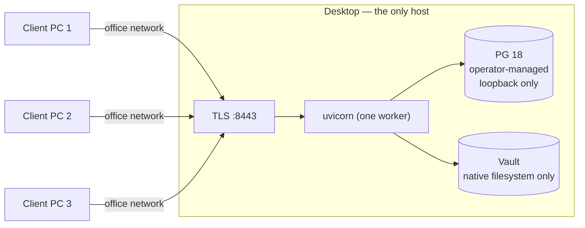
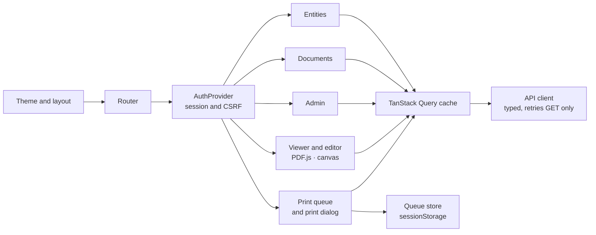

# 02 — Architecture

> **In plain words:** One small backend process sits on the desktop. It serves the web app,
> enforces permissions, and encrypts files. It talks to one PostgreSQL database and one vault
> folder. There is nothing else — no message queue, no object store, no cloud service.
>
> **Read this if:** you are building the backend or frontend, or choosing which versions to
> install.

---

## 1. The system in context



At runtime, DocVault has **no external dependencies**. No cloud, no telemetry, no licence
server, no update check. Its only inputs are the vault folder, the passphrase, and browser
requests from the office network.

## 2. The containers

A "container" here means a running piece of software, not a Docker container.



| Container | What it does | What it deliberately does not do |
|---|---|---|
| React app | All screens. No business rules, no cryptography. | Never decrypts anything |
| FastAPI app | Login, permissions, encryption, vault I/O, scheduling | Does not use a background job broker |
| PostgreSQL | Metadata, permissions, audit index, sessions | Never stores document bytes; never installed, started, or upgraded by the app |
| Vault folder | Ciphertext, encrypted dump, audit files, wrapped key | Contains nothing readable |
| OS config folder | TLS material, configuration, logs, DB credential | Holds no vault secret |

**Why only one worker?** The decrypted vault key lives in the process memory. Several workers
would each hold a copy. That multiplies the locking problem and complicates key rotation. One
async worker comfortably serves a 20-person office. Heavy work such as encryption and hashing
runs in a thread pool.

## 3. Inside the backend



### Layering rules

These are checked in code review, not just hoped for.

1. **Routes contain no logic.** A route parses the request, checks the endpoint-level
   permission, calls one service, and formats the response. No SQL, no crypto, no filesystem.
2. **Services own the rules.** Every permission decision, every state change, and every audit
   event starts in a service. A route that could be called misleadingly is a bug.
3. **Infrastructure knows nothing about HTTP.** The `crypto` and `vault` modules work with no web
   server, which is what makes commands such as `docvault restore` possible.
4. **One permission gate.** `AclService.require(user, document, capability)` and
   `AclService.visible_documents(user)` are the only ways to check permissions. A route never
   reads the document tables directly.
5. **Audit is part of the same transaction.** The change and its audit row commit together, so a
   change without an audit record cannot exist.
6. **The render worker never sees a key.** `RenderService` decrypts a blob in the API process,
   hands the plaintext to the worker over a pipe, and receives pixels or PDF bytes back. The
   worker has no vault path, no database credentials, and no network. This is the one place
   where plaintext crosses a process boundary, and it is deliberate: it keeps C decoders away
   from the key (`01` R-12).

## 4. Life of a request



If anything fails, the transaction rolls back and the client receives a `problem+json` error.
A blob already written to `vault/tmp/` is removed unless the commit succeeded. The ordering of
blob write and database commit is fixed in `09` §4.

## 5. Deployment



| Aspect | Decision |
|---|---|
| Bind address | The LAN interface, `0.0.0.0:8443`, restricted by firewall. Never a public interface. |
| TLS | A private certificate authority created at first run. Each client imports the root once. |
| PostgreSQL | **Operator-managed and installed separately.** The app connects to an existing server on loopback only, never starts, stops, or upgrades it. Requires major version 18 (§6.3). |
| Vault location | A local native disk. Network shares and container mounts are rejected. |
| Service | A Windows Service in production, a systemd unit in development. Thin wrappers over the same command-line tool. |
| Updates | Manual, offline installer. The app refuses to start if the vault schema is newer than it. |

## 6. Technology choices and why

| Layer | Choice | Why |
|---|---|---|
| API | FastAPI 0.162 + Pydantic 2.14 | Typed request and response models, automatic OpenAPI, async streaming |
| ORM | SQLAlchemy 2.1 + Alembic 1.20 | Mature migrations and explicit transactions |
| Driver | psycopg 3.3 (`[binary,pool]`) | Modern async driver, binary protocol, good `bytea` handling |
| Crypto | `cryptography` 50 (OpenSSL) | AES-GCM, HKDF, and HMAC in one audited library. No hand-rolled primitives. |
| Passwords | `argon2-cffi` 25.1 | Argon2id with a tunable memory cost |
| Database | PostgreSQL 18, operator-managed | Requested. Strong constraints, partial indexes, `jsonb` for audit detail. Installed and patched by the operator, not bundled. |
| Frontend | React 19.3 + TypeScript 7 + Vite 8 | Requested. Built to static files and served by the backend. |
| Client state | TanStack Query 5 | Caches server state and refreshes predictably after changes |
| Forms | React Hook Form + Zod | Checks input in the browser, mirroring backend rules |
| Jobs | In-process scheduler (APScheduler) | One host, no broker. Jobs: dump, verify, session cleanup. |
| Packaging | PyInstaller or uv, plus a per-OS installer | Native backend with no Docker requirement. PostgreSQL is a prerequisite the operator installs. |

**Rejected:** Celery and Redis (a broker for three jobs); SQLite (Postgres was requested, and
`jsonb` and concurrency are useful); encryption in the browser (it would put keys in the
browser); putting the PostgreSQL data directory inside the vault (absolute paths and
version fragility, see ADR-004); bundling the PostgreSQL server (see ADR-031).

### 6.1 Pinned versions, checked 2026-10-28

Exact versions go in the lockfiles. This table records what "current" meant on that date, so a
future reader can tell whether a pin is stale. Re-check it every quarter (§6.2).

| Component | Pin | Released | Why this version |
|---|---|---|---|
| **Python** | `3.14.10` | 2026-10-25 | The newest *mature* line. 3.15.2 is newer but only 19 days old; packaging tools and prebuilt libraries lag a new minor, and the 3.15 macOS builds now default to free-threading, which complicates packaging. 3.14 gets security fixes to 2030. |
| **PostgreSQL** | `18.6` | 2026-08-13 | 19 exists only as RC1 (2026-10-15). 18 is supported to November 2030 and is what hosting tools target. |
| **FastAPI** | `0.162.0` | 2026-10-23 | Current stable |
| **Pydantic** | `2.14.1` | 2026-10-11 | Adds Python 3.15 support, so moving to 3.15 later needs no change here |
| **SQLAlchemy** | `2.1.6` | 2026-10-21 | The 2.1 line; requires Python 3.11 or newer |
| **Alembic** | `1.20.1` | 2026-10-22 | Matches SQLAlchemy 2.1 |
| **psycopg** | `3.3.6` | 2026-09-18 | Works with PostgreSQL 18 and 19 |
| **uvicorn** | `0.54.0` | 2026-09-25 | HTTP/2 is still experimental, so we use HTTP/1.1 behind TLS |
| **cryptography** | `50.0.2` | 2026-09-30 | Current stable; no open advisories affecting AES-GCM, HKDF, or HMAC |
| **argon2-cffi** | `25.1.0` | 2025-06-03 | Still current. Its bindings package is `26.1.0` and updates separately. |
| **Node.js** | `24.22.1` (LTS "Krypton") | 2026-10-20 | Build-time only. Node 26.12.1 reaches LTS on 2026-10-28; adopt it after a bake period under §6.2. Node 24 is supported to April 2028. |
| **npm** | `11.x`, bundled with Node 24.22.1 | — | Ships with Node. Pin it through the Node version, never with a separate global install. |
| **React / React DOM** | `19.3.1` | 2026-10-14 | Latest 19.x. React 20 has not been announced. |
| **TypeScript** | `7.0.2` | 2026-07-08 | Native compiler, stable for over three months. Fall back to `6.0.2` only if a build tool misbehaves; 7.1 is beta. |
| **Vite** | `8.3.5` | 2026-10-21 | The Rolldown-based Vite 8. Vite 6.4.x is the maintenance line, not the default. |
| **TanStack Query** | `5.105.0` | 2026-10-26 | Current v5 |
| React Hook Form, Zod, router | pin at first install | — | Not sensitive for this design; record the resolved versions in the lockfile |

Two compatibility notes:

- **Vite 8 needs Node 20.19 or newer, or 22.12 or newer.** Node 24 LTS is comfortably inside
  that range.
- **`pg_dump` must be the same version as the server, or newer.** PostgreSQL is not bundled, so
  the client tools come from the operator's installation. `docvault doctor` compares
  `pg_dump --version` with `server_version` and refuses on skew. A distro client talking to a
  PGDG server is the most likely mismatch in practice (§6.3).

### 6.2 Upgrade policy

| Rule | Detail |
|---|---|
| Security patches (app) | Apply within 7 days for Python, `cryptography`, FastAPI/Starlette, psycopg, React, and Vite |
| Security patches (PostgreSQL) | **Owned by the operator**, not by this project. `docvault doctor` reports the running version and flags anything below the supported floor. |
| Other patches | Monthly, batched |
| Minor releases | Quarterly, after the permission, crypto, and vault round-trip tests pass on Windows and Linux |
| Major releases | Wait at least 30 days after general availability. For PostgreSQL, wait for the first point release **and** 90 days, then dump and restore. |
| Python minor | At most one per year, and only after PyInstaller, `cryptography`, `psycopg[binary]`, and `argon2-cffi` publish wheels for Windows and Linux |
| Database major | Never in place. Use `pg_dump` and `pg_restore`, with a rehearsed restore drill (`08` §4). |
| Re-check | This table is re-verified quarterly. A stale entry is a documentation bug. |

**Rejected:** tracking `@latest` at build time (unreproducible builds, and the easiest route for
a supply-chain attacker); freezing for a year (security debt piles up).

### 6.3 PostgreSQL is a prerequisite, not a dependency we ship

The server is installed and maintained by the operator. The app is a client. This is deliberate
(ADR-031): it removes a whole installer surface and lets the host use its normal patching
routine, at the cost of one external prerequisite.

| Item | Rule |
|---|---|
| Supported server | **Major 18 only.** Refuse anything else with `PG_VERSION_UNSUPPORTED` and a message naming the supported version. |
| Future server | Major 19 is added after GA, a 90-day wait, and a completed dump/restore drill. The app then accepts both 18 and 19. |
| Client tools | `pg_dump` and `pg_restore` must be **≥** the server version, and are located through `pg_bin_dir` (auto-detected, e.g. `C:\Program Files\PostgreSQL\18\bin`). |
| Network | Loopback only. A non-loopback host is refused unless an operator sets an explicit opt-out, and the refusal is the default because this is a single-host system. |
| Credentials | A password, encrypted with **DPAPI machine scope** on Windows or stored in the OS keyring on Linux, and ACL'd to the service account. Never in `docvault.toml`, never in the vault, never in an environment variable. |
| Role | A dedicated `docvault_app` role with no superuser and no `CREATEDB`. `docvault init` creates it if the operator supplies an admin connection. |
| App responsibility | Connect, read `server_version`, migrate, dump, restore. It does not create clusters, start services, or apply PostgreSQL updates. |
| Patching | The operator's job, and stated as such to the customer. A stale PostgreSQL is outside the threat model we can enforce (`01` §4, T3). |

> **Why a narrow pin rather than 16–18?** There is one production host, and it runs 18.6. A range
> of three majors triples the restore drill and buys nothing. Widening it later is a one-line
> change; discovering a 16-only quirk during a recovery is not.

The `pg_dump` password reaches the child process through a transient `PGPASSFILE` in
`vault/tmp/`, created restricted and deleted in a `finally` (`03` §9.1, `08` §2.2). The
alternative — an environment variable — is equally short-lived but harder to audit and easy to
inherit by accident.

### 6.4 Rendering and print dependencies

The viewer and the printer add libraries whose job is to parse untrusted bytes. They are pinned at
first install and the resolved versions are recorded in the lockfile, because a decoder's version
is a security property, not an implementation detail.

| Library | Purpose | Rule |
|---|---|---|
| **Pillow** | JPEG and PNG decode; tile and resize | Pin at first install. Ships its own decoders; patch within 7 days. |
| **pypdfium2** | PDF page rasterisation when a recipe forces it | Pin. Bundles PDFium; the version string is logged at start-up. |
| **pypdf** | Page import and placement for print assembly | Pin. Pure Python, so it is preferred over rasterising. |
| **LibreOffice** (optional) | One-time Office → PDF conversion at ingest | Pinned installer, not a Python package. Present only if Office intake is enabled. |

Two rules follow:

- **PDF assembly uses `pypdf` first.** Rasterising is the fallback, not the default. Vectors stay
  vectors and PDFium sees less untrusted input (`12` §6).
- **LibreOffice is an ingest-only dependency.** It is never invoked during preview or printing,
  so a broken or slow conversion cannot affect the print path. When it is absent, Office uploads
  are rejected with `415` and the message says why. It is the single largest optional dependency
  in the system and is installed separately for that reason.

**Rejected:** rendering Office files on demand with a document server such as Collabora Online.
It adds a network service, an editing surface, and a second permission model — three things this
design does not need (`10` ADR-038).

## 7. Frontend structure



- **Same origin.** FastAPI serves the built app at `/`, so there is no CORS setup and cookies
  are first-party. During development, Vite proxies to the same shape.
- **No secrets in the browser.** No document keys, no derived keys, no passphrase. The browser
  receives plaintext only for documents the user may read.
- **Route guards are convenience, not security.** Every guard is backed by a server check.
- **Errors** are read from `application/problem+json` and shown as field-level messages.
- **Density matters.** This is a records tool. Tables, keyboard navigation, and clear focus
  states matter more than animation.
- **The browser renders nothing authoritatively.** Previews, edited pages, and the print PDF all
  come from the server. The client draws what it is given (`11` §1).
- **The print queue is client state.** It is a plan, held in `sessionStorage`, cleared on logout.
  It becomes a server-side fact only when `POST /print-jobs` is called (`11` §9).

## 8. Repository layout

```
doc_mgmt/
├── .nvmrc                     # pinned Node version for the frontend
├── docs/                      # this documentation set
├── config/
│   └── dev.toml.example       # development configuration template
├── backend/
│   ├── app/
│   │   ├── api/               # routes, one file per resource
│   │   ├── core/              # config, errors, logging, middleware
│   │   ├── crypto/            # keys, envelope, blind index  (no HTTP imports)
│   │   ├── vault/             # layout, blobs, manifest, lock, verify, salvage
│   │   ├── render/            # render client, recipe model, rendition cache
│   │   ├── print/             # layout maths, composer, job records
│   │   ├── db/                # models, repositories, migrations
│   │   ├── services/          # business rules — the only place permissions are decided
│   │   ├── jobs/              # dump, verify, session cleanup, rendition eviction
│   │   └── main.py            # app factory and CLI entry point
│   ├── worker/
│   │   ├── main.py            # render worker entry point: pipe in, bytes out
│   │   ├── decode.py          # JPEG, PNG, PDF, Office conversion
│   │   ├── recipe.py          # the fixed operation order
│   │   └── limits.py          # memory, CPU, and dimension ceilings
│   └── tests/
│       ├── unit/              # crypto vectors, permission matrix, grid maths
│       ├── integration/       # temporary PostgreSQL, real vault in a temp directory
│       ├── render/            # golden-page hashes, hostile-input corpus
│       └── e2e/               # API-level, one test per route as an unauthorised user
├── frontend/
│   └── src/{pages,components,viewer,editor,print,api,hooks,store}
├── packaging/                 # PyInstaller specs, installers, service units
└── scripts/                   # development bootstrap, drift checks
```

The render worker is a **separate entry point**, not a module the API imports. It is started as a
child process, talks over pipes, and is killed and restarted on a timeout. That separation is the
control described in `01` R-12, so it has to exist in the layout, not just in prose.

## 9. Cross-cutting concerns

| Concern | Approach |
|---|---|
| **Configuration** | `docvault.toml` in the OS config folder: `environment`, bind address, port, vault root, database DSN, `pg_bin_dir`, limits, log level. No secrets. Development may point `DOCVAULT_CONFIG` at a repo-local file (`14` §4.4). |
| **Secrets** | Vault passphrase typed at start-up, or read from an OS keyring if the operator opts in. The database password is DPAPI-encrypted on Windows and ACL'd to the service account. Neither is ever in config, environment variables, or logs. |
| **Logging** | Structured JSON, rotating, in the OS log folder. Log IDs and counts, never titles, filenames, identifiers, or content. |
| **Errors** | RFC 9457 `application/problem+json`. Internal errors carry a correlation ID, never a stack trace. |
| **Time** | UTC in the database, local time in the interface, ISO-8601 in the API |
| **IDs** | UUIDv7 generated by the app: sortable, no sequence leakage, safe to create before insert |
| **Concurrency** | Optimistic locking with `row_version`; `409` on conflict, with a readable hint |
| **Retries** | Uploads carry a client-generated request ID. A retry returns the existing version instead of creating a duplicate. |
| **Health checks** | `/healthz` for the process, `/readyz` for database, vault, and unlock state. An admin-only status page. No metrics endpoint. |
| **Offline** | No outbound sockets. A test enforces this: unexpected egress fails the build. |

## 10. Quality gates

1. **Permission matrix tests** — every capability, every role, every inheritance mode.
2. **Leak tests** — unauthorised attempts against list, search, count, export, download,
   related-document, and audit endpoints. Each must return `404`, not `403`, where existence
   matters.
3. **Crypto vectors** — fixed plaintext, key, and nonce produce fixed ciphertext, and tampering
   is detected.
4. **Vault round trip** — create, populate, dump, delete the database, restore, and compare
   bytes. Run once with `pg_dump` and `pg_restore` from a matching client, and once with the
   dump decryption step forced to fail, to prove the failure is clean.
5. **Two-platform CI** — Windows and Linux, including case-insensitive filesystem behaviour on
   Windows and the DPAPI credential path. macOS is not tested in v1.
6. **Drift check** — the examples in `03-vault-format.md` are validated against the code's
   manifest schema, and the `DVD1` layout is validated against the code's dump writer.
7. **Render isolation** — a test asserts that the worker process holds no key material, opens no
   socket, and dies cleanly at its memory ceiling without taking the API down.
8. **Hostile-input corpus** — a checked-in set of malformed JPEG, PNG, and PDF files must fail
   with a typed error, never a crash and never a partial page.
9. **Print golden files** — every grid at every supported paper size is compared against a
   reference page geometry, and a 4-up duplex job is compared against a known page order.
