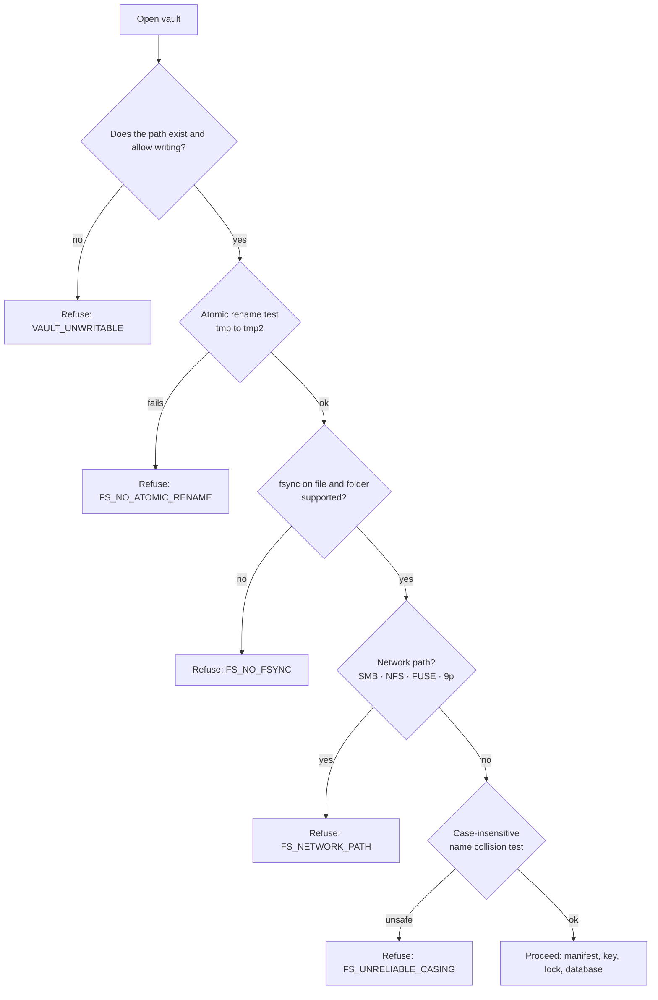

# 03 — Vault Format Specification

> **In plain words:** This document describes exactly what sits in the vault folder, byte by
> byte. Think of it as the shape of the filing cabinet and the labels on every drawer.
>
> **This is the compatibility contract.** We may rewrite the code, but this layout must not
> break. Any change here needs a format-version bump and a migration path. Read it line by line
> before writing storage code.
>
> **Read this if:** you are writing storage or crypto code, or you are moving a vault to
> another machine.

| | |
|---|---|
| **Vault format version** | `1` |
| **Blob file format** | `DVC1` |
| **Dump file format** | `DVD1` |
| **Key file format** | `DVK1` |
| **Status** | Frozen for v1 |

---

## 1. What the vault is

A vault is one directory that holds every byte DocVault owns. It is the unit of backup, of
portability, and of trust.

**Guarantees**

| # | Guarantee |
|---|---|
| G-1 | Every file under `blobs/` is authenticated ciphertext. No plaintext, no filenames, no thumbnails, no rendered pages. |
| G-2 | The database dump lives inside the vault and is itself encrypted, so one folder is a complete backup. |
| G-3 | Paths in the database are **relative to the vault root**. Only the single `vault_root` setting is absolute, and it can be re-pointed. |
| G-4 | Blob names come from content, never from user input. |
| G-5 | With the passphrase, blobs can be decrypted even if the database is lost. This is what makes `salvage` possible. |
| G-6 | The vault refuses to open on a filesystem that cannot do atomic rename and `fsync`. |
| G-7 | No readable copy of a document, and no readable copy of the database, is ever written into the vault. |

## 2. Folder layout

```text
<vault-root>/
├── manifest.json                 # identity, versions, key fingerprint, signature
├── keys/
│   └── kek.wrapped               # vault key wrapped by the passphrase key  (DVK1, 96 bytes)
├── blobs/
│   └── 9f/3a/
│       └── 9f3a...c1.blob        # ciphertext, 2+2 folder fan-out, hex name
├── index/
│   └── db/
│       ├── LATEST                # pointer: filename, sizes, sha256, created_at
│       ├── docvault-20261028T010000Z.dump.enc
│       └── docvault-20261027T010000Z.dump.enc
├── audit/
│   ├── 2026-10.jsonl             # append-only, hash-chained events
│   └── anchors.jsonl             # monthly closure anchors
├── journal/                      # optional safety net; never required for correctness
│   └── 2026-10.jsonl.gz
├── tmp/                          # staging; safe to delete when the app is stopped
├── trash/                        # purge staging, empty unless purge.mode = staged
└── .lock                         # single-writer guard (absent when cleanly stopped)
```

Rules:

- Directories are `0700` and files are `0600` on POSIX systems. On Windows, NTFS permissions are
  inherited from the vault root, which the installer restricts to the service account.
- `tmp/`, `trash/`, and `.lock` are not part of the backup's meaning. You may leave them out of a
  copy, as long as the application is stopped.
- Nothing else may be created at the root. `verify` reports unknown files but never deletes
  them.

### 2.1 `.lock` — one writer at a time

Two backends writing the same vault is the most destructive failure in this system. They would
interleave dumps, race on key files, and corrupt the audit chain. The lock prevents that.

```json
{
  "instance_id": "0192f0d1-4c22-7a10-8b31-77aa01c9d2e4",
  "vault_id": "0192f0c4-7a1e-7c3b-9a55-2c1f0b6d4e11",
  "host_id": "sha256:f3a1c9...",
  "pid": 48213,
  "app_version": "1.0.0",
  "started_at": "2026-10-28T09:00:00Z",
  "heartbeat_at": "2026-10-28T09:14:05Z"
}
```

| Rule | Behaviour |
|---|---|
| Acquisition | Create exclusively (`O_CREAT\|O_EXCL`, or `FileMode.CreateNew`). Failure means `VAULT_LOCKED`. |
| Heartbeat | Rewritten every 5 seconds by the single writer |
| Staleness | A heartbeat older than 30 seconds means the writer is dead |
| Takeover | Only with `--force`, which writes a `vault.lock.forced` audit event and warns |
| Release | Deleted on clean shutdown. Left behind after a crash on purpose: it is evidence. |
| Scope | Advisory on some filesystems, which is why network filesystems are refused (§7) |

The lock is a **correctness** control, not a security control. Someone determined to run two
instances can defeat it. Refusing network paths removes the accidental version.

## 3. `manifest.json`

This file is readable without a key. It is not signed by itself, but it carries an HMAC that is
checked after the vault unlocks.

```json
{
  "format": "docvault.vault",
  "format_version": 1,
  "vault_id": "0192f0c4-7a1e-7c3b-9a55-2c1f0b6d4e11",
  "display_name": "Knaps — Records",
  "created_at": "2026-10-28T10:12:03Z",
  "created_by_app": "1.0.0",
  "schema_version": 1,
  "key_wrap": "keys/kek.wrapped",
  "key_fingerprint": "8f3a91c47d02be66a1f5c9d3e07b2a44",
  "blob": {
    "format": "DVC1",
    "version": 1,
    "address": "hmac-sha256",
    "address_prefix": "docvault/blobaddr/v1",
    "fanout": [2, 2],
    "pad_to": 4096
  },
  "paths": {
    "blobs": "blobs",
    "dump": "index/db",
    "audit": "audit",
    "journal": "journal",
    "keys": "keys",
    "tmp": "tmp"
  },
  "limits": { "max_file_bytes": 104857600 },
  "notes": "Primary records vault. Passphrase held by two custodians.",
  "integrity": {
    "alg": "hmac-sha256",
    "sig": "base64url-of-hmac"
  }
}
```

| Field | Meaning | Change policy |
|---|---|---|
| `format` | Literal `docvault.vault` | Never |
| `format_version` | On-disk layout version | Bump on any breaking layout change |
| `vault_id` | UUIDv7, the permanent identity of this vault | Never |
| `schema_version` | Database migration level | Incremented by Alembic |
| `key_fingerprint` | 32 hex characters: the first 16 bytes of `SHA-256(HKDF(VMK,"docvault/v1/fp"))` | Changes only when the vault key is replaced |
| `blob.address` | Address algorithm | Versioned by `blob.version` |
| `blob.pad_to` | Ciphertext padding bucket in bytes (`0` turns padding off) | Configurable per vault |
| `integrity.sig` | `HMAC-SHA256(HKDF(VMK,"docvault/v1/manifest"), canonical_json_without_integrity)` | Recomputed on every manifest edit |

**Canonical JSON** for signing means UTF-8, keys sorted alphabetically, no insignificant
whitespace, and `\u` escapes only where required. If verification fails, the app refuses to
start and says why.

**Unknown fields are preserved** when the manifest is rewritten, because a newer app may have
added them.

## 4. How blobs are named

```
salt      = 16 random bytes, one per version, stored in document_versions.blob_salt
address   = HMAC-SHA256(addr_key, "docvault/blobaddr/v1" || salt || plaintext)
name      = lowercase hex(address)            # 64 characters
path      = blobs/<hex[0:2]>/<hex[2:4]>/<hex>.blob
```

- `addr_key = HKDF-SHA256(VMK, info="docvault/v1/addr")`
- **The salt is why identical files do not collide.** If two people upload the same PDF, you get
  two separate blobs. That trades deduplication for two things: no equality leak (nobody can tell
  that two entities hold the same file) and independent deletion. See ADR-012.
- The address is an identity and integrity value, not a filename. It never contains user data.
- `verify` decrypts the blob, recomputes the address, and compares it with the filename.

## 5. Blob file format `DVC1`

A fixed 96-byte header, followed by the ciphertext and its 16-byte GCM tag.

| Offset | Size | Field | Notes |
|---:|---:|---|---|
| 0 | 4 | `magic` | ASCII `DVC1` |
| 4 | 1 | `format_version` | `1` |
| 5 | 1 | `flags` | Bit 0 means padded. Bits 1–7 must be zero; an unknown flag means reject. |
| 6 | 2 | `reserved` | All zero |
| 8 | 8 | `key_id` | First 8 bytes of `key_fingerprint` |
| 16 | 8 | `plaintext_len` | uint64, little-endian; bytes before padding |
| 24 | 12 | `nonce_wrap` | Random GCM nonce for the key wrap |
| 36 | 48 | `wrapped_fk` | `AES-256-GCM(file_kek, FK)` = 32-byte ciphertext + 16-byte tag |
| 84 | 12 | `nonce_payload` | Random GCM nonce for the payload |
| 96 | *n* | `ciphertext` | `AES-256-GCM(FK, padded_plaintext)` + 16-byte tag |

Key derivation and AAD values:

| Value | Definition |
|---|---|
| `file_kek` | `HKDF-SHA256(VMK, info="docvault/v1/file")`, 32 bytes |
| `FK` | 32 random bytes per version |
| Wrap AAD | ASCII `docvault/filekey/v1` |
| Payload AAD | ASCII `docvault/blob/v1` |

**Why the file key is wrapped inside the blob:** it makes each blob self-describing. With the
passphrase alone, a folder of blobs is still recoverable (`docvault salvage`) even if the
database is gone. The cost is that "crypto-shredding" is impossible: deleting a key cannot
destroy content when a copy of the key travels with the content. ADR-011 records that trade.

**Padding:** the plaintext is zero-padded to the next multiple of `pad_to`, and the true length
is stored in the header. This blunts size-based guessing. Padding is applied before encryption
and ignored on read.

**Rejection rules:** wrong magic, unsupported `format_version`, unknown flags, `key_id` mismatch,
or a failed GCM tag means a hard error. The blob is quarantined. There is no "best effort" read.

### 5.1 Renditions are ordinary blobs

A **rendition** is a page of a version rendered with its edit recipe applied: a preview for the
screen, or a print-resolution page for the composer. It is stored as a normal `DVC1` blob under
`blobs/`, with its own random file key, and referenced by a `renditions` row (`04` §7).

This is deliberate. A plaintext cache would undo the entire design, and a second storage format
would be a second thing to get wrong. Because renditions use the same container:

- They are indistinguishable from documents on disk, so their presence leaks nothing extra.
- They are covered by every existing guarantee in §1, unchanged.
- They are safe to delete at any time. Deleting all of `blobs/` entries that have a `renditions`
  row and no `document_versions` row loses nothing that cannot be regenerated.

**A rendition is never authoritative.** The bytes in `document_versions` are the record. If the
cache is empty, cold, or corrupt, the renderer rebuilds the page from the original. `verify` treats
missing rendition blobs as cache misses, not as data loss — the one place where a missing blob is
not an incident.

**One exception to "regenerable":** the PDF produced when an Office file is accepted
(`10` ADR-038) is *not* a rendition. It lives in `document_versions.derived_pdf_addr`, it is never
evicted, and it is purged with the version. A cache entry may be rebuilt by a newer decoder; a
fidelity artifact must not change under the user's feet.

## 6. `keys/kek.wrapped` (`DVK1`)

Exactly 96 bytes.

| Offset | Size | Field |
|---:|---:|---|
| 0 | 4 | `magic` = ASCII `DVK1` |
| 4 | 1 | `format_version` = `1` |
| 5 | 3 | `reserved` = 0 |
| 8 | 16 | Argon2id salt |
| 24 | 4 | Argon2id `m_cost` (KiB), uint32 little-endian, default 65536 |
| 28 | 4 | Argon2id `t_cost`, uint32 little-endian, default 3 |
| 32 | 4 | Argon2id `p_cost` (lanes), uint32 little-endian, default 1 |
| 36 | 12 | `nonce` |
| 48 | 32 | `ciphertext` (the vault master key) |
| 80 | 16 | GCM tag |

- `PK = Argon2id(passphrase, salt, m_cost, t_cost, p_cost, len=32)`
- `VMK = AES-256-GCM-decrypt(PK, nonce, ciphertext, tag, aad="docvault/kek/v1")`
- `key_fingerprint = hex(SHA-256(HKDF-SHA256(VMK, info="docvault/v1/fp")))[:32]`
- The KDF parameters live here and **nowhere else**, so there is one source of truth. Raising
  the cost rewrites this file; the vault key itself does not change.
- A wrong passphrase and a damaged file look identical on purpose. The interface says
  "incorrect passphrase or damaged key file" and offers `salvage` diagnostics.

## 7. Filesystem requirements

The vault may live only on a local, native filesystem.



| Requirement | Why | How it is checked |
|---|---|---|
| Atomic rename | A blob is either fully present or absent | Write `tmp/.probe`, rename it, verify, delete |
| `fsync` on the file **and** the folder | A power cut must not leave a zero-length blob | Test; on Windows, accept `FlushFileBuffers` behaviour |
| Native path | SMB, NFS, and FUSE break rename, locking, and `fsync` | Detect the volume type and block with a clear error |
| Case-safe names | Windows and macOS fold case | Hex-only names, plus a collision probe |
| Path under 240 characters | Windows `MAX_PATH` is 260 | Fixed layout depth; the longest path is about 90 characters |
| No symlinks inside the vault | Prevents redirection outside the vault | Reject with `O_NOFOLLOW`-style checks; `verify` scans for links |
| No Unicode normalisation needed | Names are ASCII hex | True by construction |

> **Refusing is a feature.** A vault on a NAS "works" until the first power cut, and then
> silently loses the document someone signed.

## 8. How a blob is written

Every blob follows the same order.

```mermaid
sequenceDiagram
  participant S as Service
  participant T as vault/tmp
  participant B as vault/blobs
  participant D as PostgreSQL
  S->>T: create .part file (0600)
  S->>T: write 96-byte header + ciphertext
  S->>T: fsync(file)
  S->>B: rename part file to blobs/xx/yy/&lt;addr&gt;.blob
  S->>B: fsync(parent folder)
  S->>D: BEGIN · insert version row + audit · COMMIT
  Note over S,D: If the commit fails, the blob is an orphan.<br/>It is cleaned up later. Never the reverse.
```

**Blob before row, always.** A row pointing at a missing file breaks the interface and the
restore drill. An orphan blob costs disk space and is reported by `verify`. This ordering is an
invariant, not a preference.

Cleanup: `tmp/*.part` files older than 24 hours are deleted at start-up and nightly. `trash/` is
emptied only by an explicit purge or an operator command, never silently.

## 9. Database dumps

Dumps are logical (`pg_dump`), and they are **encrypted before they touch the disk**. A dump
contains every encrypted column as ciphertext, but it also contains the plaintext structural
fields: dates, statuses, foreign keys, blob addresses, ACL entries, usernames, and password
hashes. Leaving it readable would leak the shape of the practice to anyone holding the folder.

| Item | Rule |
|---|---|
| Naming | `docvault-YYYYMMDDTHHMMSSZ.dump.enc`, in UTC |
| Source format | `pg_dump --format=custom`. Logical only, never a physical base backup. |
| Container format | `DVD1` — chunked AES-256-GCM, described below |
| Key | `dump_key = HKDF-SHA256(VMK, info="docvault/v1/dump", len=32)` |
| Pointer | `LATEST` is plain text: filename, format, sizes, SHA-256, timestamp, PostgreSQL version, vault ID |
| Rotation | Keep the last 7 plus every pre-migration dump (configurable) |
| Verification | `LATEST`'s hash and `vault_id` are checked on restore. A mismatch aborts before touching the database. |
| Completeness | A dump is written only while the app holds the vault lock and no write is in flight |
| Client version | `pg_dump` must be the same version as the server, or newer (§14, `02` §6.1) |

### 9.1 `DVD1` container

A 32-byte header, then a sequence of independently authenticated chunks.

| Offset | Size | Field | Notes |
|---:|---:|---|---|
| 0 | 4 | `magic` | ASCII `DVD1` |
| 4 | 1 | `format_version` | `1` |
| 5 | 1 | `flags` | Must be zero. An unknown flag means reject. |
| 6 | 2 | `reserved` | All zero |
| 8 | 4 | `chunk_size` | uint32 little-endian, `65536` |
| 12 | 8 | `nonce_prefix` | Random, one per dump |
| 20 | 12 | `reserved` | All zero |
| 32 | *n* | `chunks` | Each chunk is ciphertext (0–65536 bytes) followed by a 16-byte GCM tag |

Per chunk:

```text
nonce = nonce_prefix || uint32_be(chunk_index)      # 12 bytes
aad   = header[0:32] || uint32_be(chunk_index) || final_flag(1 byte)
ct    = AES-256-GCM(dump_key, nonce, plaintext_chunk, aad)
```

- `final_flag` is `0x01` on the last chunk and `0x00` everywhere else. This is what detects
  truncation: an attacker cannot drop the tail and promote an earlier chunk to "last", because
  the tag covers the flag.
- The header is inside the AAD, so `chunk_size` and `nonce_prefix` cannot be rewritten.
- The chunk index is inside the AAD, so chunks cannot be reordered or duplicated.
- An empty dump is represented by one final chunk of zero bytes, with its tag.
- Decryption stops at the first tag failure and deletes the partial output. There is no partial
  restore.

`pg_dump` is a subprocess and cannot read DPAPI, so the database password reaches it through a
transient `PGPASSFILE` in `vault/tmp/`, created restricted and deleted in a `finally`. See
`08` §2.2.

### 9.2 `LATEST` example

```text
file=docvault-20261028T010000Z.dump.enc
format=DVD1
encrypted=1
size=48213904
plaintext_bytes=120435712
sha256=0b6f...9ad1
created_at=2026-10-28T01:00:00Z
pg_version=18.6
schema_version=1
vault_id=0192f0c4-7a1e-7c3b-9a55-2c1f0b6d4e11
```

`size` is the bytes of the `.enc` file, and `sha256` is taken over that file. This gives a cheap
integrity check that does not require the vault key. `vault_id` lets `restore` refuse a dump from
a different vault before it decrypts anything.

### 9.3 Reading a dump back

1. Read `LATEST`. Compare `vault_id` with the manifest. Refuse on mismatch.
2. Check `sha256` and `size` of the `.enc` file.
3. Decrypt to `vault/tmp/restore-<random>.dump`, with the same restricted permissions as the rest
   of `vault/tmp/`. Stop at the first bad tag or a missing final chunk.
4. Run `pg_restore`. Delete the temporary file in a `finally`, including on failure.
5. Write `vault.restore` to the audit log.

`docvault dump-list` follows the same path but runs `pg_restore --list` instead, so an operator
can inspect a dump's contents without a full restore.

**The honest exposure window:** between steps 3 and 4 a plaintext dump exists in `vault/tmp/`.
`vault/tmp/` is never backed up and is swept at start-up, and the host is about to hold the same
plaintext columns in the live database anyway. But it is a real, if brief, window, and it is why
`vault/tmp/` carries the same permission restrictions as the vault root.

**Restore always uses `LATEST`** unless an operator names a file. Restoring an older dump while
the blob folder is current is supported and documented. `verify` reports the orphans and
dangling rows (`08` §5.1).

## 10. Audit files

| Path | Content |
|---|---|
| `audit/YYYY-MM.jsonl` | One JSON object per line, append-only, hash-chained |
| `audit/anchors.jsonl` | One record per month closing: last hash, entry count, month |

Each entry looks like this:

```json
{
  "seq": 918273,
  "ts": "2026-10-28T11:04:19.221Z",
  "actor_id": "0192f0c4-...",
  "action": "document.download",
  "object_type": "document_version",
  "object_id": "0192f0c9-...",
  "outcome": "allow",
  "source_ip": "192.168.1.24",
  "detail": { "ticket": "one-time", "reason": null },
  "prev_hash": "9c1e...",
  "hash": "44b0..."
}
```

- `hash = SHA-256(prev_hash_hex || canonical_json(entry_without_hash))`
- The first entry of a month carries the previous month's last hash in `prev_hash`.
- The database keeps an index of audit events for querying. The files are the authority for
  integrity.
- **Known limitation:** the newest entries can be truncated without breaking the chain.
  `anchors.jsonl` and the audit head recorded in each dump narrow that gap but do not close it
  (R-6).

## 11. Optional journal

`journal/YYYY-MM.jsonl.gz` records metadata events — `document.created`, `version.added`,
`document.purged` — with IDs, timestamps, and content addresses. It never records keys or
plaintext.

- Purpose: reconcile a stale dump, identify orphans, and explain gaps in history.
- **Never required for correctness.** A vault with `journal/` deleted opens and works.
- Events reference blobs by address, so a journal plus blobs can rebuild a partial inventory
  even without a dump. Titles and identifiers cannot be recovered this way.

## 12. What can be rebuilt from what

| What is lost | Recoverable? | How |
|---|---|---|
| Nothing | — | Normal start |
| Database only | **Yes, fully**, if a dump exists **and** the vault is unlocked | `restore` from `LATEST` |
| Database and all dumps | **Partly** — content only | `salvage` decrypts blobs to `<addr>.bin`. Titles, links, and permissions are lost. |
| Some blobs | Metadata survives, content is lost | `verify` lists the missing addresses. This is data loss. |
| All renditions | **Nothing** | A rendition is a cache. Every page is rebuilt from its source blob on demand. |
| `version_render_settings` | Recovered from the dump, but lost without one | Rendering falls back to "as stored". The documents are intact; only the saved adjustments are gone. |
| A dump that fails its GCM tag | That dump is unusable | Fall back to the previous dump. Truncation is detected, not repaired. |
| `audit/` | Database index survives, integrity record is lost | Report it. The chain cannot be rebuilt for missing months. |
| `keys/kek.wrapped` | **No** — and the dumps become unreadable too | Content and metadata are permanently lost. This is the single point of failure by design. |
| `manifest.json` | **No**, by policy | Refuse to guess identity. Restore from backup. |
| The whole vault folder | No | That folder is the backup. |

## 13. Moving a vault

Moving a vault is supported when:

1. The application is **stopped** (no `.lock`), or you force it and accept the documented risk.
2. The whole directory is copied with permissions preserved: `robocopy /COPY:DAT` or `rsync -a`.
3. The path stays under 240 characters.
4. The destination passes the filesystem checks in §7.

After the move, `docvault restore --vault <new-path>` (or the first-run wizard) updates the one
absolute `vault_root` value and runs `verify`. No other absolute path exists anywhere in the
database.

## 14. Version rules

| Version | Meaning | Compatibility rule |
|---|---|---|
| `format_version` | Vault layout | Readers reject a higher value. No guessing. |
| `blob.version` | Blob container layout | Readers reject unknown container versions |
| `dump.format` | Dump container layout (`DVD1`) | Readers reject unknown dump formats |
| `schema_version` | Database schema | The app migrates only if `db.schema_version <= app.supported` |
| App version | Semver | Independent, and recorded for diagnostics |

Rules:

- **Additive JSON fields are allowed** within a major version. Unknown keys are preserved.
- Any change to byte layout, path derivation, or key derivation **needs** a major bump.
- Reading an older vault with a new major version must go through an explicit migration command
  that writes a new vault beside the old one, never in place.
- `manifest.json` and `kek.wrapped` are read-only for the application, except during passphrase
  rotation and explicit migration.

## 15. Invariants — do not break these

1. Blob filenames contain only `[0-9a-f]` and `.blob`.
2. No user-supplied value is used in a path.
3. The blob is written before the row commits. Rows never point at nothing.
4. `manifest.json` is signed and verified before the first request is served.
5. The `key_fingerprint` in the manifest equals the fingerprint of the unwrapped vault key.
6. The `vault_id` in the database equals the `vault_id` in the manifest.
7. Exactly one process writes a vault at a time.
8. Deleting `journal/`, `tmp/`, or `trash/` never loses a document.
9. Every blob can be decrypted with the vault key alone.
10. No absolute path is stored anywhere except `settings.vault_root`.
11. Every `.dump.enc` file is authenticated ciphertext. No plaintext dump is stored in the vault.
12. A dump is never overwritten in place. A new file is written, then `LATEST` is replaced
    atomically, so a failed dump always leaves the previous one intact.
