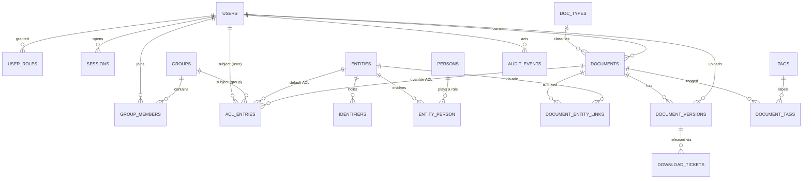
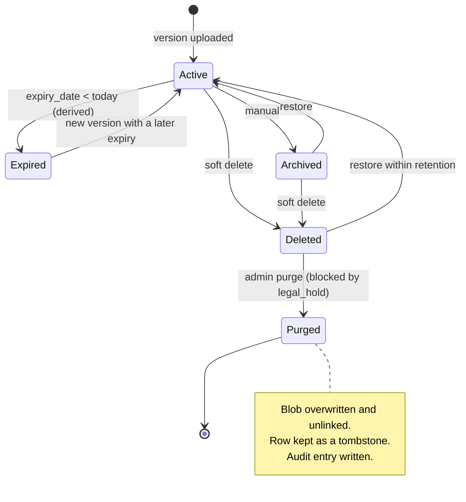

# 04 — Data Model

> **In plain words:** This is the list of tables in PostgreSQL, what each column holds, and the
> rules the database enforces by itself. Where a rule can live in a constraint or a trigger, it
> does — because application code alone is not a guarantee.
>
> **Read this if:** you are writing the schema, a migration, or a query.

---

## 1. Modelling principles

| # | Principle | What it means in practice |
|---|---|---|
| P-1 | **Identifiers are rows, not columns** | Adding GSTIN, DIN, or passport needs no schema change |
| P-2 | **Sensitive text is encrypted at the column level** | Titles, names, filenames, and ID values are stored as `bytea` |
| P-3 | **Versions are immutable; documents are soft-deleted** | History is never rewritten |
| P-4 | **UUIDv7 primary keys**, generated by the app | Sortable, safe to create before insert, no sequence leakage |
| P-5 | **Optimistic locking everywhere** | `row_version` on mutable tables; `409` on a stale write |
| P-6 | **Time is UTC** (`timestamptz`) | The interface converts to local time |
| P-7 | **Nothing absolute except `vault_root`** | Portability (`03` G-3) |
| P-8 | **Audit is written in the same transaction** as the change | No state change without a trace |

### How encrypted columns are stored

Every encrypted value uses the same envelope:

```text
enc_v1 := 0x01 || nonce(12) || ciphertext(n) || tag(16)
AAD     := utf8("<table>.<column>")
key     := HKDF-SHA256(VMK, info="meta")
```

It is stored as `bytea`. The AAD binds the ciphertext to its table and column, so a value copied
from `documents.title_enc` into `entities.legal_name_enc` fails to authenticate. See
`05-crypto.md` §5.

### How blind indexes work

A blind index lets the app find an exact match without storing the value in readable form.

```text
blind_v1 := 0x01 || HMAC-SHA256(HKDF(VMK,"bidx"), "v1|" || id_type || "|" || normalized)
```

For identifiers, "normalised" means upper-case, with spaces, hyphens, and dots removed. Only the
blind index and the ciphertext are stored. The normalised value is never written down.

## 2. Entity–relationship overview



## 3. Identity and access

### `users`

| Column | Type | Notes |
|---|---|---|
| `id` | `uuid` PK | UUIDv7 |
| `username_enc` | `bytea` | Encrypted login name, lower-case, 3–64 characters |
| `username_blind` | `bytea(33)` UK | Blind index for exact login lookup |
| `display_name_enc` | `bytea` | Encrypted |
| `password_hash` | `text` | Argon2id PHC string |
| `totp_secret_enc` | `bytea` NULL | Encrypted. NULL means TOTP is off. |
| `totp_enabled` | `boolean` | Only true after a verified code |
| `status` | `user_status` | `active`, `disabled`, or `locked` |
| `must_change_password` | `boolean` | True for admin-created accounts |
| `failed_attempts` | `smallint` | Reset on a successful login |
| `last_login_at` | `timestamptz` NULL | |
| `password_changed_at` | `timestamptz` | Invalidates sessions |
| `row_version` | `bigint` | Optimistic locking |
| `created_at` / `created_by` | `timestamptz` / `uuid` | |

Constraints: the login name must match `^[a-z0-9._-]{3,64}$` before encryption. Uniqueness is
enforced on `username_blind`, so a duplicate login is a `409` without the database ever holding a
readable name.

### `user_roles`

| Column | Type | Notes |
|---|---|---|
| `user_id` | `uuid` FK → users | `ON DELETE CASCADE` |
| `role` | `role_name` | `admin`, `editor`, `reader`, or `auditor` |
| PK | `(user_id, role)` | A user may hold several roles |

### `groups`

| Column | Type | Notes |
|---|---|---|
| `id` | `uuid` PK | |
| `name` | `citext` UK | For example `Finance` or `Partners` |
| `description_enc` | `bytea` NULL | |
| `is_system` | `boolean` | Reserved groups cannot be deleted |
| `row_version` | `bigint` | Optimistic locking. **D-10** |

`group_members(user_id, group_id, added_at)` has primary key `(user_id, group_id)`.

### `sessions`

| Column | Type | Notes |
|---|---|---|
| `id` | `uuid` PK | |
| `user_id` | `uuid` FK | `ON DELETE CASCADE` |
| `token_hash` | `bytea(32)` UK | SHA-256 of the opaque cookie token |
| `csrf_secret` | `bytea(32)` | Per-session value for the anti-forgery token |
| `state` | `session_state` | `pending_totp` until the second factor is verified, then `active` |
| `created_at` | `timestamptz` | |
| `last_seen_at` | `timestamptz` | Basis for the idle timeout |
| `idle_expires_at` | `timestamptz` | `last_seen + 30 minutes` |
| `absolute_expires_at` | `timestamptz` | `created_at + 12 hours` |
| `source_ip` | `inet` | Recorded in the audit, not enforced in v1 |
| `user_agent` | `text` | Truncated to 256 characters |
| `revoked_at` | `timestamptz` NULL | |

Indexes: `(user_id) WHERE revoked_at IS NULL` and `(idle_expires_at)` for cleanup.

## 4. Entities and persons

### `entities`

| Column | Type | Notes |
|---|---|---|
| `id` | `uuid` PK | |
| `entity_type` | `entity_type` | `individual`, `company`, `llp`, `partnership`, `trust`, `huf`, `society`, `government`, or `other` |
| `legal_name_enc` | `bytea` | Encrypted official name |
| `display_name_enc` | `bytea` NULL | Encrypted short name for lists |
| `name_blind` | `bytea(33)` | Blind index of the normalised legal name, used for duplicate hints |
| `incorporation_date` | `date` NULL | |
| `registered_address_enc` | `bytea` NULL | Encrypted free text |
| `contact_enc` | `bytea` NULL | Encrypted JSON: phones and emails |
| `notes_enc` | `bytea` NULL | |
| `acl_mode` | `acl_mode` | `inherit` (vault default) or `explicit` |
| `status` | `entity_status` | `active`, `inactive`, or `merged` |
| `merged_into_id` | `uuid` NULL FK → entities | For future de-duplication |
| `row_version` | `bigint` | |
| `created_at` / `created_by` | | |
| `updated_at` / `updated_by` | | |
| `deleted_at` | `timestamptz` NULL | Soft delete |

Constraints: an `individual` must have exactly one `entity_person` row with `role='self'`
(enforced by a trigger). Non-individuals must not.

### `persons`

| Column | Type | Notes |
|---|---|---|
| `id` | `uuid` PK | |
| `full_name_enc` | `bytea` | |
| `name_blind` | `bytea(33)` | Duplicate hints |
| `date_of_birth` | `date` NULL | |
| `gender` | `gender` NULL | Optional: `female`, `male`, `other`, or `undisclosed` |
| `notes_enc` | `bytea` NULL | |
| `row_version` | `bigint` | Optimistic locking. **D-10** |
| `created_at` / `created_by` | | |
| `deleted_at` | `timestamptz` NULL | |

### `entity_person`

| Column | Type | Notes |
|---|---|---|
| `entity_id` | `uuid` FK | |
| `person_id` | `uuid` FK | |
| `role` | `person_role` | `self`, `director`, `signatory`, `guarantor`, `partner`, `trustee`, `beneficiary`, or `other` |
| `effective_from` / `effective_to` | `date` NULL | Roles are time-bound |

Primary key `(entity_id, person_id, role)`, plus a partial unique index that allows one `self`
per individual.

### `identifiers`

| Column | Type | Notes |
|---|---|---|
| `id` | `uuid` PK | |
| `entity_id` | `uuid` FK | |
| `id_type` | `text` | `pan`, `aadhaar`, `gstin`, `cin`, `din`, `passport`, `tan`, or `other` |
| `value_enc` | `bytea` | Encrypted value |
| `value_blind` | `bytea(33)` | Exact-match lookup |
| `label` | `text` NULL | For example "old PAN" |
| `verified` | `boolean` | A human confirmed it |
| `verified_at` / `verified_by` | | |
| `duplicate_ack_of` | `uuid` NULL FK → identifiers | Set when an operator accepts a known duplicate |
| `notes_enc` | `bytea` NULL | |
| `row_version` | `bigint` | Optimistic locking. **D-10** |
| `created_at` / `created_by` | | |
| `deleted_at` | `timestamptz` NULL | |

Indexes: `(id_type, value_blind) WHERE deleted_at IS NULL` (not unique; see ADR-013) and
`(entity_id) WHERE deleted_at IS NULL`.

## 5. Documents

### `doc_types`

Two levels only. `parent_id = NULL` means the row is a **category**; a row with a parent is a
**document type** inside that category (`13` §3). A trigger refuses a third level.

| Column | Type | Notes |
|---|---|---|
| `id` | `uuid` PK | |
| `code` | `citext` UK | Stable machine name, such as `pan_card`. Never changes on rename. |
| `name_enc` | `bytea` | Display name |
| `parent_id` | `uuid` NULL FK → doc_types | NULL for a category. Two levels maximum. |
| `default_confidentiality` | `conf_level` | The sensitivity given to new documents of this type (`13` §6) |
| `retention_months` | `integer` NULL | NULL means keep indefinitely |
| `requires_expiry` | `boolean` | Interface hint and validation |
| `side` | `side_kind` NULL | `front`, `back`, or NULL. A **hint** used to sort a pre-filled print queue. Nothing validates pairing. |
| `purpose_enc` | `bytea` NULL | DPDP purpose note |
| `is_system` | `boolean` | Seeded types cannot be deleted |
| `sort_order` | `integer` | |
| `row_version` | `bigint` | Optimistic locking. **D-10** |

The category of a document is **derived** from its type, never stored a second time. That makes it
impossible for the two to disagree.

### `documents`

| Column | Type | Notes |
|---|---|---|
| `id` | `uuid` PK | |
| `doc_type_id` | `uuid` FK → doc_types | `RESTRICT` on delete |
| `title_enc` | `bytea` | |
| `title_blind` | `bytea(33)` NULL | Optional exact-title lookup |
| `issuer_enc` | `bytea` NULL | Encrypted |
| `doc_number_enc` | `bytea` NULL | Encrypted |
| `issue_date` | `date` NULL | |
| `expiry_date` | `date` NULL | Stored even though reminders are out of scope |
| `status` | `doc_status` | `active`, `archived`, or `deleted` |
| `owner_id` | `uuid` FK → users | Always has read, write, and manage-permissions |
| `acl_mode` | `acl_mode` | `inherit` from the entity, or `explicit` |
| `confidentiality` | `conf_level` | `normal`, `sensitive`, or `restricted`. Copied from the type's default at upload; may be raised by anyone with `write`, lowered only by an admin (`13` §6). |
| `legal_hold` | `boolean` | Blocks purge regardless of role |
| `current_version_id` | `uuid` NULL FK → document_versions | Denormalised pointer |
| `version_count` | `integer` | Denormalised counter, maintained by a trigger |
| `row_version` | `bigint` | |
| `created_at` / `created_by` | | |
| `updated_at` / `updated_by` | | |
| `deleted_at` / `deleted_by` | | Soft delete |
| `purge_after` | `date` NULL | Retention deadline from the document type |
| `purged_at` | `timestamptz` NULL | Content irreversibly removed |

Partial indexes: `(doc_type_id) WHERE deleted_at IS NULL`,
`(expiry_date) WHERE deleted_at IS NULL AND expiry_date IS NOT NULL`, and
`(owner_id) WHERE deleted_at IS NULL`.

### `document_versions`

| Column | Type | Notes |
|---|---|---|
| `id` | `uuid` PK | |
| `document_id` | `uuid` FK | `ON DELETE RESTRICT` |
| `version_no` | `integer` | Starts at 1, unique per document |
| `blob_addr` | `char(64)` UK | Hex HMAC address (`03` §4) |
| `blob_salt` | `bytea(16)` | Address salt, needed to re-verify |
| `plaintext_size` | `bigint` | True size before padding |
| `stored_size` | `bigint` | Bytes on disk |
| `mime` | `text` | Sniffed from magic bytes, never from the extension |
| `original_filename_enc` | `bytea` | Encrypted. **Never** used as a path. |
| `derived_pdf_addr` | `char(64)` NULL UK | For Office intake: the immutable PDF produced at upload (`10` ADR-038). Its own blob. |
| `derived_pdf_salt` | `bytea(16)` NULL | Address salt for the derived PDF |
| `note_enc` | `bytea` NULL | For example "Re-uploaded, clearer scan" |
| `uploaded_at` / `uploaded_by` | | |
| `purged_at` | `timestamptz` NULL | |

**Immutability trigger:** any `UPDATE` that touches `document_id`, `version_no`, `blob_addr`,
`blob_salt`, `plaintext_size`, `stored_size`, `mime`, `original_filename_enc`,
`derived_pdf_addr`, `derived_pdf_salt`, or `uploaded_*` raises an exception. Only `note_enc` and
`purged_at` may change.

A DOCX version therefore owns two blobs: the original bytes and the PDF rendition made once at
upload. Both are immutable, both are purged together, and the PDF is a **stored artifact, not a
cache** — it is never evicted, because regenerating it after a LibreOffice upgrade could produce a
different document than the one that was printed last year.

`document_entity_links(document_id, entity_id, link_role, created_at)` has primary key
`(document_id, entity_id, link_role)`, where `link_role` is one of `belongs_to`, `proves`,
`guarantor_for`, `address_proof_of`, or `other`. A document may link to several entities, and an
entity may have many documents.

### Tags

`tags(id, name_enc, name_blind UK, color, is_system, row_version)`.
`document_tags(document_id, tag_id)` has primary key `(document_id, tag_id)`.

### `version_render_settings` — the edit recipe

One row per version, written only when a user changes how the version is rendered. Absence of a
row means "render as stored", which is the overwhelmingly common case.

| Column | Type | Notes |
|---|---|---|
| `version_id` | `uuid` PK FK → document_versions | `ON DELETE CASCADE` |
| `recipe_enc` | `bytea` | Encrypted canonical JSON. See `05` §5.2. |
| `recipe_hash` | `char(64)` | SHA-256 of the plaintext canonical JSON, for print-job provenance |
| `row_version` | `bigint` | Optimistic locking. **D-10** |
| `updated_at` / `updated_by` | | |

The recipe is a rendering choice, not a document. It is **not** versioned, and changing it does
not create a version (`10` ADR-036). It is audited like any other mutation.

```json
{"rotate": 90, "straighten": -1.5, "crop": [0.02, 0.03, 0.98, 0.97],
 "brightness": 12, "contrast": 8, "gamma": 1.0, "grayscale": true,
 "invert": false, "threshold": null, "despeckle": false, "auto_trim": false}
```

`recipe_hash` is what makes a printout provable: a print job stores the hash it used, so a later
change to the recipe cannot rewrite history silently, even though it does mean an old printout
cannot be rebuilt byte for byte.

## 6. Permissions

### `acl_entries`

| Column | Type | Notes |
|---|---|---|
| `id` | `uuid` PK | |
| `object_type` | `acl_object` | `document` or `entity` |
| `object_id` | `uuid` | Polymorphic, validated by a trigger |
| `subject_type` | `acl_subject` | `user` or `group` |
| `subject_id` | `uuid` | |
| `capabilities` | `smallint` | Bitmask: `1` = view, `2` = read, `4` = write, `8` = delete, `16` = manage permissions, `32` = print. Range `1–63`. |
| `effect` | `acl_effect` | `allow` or `deny` |
| `row_version` | `bigint` | Optimistic locking. **D-10** |
| `created_at` / `created_by` | | |
| `updated_at` / `updated_by` | | |

Unique on `(object_type, object_id, subject_type, subject_id)`. Indexes on
`(subject_type, subject_id)` and `(object_type, object_id)`. Two `CHECK` constraints keep the
mask coherent: `read` implies `view`, and `print` implies `read`.

**Purge is not a grantable capability.** It is an admin-only role check (`06` §4).

How the bits combine, and why deny wins, is explained in `06-rbac-acl.md` §5.

## 7. Operational tables

### `audit_events` — the query index; the files are authoritative

| Column | Type | Notes |
|---|---|---|
| `seq` | `bigint` identity PK | Monotonic; gaps only on rollback |
| `ts` | `timestamptz` | |
| `actor_id` | `uuid` NULL | NULL means a system job |
| `action` | `text` | `entity.create`, `document.download`, `acl.grant`, and so on |
| `object_type` | `text` | |
| `object_id` | `uuid` NULL | |
| `outcome` | `audit_outcome` | `allow`, `deny`, or `error` |
| `source_ip` | `inet` NULL | |
| `detail` | `jsonb` | Never contains content or ID values |
| `prev_hash` / `hash` | `bytea(32)` | Chain |
| `file_month` | `text` | `YYYY-MM` of the audit file holding this entry |

`REVOKE UPDATE, DELETE` from the application role once it is provisioned ([08 §2.2](08-ops.md));
a trigger rejects `UPDATE`, `DELETE`, and `TRUNCATE` unconditionally, including for the owner.

### `download_tickets`

| Column | Type | Notes |
|---|---|---|
| `id` | `uuid` PK | |
| `token_hash` | `bytea(32)` UK | |
| `version_id` | `uuid` FK | |
| `user_id` | `uuid` FK | Bound to the requester |
| `expires_at` | `timestamptz` | 60 seconds |
| `used_at` | `timestamptz` NULL | Single use |
| `source_ip` | `inet` | Must match on redemption |

### `renditions`

A cached, rendered view of one page of one version, with a recipe applied. It is **derived data**:
correct to delete at any moment, never authoritative, never required for correctness.

| Column | Type | Notes |
|---|---|---|
| `id` | `uuid` PK | |
| `version_id` | `uuid` FK → document_versions | `ON DELETE CASCADE` |
| `page_no` | `integer` | 1-based |
| `kind` | `rendition_kind` | `preview` (longest edge 1200 px) or `page` (print resolution) |
| `recipe_hash` | `char(64)` | Which recipe produced it |
| `blob_addr` | `char(64)` UK | Ordinary `DVC1` blob, encrypted like everything else |
| `plaintext_bytes` | `integer` | |
| `created_at` / `last_used_at` | | LRU eviction key |

Index on `(version_id, kind, page_no, recipe_hash)` for lookup and on `last_used_at` for eviction.
A rendition is reachable only through the document's `read` check; the address is never given to
the browser (`07` §5.4).

### `print_jobs`

| Column | Type | Notes |
|---|---|---|
| `id` | `uuid` PK | |
| `requested_by` | `uuid` FK → users | |
| `created_at` / `completed_at` | | |
| `paper` | `text` | `A4`, `Letter`, `Legal`, `A5`, `A3` |
| `orientation` | `text` | `portrait` or `landscape` |
| `cells_per_side` | `smallint` | 1, 2, 4, 6 or 9 |
| `duplex` | `boolean` | |
| `flip_edge` | `text` NULL | `long` or `short` |
| `margin_mm` / `gutter_mm` | `smallint` | |
| `fit_mode` | `text` | `contain` or `fill` |
| `item_count` / `page_count` / `sheet_count` | `integer` | |
| `status` | `print_status` | `completed`, `denied`, `failed`, `interrupted` |
| `preset_id` | `uuid` NULL | Which preset was used |
| `source_ip` | `inet` | |

### `print_items`

| Column | Type | Notes |
|---|---|---|
| `print_job_id` | `uuid` FK → print_jobs | `ON DELETE CASCADE` |
| `position` | `integer` | The user's order. PK `(print_job_id, position)`. |
| `version_id` | `uuid` | **No foreign key.** A historical reference that survives a purge. |
| `document_id` | `uuid` | Same. |
| `page_from` / `page_to` | `integer` | Resolved range |
| `recipe_hash` | `char(64)` | Provenance |

`print_items` deliberately has no foreign keys to `document_versions` or `documents`. A print
record must outlive the document it names — that is the point of an audit trail — and a `RESTRICT`
foreign key would make purging a document impossible. The IDs are never joined back to content;
the journal explains the gap (`08` §5.1).

**No print output is stored.** There is no `print_blobs` table and no output column, because the
generated PDF is streamed and discarded (`12` §9).

### `idempotency_keys`

Primary key `(key text, user_id uuid)`, plus `endpoint text`, `request_hash bytea(32)`,
`response_ref jsonb`, `created_at`, and `expires_at` (24 hours). This is what makes a retried
upload safe.

### `settings`

| Column | Type | Notes |
|---|---|---|
| `key` | `text` PK | |
| `value` | `text` NULL | Plaintext. Used **only** for `vault_root` |
| `value_enc` | `bytea` NULL | Encrypted. Used for every other setting |
| `row_version` | `bigint` | Optimistic locking. **D-10** |
| `updated_at` | `timestamptz` | |

Exactly one of `value` and `value_enc` is non-null, enforced by a `CHECK`. `vault_root` is the
only plaintext setting; it is the single absolute path in the system. The database identity keys
— `vault_id` and `schema_version` — live here as encrypted values, which is what lets
`doctor` refuse a database that belongs to another vault ([08 §2.2](08-ops.md)).

## 8. Document lifecycle



`Expired` is **calculated, not stored**. The status stays `active`, and the interface derives the
badge from `expiry_date`. Storing it would need a nightly job and would be wrong between runs.

**Purge always comes second.** A document must be soft-deleted before it can be purged, so no
irreversible step is ever one click away. That is what makes `purged_at ⇒ deleted_at` (rule D-8)
hold.

### What purge removes

Purge is the only operation that destroys content, so its scope is written down rather than
inferred from foreign keys.

| Object | What happens |
|---|---|
| Original blob | Overwritten, then unlinked |
| Derived PDF (Office intake) | Overwritten, then unlinked |
| Every rendition of every version | Overwritten, then unlinked, then the rows deleted |
| `version_render_settings` | Rows deleted (recipes are content-derived) |
| `print_items` rows | **Kept.** They hold IDs and counts, not content. |
| Audit events | **Kept.** They are the record that the purge happened. |
| Database row | Kept as a tombstone with `purged_at` |

Orphan renditions — rows whose blob is missing, or blobs with no row — are harmless. The cache is
safe to delete wholesale at any time, and `docvault verify` reports the count without treating it
as data loss.

## 9. What is encrypted, and what is not

| Table and column | Encrypted | Also indexed as |
|---|---|---|
| `users.username_enc`, `users.display_name_enc` | Yes | `username_blind` for login lookup |
| `users.totp_secret_enc` | Yes | — |
| `entities.legal_name_enc`, `display_name_enc`, `registered_address_enc`, `contact_enc`, `notes_enc` | Yes | `name_blind` for hints |
| `persons.*_enc` | Yes | `name_blind` |
| `identifiers.value_enc`, `notes_enc` | Yes | `value_blind` |
| `documents.title_enc`, `issuer_enc`, `doc_number_enc` | Yes | `title_blind` (optional) |
| `document_versions.original_filename_enc`, `note_enc` | Yes | — |
| `version_render_settings.recipe_enc` | Yes | `recipe_hash` is a plaintext digest of the recipe, not the recipe |
| `doc_types.name_enc`, `purpose_enc` | Yes | — |
| `tags.name_enc`, `groups.description_enc` | Yes | `name_blind` |
| Structural fields: dates, status, sizes, foreign keys, `blob_addr` | No | By design |

**Structural fields are deliberately plaintext.** Encrypting `expiry_date` would break sorting
and indexing while protecting very little. The link between an entity and a document is already
visible from the shape of the schema. This is a documented, accepted leak (R-1, `01` §6).

**But structural fields never leave the host in the clear.** They are readable to anything that
can read the live database, and that host is inside the trust boundary. They are *not* readable
from the vault, because every dump is encrypted as a whole (`03` §9.1, `05` §5.1). Without that,
a stolen backup folder would expose the ACL graph, dates, and usernames to someone who had no
passphrase at all.

## 10. Rules the database enforces

| # | Rule | Mechanism |
|---|---|---|
| D-1 | Immutable version fields cannot be updated | `BEFORE UPDATE` trigger |
| D-2 | `documents.current_version_id` belongs to the same document | Trigger |
| D-3 | `version_count` matches reality | Trigger on insert and delete |
| D-4 | An individual has exactly one `self` person link | Partial unique index plus **deferred** constraint triggers on both tables, so the entity and person can be created in one transaction |
| D-5 | `acl_entries.object_id` points at a live row of the right type | Trigger |
| D-6 | `audit_events` cannot be updated, deleted, or truncated | Trigger (and `REVOKE` once the application role exists, [08 §2.2](08-ops.md)) |
| D-7 | A purged document has no live blobs | Service check plus `verify` reconciliation |
| D-8 | `purged_at` implies `deleted_at` | `CHECK` |
| D-9 | `legal_hold` blocks purge | Service check plus trigger guard |
| D-10 | Every user-editable table has `row_version` | `CHECK (row_version > 0)`. Join, append-only, cache, and internal tables (`user_roles`, `group_members`, `entity_person`, `document_entity_links`, `document_tags`, `document_versions`, `audit_events`, `download_tickets`, `renditions`, `print_jobs`, `print_items`, `idempotency_keys`, `sessions`) deliberately have none |
| D-11 | A rendition cannot outlive its version | `ON DELETE CASCADE` on `renditions.version_id` |
| D-12 | `print_items` never blocks a purge | No foreign keys to `documents` or `document_versions` |
| D-13 | One recipe per version | `version_render_settings.version_id` is the primary key |
| D-14 | `doc_types` never goes deeper than two levels | Trigger on `parent_id` |
| D-15 | A type cannot be its own parent, or a child of a type | `CHECK` plus trigger |
| D-16 | `updated_at` is authoritative | `BEFORE UPDATE` trigger on `entities`, `documents`, `acl_entries`, `settings`, and `version_render_settings` |

## 11. Expected volumes

| Table | After 1 year | After 5 years |
|---|---|---|
| entities | 5,000 | 25,000 |
| persons | 3,000 | 15,000 |
| identifiers | 12,000 | 60,000 |
| documents | 40,000 | 200,000 |
| document_versions | 55,000 | 300,000 |
| acl_entries | 25,000 | 120,000 |
| audit_events | 1.5 million | 7 million |
| renditions | 400,000 rows, ~2–5 GB cached | bounded by `render.cache_bytes`, not by age |
| print_jobs | 12,000 | 60,000 |

`renditions` is the only table whose size is capped rather than growing with the archive, because
it is a cache (`08` §9.1). `print_jobs` grows with use, not with documents, and holds no content.

At 7 million audit rows, partition by month if queries slow down. The `file_month` column makes
archiving to the JSONL files trivial.

## 12. Migration rules

1. **Alembic only.** No hand-edited production schema.
2. Before any migration, write a pre-migration dump and keep it permanently.
3. Run migrations inside a transaction where PostgreSQL allows it. Otherwise, make each step
   idempotent and resumable.
4. Write `schema_version` to both the database and `manifest.json`. A mismatch is a hard error.
5. An app **older** than the database schema refuses to start.
6. An app **newer** than the database schema migrates on start, after the pre-migration dump.
7. Data migrations that touch encrypted columns need the vault unlocked. They cannot run from a
   maintenance shell without the passphrase.
