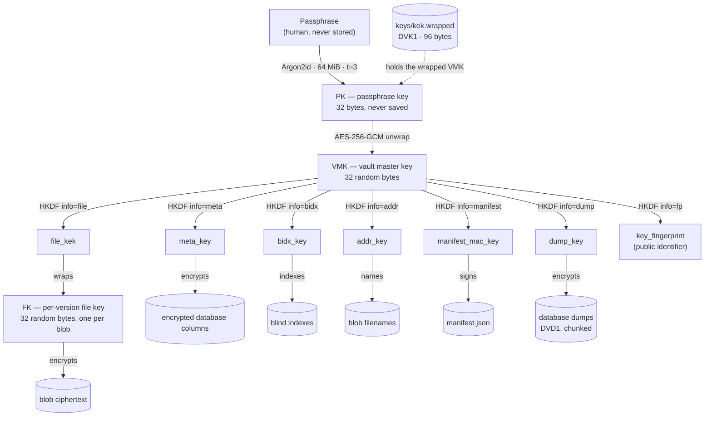
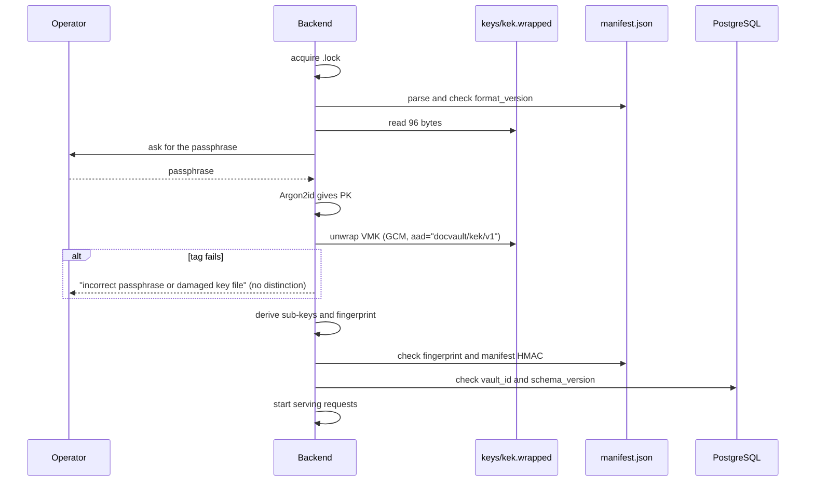

# 05 — Cryptography

> **In plain words:** One passphrase unlocks one vault key. That vault key is never stored in
> readable form. It is used to derive separate keys for separate jobs: encrypting files,
> encrypting database columns, naming blobs, and signing the manifest. Each file also gets its
> own random key, so a single leaked file key harms only that file.
>
> **Read this if:** you are writing crypto code, reviewing the security claims, or explaining to
> someone what this system does and does not protect.

---

## 1. The building blocks

| Purpose | Algorithm | Settings |
|---|---|---|
| Passphrase → key | **Argon2id** | `m=65536 KiB`, `t=3`, `p=1`, 32-byte output |
| Derive sub-keys | **HKDF-SHA256** | A different `info` label per purpose |
| Encrypt content | **AES-256-GCM** | 96-bit random nonce, 128-bit tag |
| Wrap keys | **AES-256-GCM** | Same |
| Name blobs | **HMAC-SHA256** | Salt-prefixed plaintext |
| Blind index | **HMAC-SHA256** | Normalised, typed input |
| Store passwords | **Argon2id PHC** | Per-user salt, tuned cost |
| Audit chain | **SHA-256** | Length-prefixed chaining |

The only crypto library is `cryptography` (OpenSSL bindings). No other crypto dependency is
allowed in the data path.

## 2. The key hierarchy

Think of it as a safe inside a safe. The passphrase opens the outer safe, which holds one key.
That key is copied into several labelled slots, one per job.



**Why the extra layer?** The passphrase never touches content. Changing it re-wraps 32 bytes and
nothing else. Each purpose gets its own sub-key, so a problem in one area does not weaken
another.

| Key | Lives for | Stored where |
|---|---|---|
| Passphrase | Human memory or a safe | Never stored |
| PK | Seconds at start-up | Memory only |
| VMK | The life of the process | Memory, plus wrapped in `kek.wrapped` |
| `file_kek`, `meta_key`, `bidx_key`, `addr_key`, `manifest_mac_key`, `dump_key` | The life of the process | Derived in memory |
| FK | One blob | Wrapped inside that blob's header |

## 3. How each sub-key is derived

```text
file_kek      = HKDF-SHA256(VMK, info="docvault/v1/file",      len=32)
meta_key      = HKDF-SHA256(VMK, info="docvault/v1/meta",      len=32)
bidx_key      = HKDF-SHA256(VMK, info="docvault/v1/bidx",      len=32)
addr_key      = HKDF-SHA256(VMK, info="docvault/v1/addr",      len=32)
manifest_key  = HKDF-SHA256(VMK, info="docvault/v1/manifest",  len=32)
dump_key      = HKDF-SHA256(VMK, info="docvault/v1/dump",      len=32)
fingerprint   = hex(SHA-256(HKDF-SHA256(VMK, info="docvault/v1/fp")))[:32]
```

HKDF uses an empty salt and the exact `info` label above. The `v1` in each label means a future
scheme can coexist without ambiguity.

## 4. Encrypting a document: follow one upload

```mermaid
sequenceDiagram
  participant C as Client
  participant API as Service
  participant CR as crypto
  participant FS as vault/tmp then blobs
  participant DB as PostgreSQL

  C->>API: upload stream (size, MIME, idempotency key)
  API->>CR: new_file_key()
  CR-->>API: FK (32 random bytes)
  API->>CR: wrap(FK, file_kek) gives 48 bytes
  loop each streamed chunk
    API->>CR: AES-256-GCM encrypt under FK
    CR-->>FS: write the 96-byte header, then ciphertext
  end
  API->>CR: finish padding and write the tag
  API->>CR: address = HMAC(addr_key, "docvault/blobaddr/v1" || salt || plaintext)
  API->>FS: fsync, rename to blobs/xx/yy/&lt;addr&gt;.blob
  API->>DB: insert the version row (address, salt, size, MIME, encrypted filename)
  DB-->>API: commit
  API-->>C: 201 Created
```

What this buys:

- **No plaintext temp file, ever.** Data is encrypted as it arrives. The `.part` file only ever
  contains ciphertext.
- **Padding** to `blob.pad_to` (default 4096 bytes) happens before the last block is written, so
  the on-disk size rounds up and reveals little about the real size.
- **A fresh file key for every version.** One key encrypts one payload, which removes the usual
  risk of reusing a nonce across files.

## 5. Encrypting database columns

```text
ciphertext := 0x01 || nonce(12) || AES-256-GCM(meta_key, plaintext, aad="<table>.<column>")
```

| Rule | Reason |
|---|---|
| AAD binds ciphertext to its table and column | A stolen `title_enc` cannot be pasted into `legal_name_enc` and decrypted |
| Random 96-bit nonce per value | Collision chance stays negligible well past 10⁸ values |
| `meta_key` is reused across rows | Acceptable until about 2³² encryptions; rotate at a documented threshold |
| No deterministic encryption | Searchable ciphertext is not needed; exact lookup uses blind indexes |

Anything that must be **sorted, joined, or range-queried** stays plaintext. Anything that
identifies a person or a document's content is encrypted. The full list is fixed in `04` §9.

### 5.1 Encrypting a database dump

A dump is the database, so encrypting the columns is only half the job. The dump also carries the
structural columns in clear, plus usernames and password hashes. It is therefore encrypted as a
whole container with a separate key:

```text
dump_key = HKDF-SHA256(VMK, info="docvault/v1/dump", len=32)
```

The `DVD1` format splits the stream into 64 KiB chunks, each encrypted with its own GCM nonce and
a tag that covers the header, the chunk index, and a final-chunk flag. That is what makes
truncation detectable, which a single trailing tag would also do but only after writing the whole
file to disk. The byte layout is in `03` §9.1.

Why a separate key rather than `meta_key`:

- Domain separation. A weakness in dump handling cannot weaken column encryption (ADR-007).
- The chunk counter needs its own nonce space, so it cannot collide with column nonces.
- `kek.wrapped` and the manifest are untouched, so passphrase rotation still re-wraps 32 bytes.

### 5.2 Encrypting the render recipe and the rendition cache

Two new pieces of data came with the viewer and the printer, and neither needs a new key.

| Data | Encrypted with | AAD | Why |
|---|---|---|---|
| `version_render_settings.recipe_enc` | `meta_key` | `version_render_settings.recipe` | It is metadata: a description of how to display. It never contains document content. |
| Rendition blobs | `file_kek` → per-blob FK | `docvault/blob/v1` | A rendition is an ordinary blob (`03` §5.1). Same container, same guarantees. |

**The recipe is encrypted** because it is surprisingly revealing. `{"crop": [0.31, 0.62, 0.36, 0.68],
"threshold": true}` says "there is a signature in the bottom-right corner that we needed to
brighten", which is a fact about the document, not about the software.

**`recipe_hash` stays plaintext.** It is the SHA-256 of the canonical recipe JSON, used so a print
job can prove which recipe it used. A digest of a low-entropy JSON object is brute-forceable, so
this is not a secrecy mechanism — it is an integrity and provenance mechanism. It does leak
equality: two versions with identical recipes share a hash. Accepted, and recorded in `01` R-1.

**Renditions add no key and no nonce space.** Each is a fresh blob with a fresh random FK, so the
nonce budget argument for `meta_key` is untouched. The only consequence is more blobs, which
`08` §9 sizes.

## 6. Blind indexes: finding a value without storing it

```text
blind := 0x01 || HMAC-SHA256(bidx_key, "v1|" + id_type + "|" + normalize(value))
```

- For identifiers, `normalize` means upper-case, then remove spaces, hyphens, and dots.
- Equality only. No prefix search, no range, no fuzzy matching — by design.
- An attacker with the database but **not** `bidx_key` cannot brute-force PANs from the index,
  because the key derives from the vault key, which is not in the database.
- An attacker with the **vault key** can brute-force PANs offline, because the PAN space is
  small. That is unavoidable, and it is why the vault key is the crown jewel.

## 7. What permissions do not protect — read this twice

Per-document permissions are enforced **inside the application**. They are not a cryptographic
boundary.

| Who holds what | Can they read every document? |
|---|---|
| A user with a valid session and a grant | Only the documents they were granted |
| A user without a grant, using the API | No — blocked |
| Anyone with the vault folder **and** the passphrase | **Yes** — decrypt the blobs directly |
| The admin running the backend while unlocked | **Yes** — the vault key is in its memory |
| Anyone with the folder only | No — it is ciphertext |

So **the passphrase is the real perimeter.** Permissions stop colleagues from wandering. The
passphrase stops everyone else.

If a future requirement says "the admin must not be able to read HR files", that needs per-user
key wrapping, which is designed for but not built (§12).

## 8. Passphrase and key lifecycle

### 8.1 Creating a vault (first run)

1. The operator types a passphrase twice. Policy: at least 12 characters, no composition rules,
   rejected against a small common-password list, and a zxcvbn score of 3 or better.
2. `salt = 16 random bytes`, then `PK = Argon2id(passphrase, salt, params)`.
3. `VMK = 32 random bytes`. `kek.wrapped` is written with a fresh nonce, using atomic
   temp-then-rename.
4. `key_fingerprint` is computed and written to `manifest.json`, and the manifest is signed.
5. The passphrase is **never** written anywhere. The operator is told to seal a copy physically.

### 8.2 Unlocking (every start)



What happens when something is wrong:

| Failure | Response |
|---|---|
| GCM tag fails on unwrap | Reject. After 5 attempts, back off exponentially. Audit `vault.unlock.deny`. |
| Fingerprint does not match the manifest | Refuse to start: `VAULT_KEY_MISMATCH` — wrong key for this vault |
| Manifest HMAC invalid | Refuse to start: `VAULT_MANIFEST_TAMPERED`, and offer `salvage` |
| `vault_id` does not match the database | Refuse to start: `VAULT_DB_MISMATCH` |
| Schema is newer than the app | Refuse to start: `SCHEMA_TOO_NEW` |

Unlock attempts and outcomes are written to the audit log **before** the vault is fully open.
The audit files themselves are not encrypted.

### 8.3 Changing the passphrase

```
docvault rotate-passphrase
```

1. Ask for the old passphrase, the new one, and confirmation that a fresh backup exists.
2. Derive a new PK from the new passphrase with a **new salt**.
3. Re-wrap the same vault key and rewrite `kek.wrapped` atomically.
4. Sub-keys are untouched, so **no content is re-encrypted**.
5. Audit `vault.passphrase.rotated` with the key fingerprint unchanged.
6. Seal the new passphrase physically and destroy the old sealed copy.

### 8.4 Replacing the vault key after a suspected compromise

Only when the vault key itself may be compromised. This is expensive and deliberate.

1. Stop the app and take a full vault backup.
2. `docvault rotate-vmk` generates a new vault key, then walks every blob: decrypt with the old
   key, re-encrypt with the new one, and **rename** it to the new address, because the address
   depends on `addr_key`.
3. Re-encrypt every encrypted column and rebuild every blind index.
4. Rewrite `kek.wrapped`, `manifest.json` (new fingerprint and signature), and the dump.
5. Audit the start and end with counts. `verify` must pass before serving resumes.

Expect hours, not minutes, in proportion to vault size.

### 8.5 Losing the passphrase

**Unrecoverable.** There is no recovery key, because a recovery key would be a second way in.
The mitigations are organisational: two custodians, a sealed physical copy, and the procedure in
`08` §7.

## 9. Memory hygiene: the honest version

| Practice | Reality in Python |
|---|---|
| Never log secrets | Achieved: log filters strip `*_enc` values, keys, and tokens |
| Avoid swap | Recommended: full-disk encryption on, hibernation off |
| Zero memory after use | **Best effort only.** A `bytearray` can be cleared; `bytes` cannot, and the interpreter keeps copies. |
| Prevent core dumps | Achieved on Linux with `ulimit -c 0`; Windows Error Reporting is turned off |
| Keep keys out of tracebacks | Achieved: key objects redact themselves in `__repr__` |

> We do not claim memory zeroisation. We claim that keys are never persisted in plaintext, never
> logged, and never leave the host.

## 10. Detecting tampering

| What was tampered with | How we notice | Result |
|---|---|---|
| Blob bytes | GCM tag on read; `verify` recomputes the address | Hard failure; blob quarantined |
| Blob header | `key_id` mismatch, bad magic, unknown flags | Hard failure |
| Encrypted column | AAD mismatch or GCM tag failure | Row reported; page returns `500` with a correlation ID |
| Dump bytes | Per-chunk GCM tag; `LATEST` SHA-256; `vault_id` check | Hard failure; fall back to the previous dump |
| Dump tail | Missing final chunk flag | Hard failure; truncation is detected, never silently accepted |
| `manifest.json` | HMAC mismatch after unlock | Refuse to start |
| `kek.wrapped` | GCM tag failure | Reject the passphrase or report a damaged key |
| Audit file | Chain verification | Report the first broken `seq` |
| Database rows | Not signed; relies on database access control and audit | Residual risk |

The database is not cryptographically signed. An attacker who can write to PostgreSQL can change
plaintext structural fields such as dates and links. `verify` cross-checks blob existence and
counts, and the audit log records what the application did. But a determined insider with
database access is inside the trust boundary (`01` §4, T3).

## 11. Tests that must exist

1. **Known-answer tests** for Argon2id, HKDF, AES-GCM, and HMAC, using fixed inputs.
2. **Round trip** at every size boundary: 0 bytes, 1 byte, 4095, 4096, 4097, and 100 MB.
3. **Tamper tests:** flip one bit in the header, in the ciphertext, and in the tag. All must
   fail closed.
4. **AAD tests:** move a ciphertext between columns. It must fail.
5. **Address tests:** same plaintext and same salt give the same address; different salt gives a
   different address.
6. **Fingerprint tests:** wrong passphrase is rejected; a corrupted manifest is rejected.
7. **Property test:** random plaintext, key, and nonce always decrypt back to the input.
8. **Dump tests:** round trip at 0, 65535, 65536, 65537, and 1 GiB; truncate the last chunk and
   confirm the final-chunk flag catches it; reorder two chunks and confirm the index in the AAD
   catches it; restore a dump written by the previous app version.

## 12. A future option: per-user key wrapping (not in v1)

The design leaves room for a real cryptographic boundary later, without changing stored blobs.

- Add a `document_keys` table: each version's file key is wrapped again under each authorised
  user's public key (X25519), or under a per-user symmetric key.
- The blob format moves to `DVC2`: the file-key wrap leaves the header and lives only in the
  database. The database then becomes required for access — and that dependency is exactly what
  makes crypto-shredding possible, by discarding the wrapped keys.
- The cost is that a user's key must be recoverable on a new machine, which brings back the
  problem of key escrow. That is why this is a separate project, not a v1 feature.

## 13. Things we never do

1. Never invent a construction: no XOR chains, no "encrypt twice for safety".
2. Never use ECB, CBC without a MAC, or a static IV.
3. Never derive content keys directly from a user's password.
4. Never put keys in environment variables, config files, or the database.
5. Never add a second crypto library.
6. Never encrypt in the browser. The browser never sees a key.
7. Never log, cache, or index plaintext.
8. Never write a rendered page, a print job, or a recipe to disk in the clear. A rendition is a
   `DVC1` blob or it does not exist.
9. Never let a failed decryption degrade into "return partial content".
10. Never increase `pad_to` without measuring the storage cost.
11. Never replace the vault key without a verified backup first.
