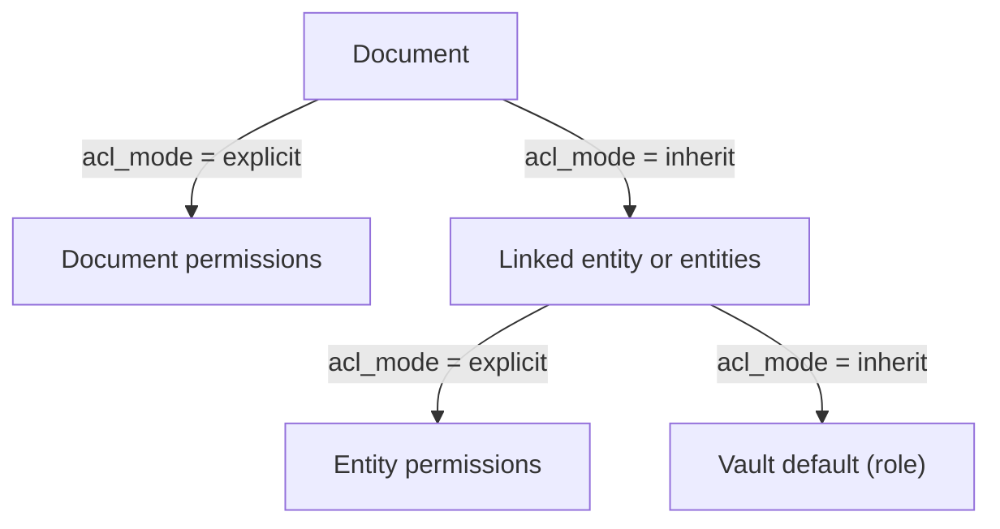

# 06 — Roles and Access Control

> **In plain words:** There are six specific things a user can be allowed to do. Every document
> has a list saying who may do what. A document usually inherits that list from its entity, and
> an entity usually inherits from the vault-wide role. One function answers every "can this
> person see this?" question, and nothing else is allowed to answer it.
>
> **Read this if:** you are building permissions, designing screens, or explaining to a user why
> they cannot open a document.

---

## 1. Who and what can hold permissions

| Principal | What it is | Who manages it |
|---|---|---|
| **User** | A named person with a login | Admin |
| **Group** | A named set of users; the unit of sharing | Admin |
| **Role** | A vault-wide default grant | Fixed: four roles |
| **Owner** | The user accountable for a document; seeded as a permission entry | Set at creation, transferable |

Roles are coarse and global. Groups and per-document entries are how you get specific. There is
no per-user role, no per-field permission, and no folder tree.

## 2. The six capabilities

A **capability** is one specific action. Permissions are built from capabilities.

| Bit value | Capability | What it allows |
|---:|---|---|
| 1 | `view` | See the document in lists, counts, and metadata screens |
| 2 | `read` | Download the content, and view it on screen. Implies `view`. |
| 4 | `write` | Create documents, edit metadata, upload a new version, save a render recipe |
| 8 | `delete` | Soft delete and restore |
| 16 | `manage_acl` | Change who has access |
| 32 | `print` | Build a print job that includes the document. Implies `read`. |

`print` was added in v1 because paper leaves the building and the office wanted to separate "may
look at it" from "may produce copies". It is a policy control, not a boundary: anyone with `read`
can download the bytes and print them elsewhere. `01` §6 R-11 says so plainly rather than
implying more protection than exists.

### Implication rules

Three capabilities imply the ones below them, and this has to be handled in **one** direction
going up and the opposite direction going down:

```text
print  ->  read  ->  view
```

| Rule | Meaning |
|---|---|
| **Upward closure** (allows) | A grant of `print` also grants `read` and `view`. A grant of `read` also grants `view`. |
| **Downward closure** (denies) | A deny of `view` also denies `read` and `print`. A deny of `read` also denies `print`. |

The downward rule is the one that was missing from the first draft of this document, and it
mattered: without it, an entity that denied `view` while a document allowed `read` produced a
user who could read but not see the document existed. §5 now states the fixed algorithm.

| Not a capability | Why |
|---|---|
| **Purge** | Admin role only. Irreversible actions are not delegated. |
| **Break-glass** | Admin role only, needs a written reason, always audited. |
| **Reading the audit log** | Auditor role only; admins also have it. |

`read` implies `view`. The service normalises the bitmask when writing, so stored values are
always consistent (`caps |= READ` also sets `VIEW`).

### `restricted` documents add one condition to `print`

Sensitivity is not a capability and does not change the bitmask. It is a second gate applied
after the ACL check: a document marked `restricted` needs `print` **from an explicit entry on that
document**, not merely through a role or an entity. Admins are exempt, and every admin print is
audited. The full rule and its reasoning are in `13` §6; the gate itself is in §5.

Marking a document `restricted` therefore does something real. Without this gate, it would change
a badge and nothing else.

## 3. The four roles

| Role | Vault-wide default | Also allowed |
|---|---|---|
| **admin** | Every capability | Purge, break-glass, user and group management, vault operations |
| **editor** | `view, read, print, write, delete` | Can be reduced per entity or document |
| **reader** | `view, read, print` | Can be reduced |
| **auditor** | `view` | Read the audit log. **No content download and no printing** unless explicitly granted. |

Two consequences worth stating:

- **An editor is not an admin.** They cannot grant themselves access they do not already have,
  cannot purge, and cannot create users.
- **An auditor sees that a document exists** — metadata only — and cannot open it. That is the
  point of the role: accountability without content exposure.

## 4. The three scopes

There are exactly three places a permission can come from, checked in this order.



- A document with `acl_mode = inherit` takes its grants from the entity permissions of every
  entity it is linked to. If none of those entities is explicit, it falls back to the vault
  default.
- A document with `acl_mode = explicit` uses **only** its own entries. The moment you add an
  explicit grant, inheritance stops. This is deliberate, and the interface says so plainly:
  "This document no longer follows the entity's permissions."
- Documents are not nested. There is no folder inheritance, which is one less thing to reason
  about.

### Documents linked to several entities

A document may link to several entities, for example a deed naming three companies. Scope
evaluation takes the **union of all allows across the linked entities**, and **any deny wins**.

So a document inherited from entity A and entity B is visible to someone granted access on
either one — unless a deny exists on one of them.

## 5. How a decision is made

This is the whole algorithm. There is no other path.

```text
effective_caps(user, document):

1. If the user has the admin role:
       return ALL                 # content reads still require break-glass
2. allow = 0
   deny  = 0
3. Decide the scope:
     document is explicit                   -> [document]
     otherwise, entities that are explicit  -> [those entities]
     otherwise                              -> [vault]
4. For every permission entry E in that scope
   where E's subject is the user, or a group the user belongs to:
       if E is allow: allow = allow OR E.capabilities
       else:          deny  = deny  OR E.capabilities
5. allow = CLOSE_UP(allow)        # print -> read -> view
   deny  = CLOSE_DOWN(deny)       # view denies read and print; read denies print
6. return allow AND NOT deny
```

Two helper definitions, which are the whole of the implication logic:

```text
CLOSE_UP(m):     if m & READ:  m = m | VIEW
                 if m & PRINT: m = m | READ | VIEW
                 return m

CLOSE_DOWN(m):   if m & VIEW:  m = m | READ | PRINT
                 elif m & READ: m = m | PRINT
                 return m
```

**Why the order matters.** The first version of this algorithm subtracted denies first and then
re-added `view` whenever `read` survived. That silently defeated a deny on `view`: an entity that
denied `view` while a document allowed `read` produced a user who could read the content and see
the listing. Closing the deny set downward *before* subtraction makes the result correct without
a re-add step:

- Anything left in the result is already upward-closed, because a capability can only survive if
  everything it implies also survived. If `read` is in the result, `view` was allowed and not
  denied, so `view` is in the result too.
- Denying `view` removes `read` and `print`, because `CLOSE_DOWN` put them in the deny mask.

So step 6 needs no cleanup. That is the property to test.

### The six capabilities, seen as bit masks

| Grant | Effective |
|---|---|
| `view` | `view` |
| `read` | `read, view` |
| `print` | `print, read, view` |
| `write` | `write` (no read implied — an editor without `read` can file but not open) |

`write` deliberately implies nothing. Filing a document you are not allowed to read is a real
workflow: a records clerk who captures paperwork without being able to examine it.

### A worked example

Suppose Sita is in the group **Finance**. The document **"Board resolution"** is linked to
**Acme Pvt Ltd** and inherits from it. The entries are:

| Scope | Subject | Capabilities | Effect |
|---|---|---|---|
| Acme (entity) | Group Finance | view, read | allow |
| Acme (entity) | Group Contractors | view, read, write | deny |
| Acme (entity) | User Ravi | view, read, write | allow |

Sita is in Finance and not in Contractors, and is not Ravi. So:

- `caps` becomes view + read from the Finance allow.
- `denied` stays empty.
- Result: **view and read**. She can see it and download it. She cannot edit or delete it.

Now add Sita to Contractors as well. The deny includes view, read, and write, and denies always
win:

- `caps` = view + read, then `denied` = view + read + write.
- Result: **nothing**. She cannot even see it, because the deny subtracted `view` too.

To let her read that one document, an admin must remove the deny, or make the document explicit
with its own entries. That is intentional. It stops a document-level allow from quietly
overriding an entity-level restriction.

Now suppose Acme grants Group Finance `print` instead of `read`. Upward closure turns that into
`print, read, view` before any deny is applied, so Sita can print and everything that printing
requires. Had the grant been `read` alone, she could download but the print dialog would refuse
the document with a `403` naming the missing `print` capability.

### Rules that follow from the algorithm

| Rule | What it means |
|---|---|
| **Deny always wins**, at every scope | An entity-level deny blocks a document-level allow. To allow one document despite a deny, remove the deny. |
| **Deny closes downward** | Denying `view` also removes `read` and `print`. Denying `read` also removes `print`. A deny never leaves an orphan capability behind. |
| **No allow means no access** | Absence of a grant is a denial. There are no implicit grants except the owner seed and the vault default. |
| **The owner's floor cannot be removed** | The owner entry cannot be deleted or reduced below `view, read, write, manage_acl`. |
| **Admin cannot be denied** | Admin is an operational role, and every content read is audited. |
| **Group membership is checked on every request** | Removing someone from a group takes effect immediately, with no cache. |

## 6. One gate, no exceptions

Every read path calls one of these two functions. Nothing else may check permissions.

```python
# services/acl.py
def require(user, doc_id, cap) -> Document      # 404 if not visible, 403 if visible but not enough
def visible_documents(user) -> Select           # SQL filter used by every list, count, and search
```

| Surface | Must use | What happens on failure |
|---|---|---|
| `GET /documents` | `visible_documents` | Filtered. No count leak. |
| `GET /documents/{id}` | `require(view)` | 404 if not visible |
| `GET .../download` | `require(read)` | 404 if not visible; 403 if visible but no `read` |
| `GET /renditions/{id}` | `require(read)` | Same as download. A preview is content. |
| `PUT .../render-settings` | `require(write)` | 404 if not visible; 403 if visible but no `write` |
| `POST /print-jobs` | `require(print)` on **every** item | 404 if any item is not visible; 403 naming `print` if visible but not printable; `403 PRINT_RESTRICTED` if the item is `restricted` and the grant is not explicit (`13` §6) |
| `GET /entities/{id}/documents` | `visible_documents` | Same filter |
| Search results | `visible_documents` | Same filter |
| Dashboard counts | `visible_documents` | Counts over the filtered set |
| Export or report | `visible_documents` | Same filter |
| Related-document widgets | `visible_documents` | Same filter |
| Audit list | Role check (`auditor` or `admin`) | 403 |

**A preview is a read.** There is no separate rule for renditions: if a user may not download the
document, they may not see it rendered either. This is the single most important consequence of
adding a viewer, and it is why the rendition endpoint appears in this table rather than being
left to the frontend.

**404 versus 403 is a security decision.** If the user cannot `view` the document, return `404
Not Found`. Never `403`, because that confirms the document exists. If they can `view` but lack
a specific capability — for example, an auditor trying to download — return `403`.

SQL sketch:

```sql
-- Effective capabilities for one user and one document, used by require()
SELECT coalesce(sum(...), 0)  -- allow bits minus deny bits, computed per scope
FROM acl_entries ... ;

-- The list filter, used by every collection query
CREATE FUNCTION documents_visible_to(p_user uuid)
RETURNS TABLE (document_id uuid, caps smallint) AS $$ ... $$ LANGUAGE sql STABLE;
```

**Repository rule:** a query that reads `documents` without joining `documents_visible_to` is a
review-blocking defect. The integration tests enforce this by calling every route as an
unauthorised user (§10).

## 7. Rules that stop privilege escalation

| Rule | How it is enforced |
|---|---|
| You cannot grant a capability you do not hold | Service check on every permission write |
| You cannot grant `manage_acl` on a document you do not own, unless you are admin | Service check |
| You cannot grant to yourself | Rejected; ask an admin |
| `print` cannot be held without `read` | Expanded on write, so the stored mask always reflects it |
| You cannot remove the owner's floor (`view, read, write, manage_acl`) | Rejected |
| Only admins can create `deny` entries | Denies are operationally dangerous |
| Only admins can grant at the entity level | Keeps entity permissions stable |
| Every permission change is audited, with before and after | `AuditService`, in the same transaction |

## 8. Ownership and orphaned documents

- Every document has an `owner_id`, seeded as a permission entry at creation.
- Transferring ownership moves the entry and audits both sides.
- **Orphan check** (nightly): documents whose effective `view` set contains only disabled or
  deleted users are reported to admins. This is the failure mode that makes per-document
  permissions rot over time.
- **Dormant check**: documents with no `view` grant at all, apart from admin, are listed. They
  are not deleted; they are surfaced.

## 9. How this looks to a user

| What they need | How it is done |
|---|---|
| "Everyone in Finance can see this entity" | One entry: group `Finance`, capabilities `view, read` |
| "Only the two partners can see this settlement deed" | Document set to `explicit`, with two user entries |
| "The auditor must confirm these exist but must not read them" | The `auditor` role already gives `view` only |
| "They may look at it, but must not produce copies" | Grant `view, read` and withhold `print`. They can open it; the print dialog returns `403` naming `print`. |
| "This is sensitive; nobody but the owner for now" | Explicit, owner-only, `confidentiality = restricted` |
| "We repeat the same sharing pattern often" | **Presets** — a screen convenience that applies a saved list through the normal API. No new rules, no hidden inheritance. |
| "Who can see this?" | A read-only panel on every document that resolves the effective permissions and explains *why*: which scope and which entry |

The "who can see this" panel is not optional polish. With per-document permissions, admins
otherwise have no way to answer the question that matters most.

## 10. Test matrix

| Test | Expected |
|---|---|
| Reader opens a document they cannot view | `404` |
| Auditor downloads a document they can view | `403` |
| Auditor adds a visible document to a print job | `403`, naming `print` |
| Reader prints a document granted `view, read` only | `403`, naming `print` |
| Editor tries to grant `manage_acl` | `403` |
| Editor grants themselves `read` on an unshared document | `403` |
| Entity deny plus document allow | Denied |
| Two linked entities, allow on one and deny on the other | Denied |
| Entity denies `view`, document allows `read` | Nothing. `CLOSE_DOWN` removes `read` and `print` too. |
| Entity denies `read`, document allows `print` | Nothing |
| Entity allows `print` only | `print, read, view` — all three |
| Group membership removed mid-session | Immediately denied, no cache |
| Owner entry downgraded | `422`, floor violation |
| Admin reads content without a reason | `422`, reason required |
| Admin reads content with a reason | `200`, plus an audit row `document.breakglass_read` |
| Counts endpoint as a reader who can see 3 of 10 documents | Returns 3, not 10 |
| Soft-deleted document in a list | Absent for everyone except an admin using `include_deleted` |
| Print job containing one document the user cannot view | `404` for the whole job, no partial output |
| `restricted` document, `print` only through the entity | `403 PRINT_RESTRICTED` |
| Same document, explicit `print` entry added | Prints; audit records the explicit grant |
| `restricted` document, admin prints | Allowed; audit records the admin exemption |
| Raising sensitivity with `write` | Allowed |
| Lowering sensitivity with `write` but not admin | `422` |

## 11. What this does not do

- Field-level permissions, such as hiding `doc_number` but showing the title.
- Time-limited or expiring shares.
- External or anonymous links. There is no internet exposure.
- Delegation, such as "act as me for a week".
- Per-user encryption keys. `05` §12 explains the path if this becomes a requirement.
