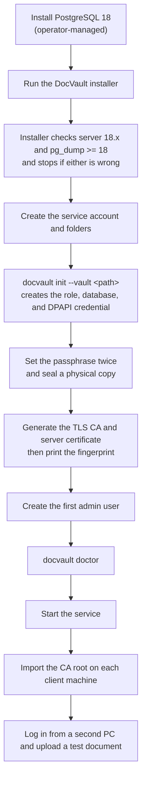
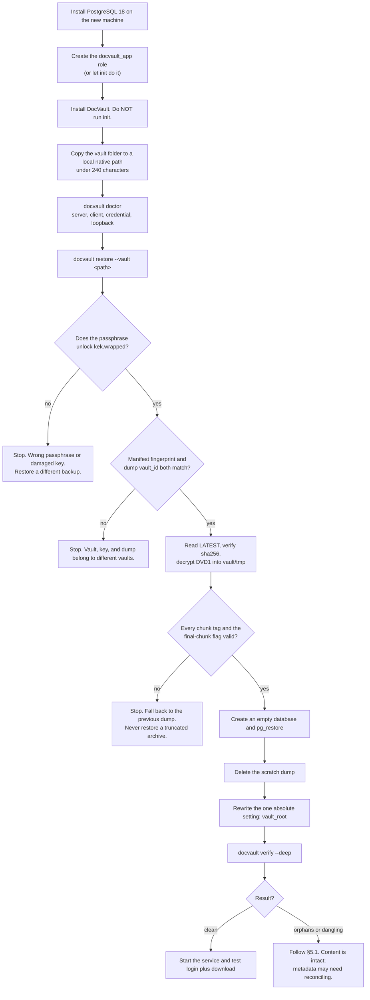
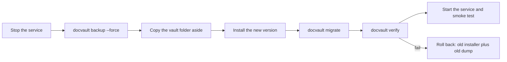

# 08 — Operations Runbook

> **In plain words:** This is the manual for running the system: installing it, backing it up,
> restoring it after a failure, checking that nothing is corrupt, and upgrading it. It is written
> so that someone doing this at 2 a.m. after a disk failure does not have to think.
>
> **Read this if:** you are the person who installs, backs up, or recovers the vault.

---

## 1. The command-line tool

Everything an operator needs is one program.

| Command | What it does |
|---|---|
| `docvault init --vault <path>` | Creates a vault, sets the passphrase, generates TLS, provisions the database role, and seeds the document-type catalogue |
| `docvault init --reuse-vault` | Re-creates the database role and credential for an existing vault, without touching `manifest.json` or `kek.wrapped` |
| `docvault serve` | Runs the backend. This is what the OS service calls. |
| `docvault unlock` | Unlocks a vault that started locked. Prompts for the passphrase; it stays in memory until restart. |
| `docvault lock` | Drops the vault key from memory without stopping the service. |
| `docvault auto-unlock enable \| disable` | Chooses whether the service unlocks at boot. Automatic mode seals the passphrase with DPAPI machine scope; see `15` §6.3. |
| `docvault status` | Shows vault, database, lock, key fingerprint, last dump and whether it is encrypted, and blob count |
| `docvault doctor` | Checks the environment: filesystem, permissions, ports, PostgreSQL server and client versions, `pg_bin_dir`, database credential |
| `docvault backup [--force]` | Writes an encrypted dump into `index/db/` and updates `LATEST` |
| `docvault dump-list [--dump <file>]` | Prints the table of contents of an encrypted dump without restoring it |
| `docvault restore --vault <path> [--dump <file>]` | Attaches a vault on this machine, decrypts the dump, and restores the database |
| `docvault verify [--deep] [--limit N]` | Checks blobs, addresses, orphans, dumps, and the audit chain |
| `docvault renditions [--clear] [--status]` | Shows or clears the encrypted preview cache. Always safe. |
| `docvault salvage --vault <path> --out <dir>` | Decrypts blobs without a database |
| `docvault migrate` | Applies schema migrations, after writing a dump. Also re-applies the seeded type catalogue if a category or type is missing. |
| `docvault rotate-passphrase` | Re-wraps the vault key under a new passphrase |
| `docvault rotate-vmk` | **Destructive and slow.** Replaces the vault key and re-encrypts everything, dumps included. |
| `docvault user create \| reset \| disable \| list` | User administration from the console |

The first installation is a separate, ordered walkthrough in `15`. This page is the reference you
keep afterwards.

## 2. Installing

PostgreSQL is a **prerequisite**, not something the installer provides. Install it first, or the
installer stops and says so.



| Target | Status in v1 | Installer | Service |
|---|---|---|---|
| **Windows** | **Production target, tested** | MSI, per machine | Windows Service, dependent on the PostgreSQL service |
| **Linux** | **Development target, tested** | `.deb` or `.rpm` | `systemd` unit, `After=postgresql.service` |
| **macOS** | Not tested in v1 | — | — |

Fixed defaults:

| Item | Value |
|---|---|
| HTTPS port | `8443` |
| PostgreSQL connection | Loopback only. A local socket on Linux, `localhost:5432` on Windows. Not configurable to a remote host without an explicit opt-out. |
| `pg_bin_dir` | Auto-detected; on Windows typically `C:\Program Files\PostgreSQL\18\bin`. Holds `pg_dump.exe` and `pg_restore.exe`. |
| Database credential | DPAPI machine-scope (Windows) or OS keyring (Linux), ACL'd to the service account |
| Configuration | `docvault.toml` in the OS config folder |
| Logs | `.../docvault/logs` in the OS log folder |
| TLS material | `.../docvault/tls` in the OS config folder, **outside the vault** |
| Vault location | Chosen by the operator. Must be a local native disk. |
| LibreOffice (optional) | Path in `office.convert_exe`. Required only for `doc`, `docx`, and `odt` uploads. Reported by `docvault doctor`. |
| Rendition cache ceiling | `render.cache_bytes`. Default 5 GB or 10 % of the vault, whichever is smaller. |

> **Why TLS material lives outside the vault:** the vault gets copied to backups and other
> machines. A server private key riding along in a backup is an unnecessary risk. A restored
> vault on a new machine gets a fresh certificate, and clients re-import the new fingerprint.

### 2.1 Trusting the certificate on each client (once)

| OS | Command |
|---|---|
| Windows | `certutil -addstore -f Root docvault-ca.crt` |
| Linux | `sudo cp docvault-ca.crt /usr/local/share/ca-certificates/ && sudo update-ca-certificates` |

Verify by opening `https://<host>:8443` and comparing the certificate fingerprint with the one
printed by `docvault status`.

### 2.2 PostgreSQL prerequisites and credentials

`docvault doctor` checks all of these and reports each one separately, so a failure names the
fix.

| Check | Pass condition | Failure code |
|---|---|---|
| Server reachable | Connects on loopback within 5 seconds | `DB_UNAVAILABLE` |
| Server major version | Exactly `18` | `PG_VERSION_UNSUPPORTED` |
| Client tools present | `pg_dump` and `pg_restore` resolve from `pg_bin_dir` | `PG_CLIENT_MISSING` |
| Client version | `pg_dump --version` ≥ `server_version` | `PG_CLIENT_TOO_OLD` |
| Server address | The resolved address is loopback | `DB_NOT_LOOPBACK` |
| Credential decrypts | DPAPI unwrap (Windows) or keyring read (Linux) succeeds | `DB_CREDENTIAL_UNREADABLE` |
| Database identity | `vault_id` in the database matches the manifest | `VAULT_DB_MISMATCH` |
| Schema | `schema_version` matches or is older than the app | `SCHEMA_TOO_NEW` |

**The credential.** `init` takes the PostgreSQL admin password once, creates a `docvault_app`
role with no superuser and no `CREATEDB`, generates a random password for it, and stores it
encrypted with DPAPI in machine scope. Only the service account can decrypt it. It is never
written to `docvault.toml`, the vault, an environment variable, or a log line.

**Why DPAPI and not the Windows Credential Manager:** Credential Manager entries are per-user,
and an administrator running `docvault doctor` from their own session is not the service
account. Machine-scope DPAPI avoids that support call.

**On Linux (development).** There is no DPAPI. The credential goes in the user's keyring through
the Secret Service API, or — if no keyring is available in a headless dev container — in a
`0600` file next to the config, and `doctor` prints a warning saying so. That fallback is for
development only and is refused when the app detects a production install.

**The `pg_dump` password.** `pg_dump` is a separate executable and cannot read DPAPI. The app
writes a transient `PGPASSFILE` into `vault/tmp/`, restricted to the service account, passes its
path to the child process, and deletes it in a `finally`. `vault/tmp/` is never backed up and is
swept at start-up.

### 2.3 The seeded document-type catalogue

`docvault init` inserts the eight categories and roughly seventy types described in `13` §4, with
`is_system = true`. Without them the first upload has nothing to choose from, so this is part of
installation, not an optional extra.

| Property | Value |
|---|---|
| Categories | 8: identity, property, legal, corporate, financial, employment, insurance, other |
| Types | About 70, each with a code, a name, a default sensitivity, and an expiry requirement |
| Size | A few hundred rows at most, negligible next to the schema |
| Re-running | `docvault migrate` inserts anything missing and changes nothing that exists |
| Deleting | Seeded rows cannot be deleted; they can be renamed (`13` §9) |

Because the seed is applied by a migration, an upgrade that adds a type does not require the
operator to remember anything. A rename by an admin survives migrations, because the seed matches
on `code`, not on the display name.

## 3. Backups

The vault **is** the backup. The schedule below is about protecting the vault itself.

| Layer | What | When | Keep |
|---|---|---|---|
| 1 | Encrypted database dump into `index/db/` | Nightly at 01:00, and before any migration | Last 7, plus every pre-migration dump |
| 2 | Journal append | Continuously | 13 months |
| 3 | Full vault copy to external media | Weekly, with the app stopped or right after `docvault backup` | 8 weekly, 12 monthly |
| 4 | Off-site copy | Monthly, in an encrypted container | 12 months |

Operator checklist for layer 3:

1. Run `docvault backup --force`.
2. Confirm that `docvault status` shows a fresh dump, `encrypted=yes`, and a matching SHA-256.
3. Stop the service, or confirm that no `.lock` file exists.
4. Copy the whole vault directory **with permissions preserved**: `robocopy X: Y: /MIR /COPY:DAT`
   or `rsync -a --delete`.
5. Start the service and confirm that `docvault verify --limit 50` passes.
6. Label the media with the vault ID, date, and key fingerprint.

> **Never** copy a vault while it is being written to. **Never** put a copy of the passphrase on
> the same media.

### 3.1 Exclude the PostgreSQL data directory from OS-level backups

The database is operator-managed, so Windows Backup, File History, or a disk-imaging tool may be
copying it on its own schedule. Those copies ignore the vault, our retention rules, and the
purge workflow.

Add an exclusion for the PostgreSQL data directory — typically
`C:\Program Files\PostgreSQL\18\data` on Windows. `docvault status` prints the path that is
actually in use.

This is not a content leak, because document columns are ciphertext. It is a structural leak:
dates, statuses, the ACL graph, usernames, and password hashes would travel in clear, and would
survive a purge. See `01` R-8a.

### 3.2 What must never be in the backup

- The passphrase, in any form.
- TLS private keys. Losing them is harmless; they are regenerated.
- Anything from `tmp/` or `trash/`. This includes the transient `PGPASSFILE` and the plaintext
  restore scratch file, which is why `tmp/` is excluded.

## 4. Restoring: the main event

Scenario: the desktop is gone. You have the folder and a fresh machine.

The vault is no longer entirely self-contained, because PostgreSQL is operator-managed. A restore
therefore starts with a database server and a role that the vault cannot carry. Budget the
PostgreSQL install into the recovery time.



The same steps as commands:

```powershell
# 1. Install PostgreSQL 18 and confirm the client tools exist.
& "C:\Program Files\PostgreSQL\18\bin\pg_dump.exe" --version

# 2. Create the role if the installer has not done it.
#    psql -U postgres -c "CREATE ROLE docvault_app LOGIN PASSWORD '...';"
#    psql -U postgres -c "CREATE DATABASE docvault OWNER docvault_app;"

# 3. Install DocVault, but do not initialise a new vault.
# 4. Copy the folder, for example to D:\Vault
# 5. Check the environment
docvault doctor --vault D:\Vault

# 6. Attach and restore (prompts for the passphrase)
docvault restore --vault D:\Vault

# 7. Deep check: read every blob, every dump, and recompute every address
docvault verify --deep

# 8. Start
Get-Service DocVault | Start-Service
```

On the Linux development host the same steps use `/srv/docvault/vault`, `sudo systemctl start
docvault`, and a local socket instead of a TCP connection.

Expected `verify` output:

```text
vault_id       0192f0c4-7a1e-7c3b-9a55-2c1f0b6d4e11
schema         v1  (app expects v1)
postgres       18.6  (client 18.6,  loopback)
blobs          41,882 present · 41,882 referenced · 0 missing · 0 orphan
addresses      41,882 verified
dumps          7 present · 7 encrypted · latest 2026-10-28T01:00:00Z · tags OK
encrypted cols 108,441 readable
audit chain    9 files · 1,204,551 entries · OK (last anchored 2026-09-30)
documents      38,104 active · 212 soft-deleted · 41 purged tombstones
result         CLEAN
```

### 4.1 After every restore

1. Log in as an admin and check that the document count matches your expectation.
2. Download three documents of different types and open them.
3. Confirm that the audit log records the restore.
4. Confirm that every user must log in again. Old sessions are gone.
5. Record the restore in the operations log: date, operator, and source media.

## 5. Checking integrity

| Mode | Cost | What it checks |
|---|---|---|
| `docvault verify` | Seconds | Row and blob existence, counts, audit chain, lock file, dump presence and `LATEST` hash |
| `docvault verify --deep` | Minutes to hours, I/O bound | Also decrypts every blob and every dump chunk, recomputes every address, and decrypts sampled columns |
| `docvault verify --deep --limit N` | Bounded | The first N blobs and the newest dump, for a quick check after a copy |

Run the shallow check nightly and the deep check monthly. Record the results; the trend matters
more than one run.

**Rendition blobs are reported separately and are never a failure.** A missing rendition is a
cache miss; a rendition blob with no row is a leftover to sweep. The shallow check prints
`renditions 12,441 cached · 3 stale · 0 problems` and moves on.

### 5.1 What the results mean

| Result | Meaning | What to do |
|---|---|---|
| **Missing blob** | A row points at an address with no file | Data loss. Restore the folder from an older backup and find out which documents are affected. |
| **Orphan blob** | A file with no row | Usually a failed upload or a stale dump. Content is recoverable; metadata is not. |
| **Address mismatch** | The file exists, but its plaintext hashes to a different address | Tampering or corruption. Quarantine it and do not serve it. |
| **Column decrypt failure** | GCM or AAD failure | Tampering or a key mismatch. Stop and investigate before serving. |
| **Dump tag failure** | A chunk tag or the final-chunk flag failed | The dump is corrupt or truncated. Use the previous one. Do not attempt a partial restore. |
| **`LATEST` hash mismatch** | The `.enc` file does not match the pointer | Usually a partial copy. Re-copy the vault; if it persists, treat it as tampering. |
| **Dump `vault_id` mismatch** | The dump belongs to another vault | Wrong backup media. Nothing else in the folder can be trusted either. |
| **Audit chain break** | Hash mismatch at some `seq` | Report the first broken entry and treat it as an incident. |
| **Lock present** | Another instance, or a crash | Confirm no other process. If the lock is older than 30 seconds, take over with `--force`. |

### 5.2 Salvage, when there is no database

```bash
docvault salvage --vault /srv/docvault/vault --out /srv/salvage
```

- Walks `blobs/`, decrypts each one with the passphrase, and writes `<address>.bin`.
- Emits `salvage-index.csv` with address, size, sniffed MIME type, and SHA-256.
- **Titles, filenames, entity links, and permissions are not recoverable.** They lived only in
  the database.
- Use this only when every dump is lost. Never as a shortcut instead of `restore`.

## 6. Upgrading



| Rule | Reason |
|---|---|
| A pre-migration dump is written automatically and kept forever | It is the only reliable rollback |
| The app refuses to start if `db.schema_version > app.supported` | Prevents silent corruption |
| Downgrades are not supported | Restore the pre-migration dump instead |
| Test the upgrade on a copy of the vault first | Cheap, and it catches almost everything |

### 6.1 PostgreSQL major-version upgrade

A PostgreSQL major upgrade is a separate, planned event. The app never performs one.

1. Stop the DocVault service.
2. `docvault backup --force`, and copy the vault aside.
3. Install PostgreSQL 19 alongside 18. Both can coexist; only one listens on the port.
4. `pg_dump` from 18 and `pg_restore` into 19. Never run `pg_upgrade` against a database the app
   is using.
5. Point `docvault.toml` at the new server, update `pg_bin_dir`, and re-run `docvault init
   --reuse-vault` to re-create the role and credential.
6. `docvault doctor` must pass, then `docvault verify --deep`.
7. Only then remove PostgreSQL 18.

Dumps written by 18 restore into 19. The reverse does not work, which is why the old server is
removed last.

## 7. Managing the passphrase

| Event | Procedure |
|---|---|
| A custodian leaves | A new custodian witnesses `rotate-passphrase`; the old sealed copy is destroyed |
| The passphrase may have leaked | Run `rotate-passphrase` immediately, then review the audit log for logins and downloads since the exposure |
| A custodian forgets, but another knows it | `rotate-passphrase` using the known passphrase |
| Every copy is lost | **Unrecoverable.** Document the loss. Content cannot be recovered by design (`05` §8.5). |
| KDF parameters are raised | `rotate-passphrase` re-wraps with the new Argon2id cost. The same passphrase is acceptable, but changing it is better. |

## 8. Monitoring and logs

| Signal | Where | Alert when |
|---|---|---|
| Service is up | `/readyz` polled from the host only | 2 failures in a row |
| Disk space | `docvault status` | Less than 15% free |
| Last successful dump | `status` | Older than 36 hours |
| `verify` result | Nightly job | Anything other than CLEAN |
| Failed logins | Audit query | More than 20 in an hour |
| `429` rate | Log aggregation | Sustained for 10 minutes |
| Blob count | Daily snapshot | Any unexpected decrease |
| Render worker restarts | Log | More than 5 in an hour |
| Rendition cache size | `docvault status` | Above the configured ceiling (§9.1) |
| Print job failures | Audit query | More than 5 in a day |

Logging rules: structured JSON, rotating at 10 MB with 10 files kept. **Never** log titles,
filenames, ID values, tokens, or content. Correlation IDs tie a UI error to a log line.

## 9. Dependencies and supply chain

1. Lockfiles are committed, and installs use hash checking (`pip install --require-hashes`,
   `npm ci`).
2. No new dependency in `crypto/`, `vault/`, or `db/` without a written justification in
   `10-decisions.md`.
3. Wheels are vendored for offline installs. The installer ships a verified bundle.
4. A CI test fails the build on any unexpected outbound connection.
5. Upgrades are manual and deliberate. There is no auto-update channel to compromise. Exact
   pins are in `02-architecture.md` §6.1; the cadence is `02-architecture.md` §6.2 and ADR-030.

### 9.1 The rendition cache has a size, and it matters

Renditions are encrypted blobs like everything else, so they consume vault space. Unlike
documents, they are disposable.

| Item | Default | Notes |
|---|---|---|
| Cache ceiling | 5 GB or 10 % of the vault, whichever is smaller | Configurable as `render.cache_bytes` |
| Eviction | Nightly job, oldest `last_used_at` first | Never evicts a rendition used in the last 7 days unless the ceiling is exceeded by more than 20 % |
| Hard floor | Evicts down to 80 % of the ceiling | Prevents thrashing at the boundary |
| Manual clear | `docvault renditions --clear` | Always safe. Loses nothing. |

A rendition costs roughly one page image. A 300 dpi A4 preview is about 0.5 MB encoded; a print
page is 2–4 MB. A 40,000-document vault that previews every page once would want tens of
gigabytes, which is why the ceiling is not optional.

The eviction job is deliberately allowed to lose work: if the ceiling is hit during a busy
afternoon, the renderer simply rebuilds. Nothing in the system depends on a cache hit.

### 9.2 Office conversion is optional, and the doctor says whether it is on

If Office intake is enabled, `docvault doctor` reports the LibreOffice version and the location of
its executable. If it is missing, uploads of `doc`, `docx`, and `odt` fail with `415` and a
message naming the missing converter. Everything else keeps working.

Conversion runs in the render worker, not in the API process, and it is capped at 60 seconds per
file. A conversion failure fails the upload — there is no "store it anyway without a PDF" path,
because a version that cannot be previewed or printed is a trap.

## 10. Troubleshooting

| Symptom | Likely cause | What to do |
|---|---|---|
| `FS_NETWORK_PATH` at start | Vault on a NAS, mapped drive, or container mount | Move it to a local native disk |
| `FS_NO_ATOMIC_RENAME` | Filesystem or permissions | Run `docvault doctor`; check ACLs and filesystem type |
| `DB_UNAVAILABLE` at start | PostgreSQL service stopped, wrong port, wrong socket | Start the PostgreSQL service. The DocVault service depends on it; if the dependency is missing, fix it rather than retrying. |
| `PG_VERSION_UNSUPPORTED` | Server is not major 18 | Install PostgreSQL 18. Do not work around this by editing the check. |
| `PG_CLIENT_MISSING` | `pg_bin_dir` wrong or the client tools are not installed | Point `pg_bin_dir` at the `bin` folder of the PostgreSQL install |
| `PG_CLIENT_TOO_OLD` | A distro `pg_dump` older than the server | Install the matching client tools, or use the ones next to the server |
| `DB_NOT_LOOPBACK` | The DSN points at another machine | Fix the DSN. This system expects one host. |
| `DB_CREDENTIAL_UNREADABLE` | The service runs as a different account, or the machine was re-imaged | Re-run `docvault init --reuse-vault` to re-create the credential under the service account |
| `VAULT_DB_MISMATCH` | Connected to the wrong database, or an empty new cluster after an OS major upgrade | Check `vault_id`. The OS upgrade may have created a new cluster; restore into the old one or re-point the DSN. |
| `VAULT_LOCKED` | `.lock` held by another process | Find the process. If the lock is older than 30 seconds, use `--force` with confirmation. |
| `VAULT_KEY_MISMATCH` | Correct passphrase, wrong vault folder | Check `vault_id` in `manifest.json` |
| `AUDIT_CHAIN_BROKEN` | The newest audit line is partial or unreadable | Run `docvault verify`. Restore the last good audit folder before appending more events; never edit the chain by hand. |
| `SCHEMA_TOO_NEW` | Older app, newer database | Install the matching app version |
| `verify` reports a dump tag failure | Truncated or corrupted `.enc` file | Restore the previous dump. Never try to salvage a partial archive. |
| Backup reports `DISK_FULL` | Not enough space for the encrypted dump | Free space and retry. `LATEST` still points at the last good dump. |
| Login works, downloads return `403` | The user has `view` but not `read` | Grant `read`. Auditors are supposed to fail here. |
| Downloads return `410` | Ticket used or expired | Request a new ticket. This is normal after 60 seconds. |
| Upload returns `413` | Over `max_file_bytes` | Raise the limit deliberately, or split the file |
| Upload returns `415` | Magic bytes look like an executable or script, the format is not allowed, or a PDF contains JavaScript | Convert or reject. Never bypass. |
| Upload of a `.tif` or `.tiff` returns `415` | TIFF is not an accepted format (`10` ADR-042) | Convert it to PDF or PNG once, outside the app, then upload that. Change the scanner's output format. |
| Office upload returns `415` and mentions a converter | LibreOffice is absent or not on the configured path | Install it, or set `office.convert_exe`, or ask the user to supply a PDF |
| Preview shows "Could not render" | The worker crashed, timed out, or rejected the file | Check the log for the worker exit reason. The document itself is intact; download it to confirm. |
| Preview is slow on first open only | Cold rendition cache | Expected. A second open is fast. If it is never fast, check disk throughput. |
| Print returns `504` | Job exceeded 120 s or 500 pages | Split the job. The limit exists so a bad request cannot stall the office. |
| Print returns `403` naming `print` | The user has `read` but not `print` | Grant `print`. This is the capability working as designed. |
| Print returns `403 PRINT_RESTRICTED` | The document is `restricted`, and the user's `print` comes only from a role or the entity, not from an explicit entry on this document | Add an explicit `print` grant on the document, or print as an admin (`13` §6). This is the classification working as designed. |
| Deleting a document type returns `409` | Documents still use that type | Reclassify those documents, or rename the type instead. Seeded types cannot be deleted at all. |
| Print PDF opens but pages are wrong | Fit mode, margins, or cells differ from what was expected | The dialog previews the real PDF (`11` §10). Re-check the layout tab, not the browser's scaling. |
| Printed output is scaled despite "actual size" | The browser or driver applied fit-to-page | Set scaling to 100 % / Actual size in the printer dialog. The PDF is already the right size. |
| Duplex comes out single-sided | The printer dialog was left on simplex, or the driver ignored the setting | The PDF is front, back, front, back. Set duplex in the printer dialog. |
| Rendition cache fills the disk | Ceiling too high, or a very large vault | Lower `render.cache_bytes`; run `docvault renditions --clear`. No document is lost. |
| List pages are slow | Large visible set or an expensive permission join | Check the query plan. See `06` §6 for the visibility check and indexing. |
| `verify` reports orphans after restore | A stale dump restored over current blobs | Expected. Reconcile, or restore a matching dump and folder pair. |
| The client shows a certificate warning | CA not imported, or the certificate was regenerated | Re-import the CA and compare the fingerprint |

## 11. Disaster-recovery drill (quarterly, on real hardware)

Run the whole list once a quarter on Windows, which is the production platform, and once a
quarter on Linux, which is the development platform. Record the date, operator, and OS.

- [ ] Fresh machine with no DocVault installed and **no PostgreSQL**.
- [ ] Install PostgreSQL 18 as the operator would, including client tools.
- [ ] Install the current DocVault release.
- [ ] Copy the vault from the weekly media to a local path.
- [ ] `docvault doctor` passes, including the server/client version checks.
- [ ] `docvault restore` accepts the passphrase, the vault ID, and the dump's vault ID.
- [ ] `docvault verify --deep` reports CLEAN, with all dump tags valid.
- [ ] Corrupt one chunk of the newest dump on a **copy** of the vault and confirm `restore`
      refuses it and falls back cleanly. Then discard the copy.
- [ ] Confirm that no plaintext dump remains in `vault/tmp/` after the restore.
- [ ] An admin logs in from a second client machine.
- [ ] Three documents of different types download and open correctly.
- [ ] A document created after the last dump is identified as an orphan, and that is explained.
- [ ] The audit log contains `vault.restore` and the login events.
- [ ] The restore finishes within the agreed recovery time. Target: one hour for a 100 GB vault
      on local disk, excluding the PostgreSQL install.
- [ ] Findings are written down, and any runbook correction is applied the same week.

## 12. Recovery targets

| Objective | Target | Depends on |
|---|---|---|
| RPO: most data you can lose | 24 hours or less | The nightly dump. The journal narrows metadata gaps but not content gaps. |
| RTO: time to service | 1 hour or less for 100 GB on local disk, **after** PostgreSQL is installed | Copy speed, dump decryption, and the runtime of `verify --deep` |
| RTO on bare hardware | Add 20–30 minutes | Installing PostgreSQL 18 and creating the role. The vault cannot carry a database server. |
| Backup verification | Weekly shallow, quarterly drill | Discipline, not software |

> If you need an RPO of minutes, the dump must become hourly and the journal must be treated as
> essential. Say so before coding, because it changes the write path.
