# 09 — Key Flows

> **In plain words:** These are the step-by-step sequences behind the main actions. The
> interesting part is usually what happens when something fails, so each diagram is followed by a
> short note about the failure path.
>
> **Read this if:** you are implementing a feature end to end, or testing that it behaves.

| Flow | Why it matters |
|---|---|
| §1 Creating a vault | Sets up the keys and the TLS trust everything else depends on |
| §2 Logging in, with TOTP | Shows the session and anti-forgery model |
| §3 Creating an entity | Shows how to search an encrypted value without storing it |
| §4 Uploading a document | Shows streaming encryption and the blob-before-row rule |
| §5 Adding a version | Shows immutability |
| §6 Editing metadata from two clients | Shows optimistic locking |
| §7 Granting access | Shows the escalation checks |
| §8 Listing and searching | Shows the single visibility filter |
| §9 Downloading | Shows single-use tickets |
| §10 Denied access | Shows why 404 and 403 differ |
| §11 Break-glass | Shows accountable admin override |
| §12 Delete, restore, purge | Shows reversible versus irreversible |
| §13 Nightly jobs | Shows dump, verify, and cleanup |

---

## 1. Creating a vault

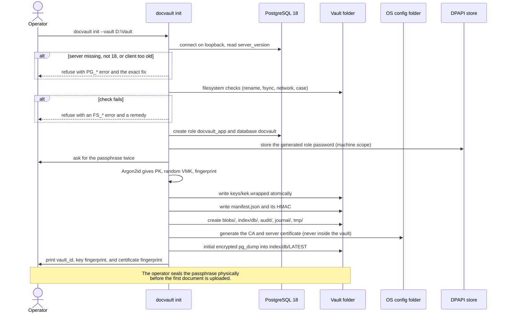

**Do not miss:** the PostgreSQL and filesystem checks both run *before* the passphrase is
requested, so a bad environment costs nothing. The database is never created, started, or
upgraded by the app; it is only used. TLS material is written outside the vault on purpose
(`08` §2). If the vault already exists and only the credential needs re-creating, `init
--reuse-vault` does that without touching `manifest.json` or `kek.wrapped`.

The client-tool version check and the initial dump are part of the same flow but not of the same
slice: `doctor` owns the `pg_dump` check, and the first `DVD1` dump arrives with S2b
([17 §7](17-implementation.md)).

## 2. Logging in, with TOTP

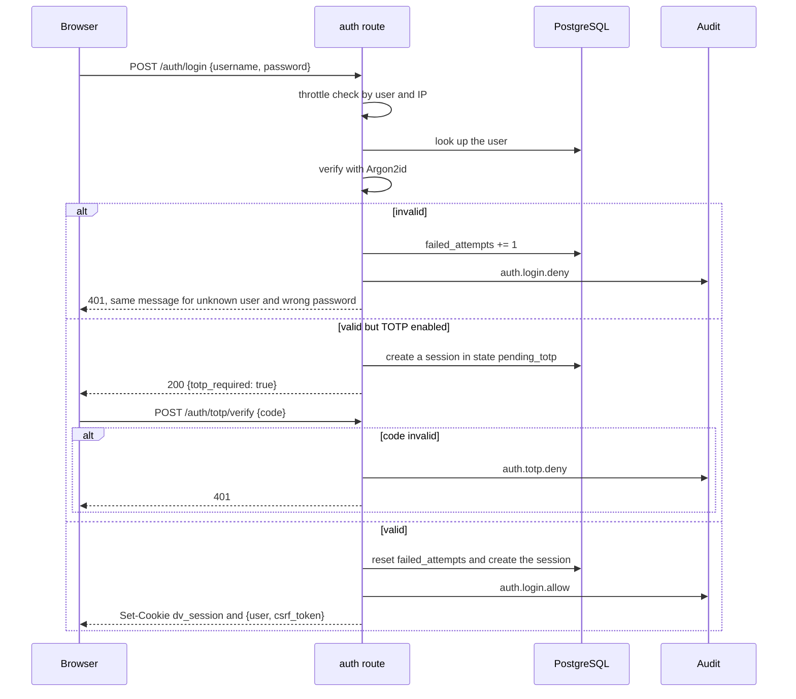

**Do not miss:** the response time and message are identical for an unknown user and a wrong
password. The TOTP step uses a short-lived pending session, not a full one.

## 3. Creating an entity with identifiers

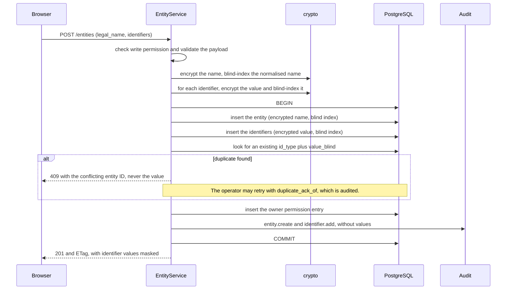

**Do not miss:** duplicate detection happens *inside* the transaction, against the blind index,
so it sees concurrent inserts. The conflict response names the other entity, never the value.

## 4. Uploading a document (create plus version 1)

```mermaid
sequenceDiagram
  participant B as Browser
  participant D as DocumentService
  participant C as crypto
  participant T as vault/tmp
  participant BL as vault/blobs
  participant DB as PostgreSQL
  participant AU as Audit

  B->>D: POST /documents (multipart, Idempotency-Key)
  D->>D: check the idempotency key; replay if known
  D->>DB: check write permission on every linked entity
  D->>D: check Content-Length is within max_file_bytes
  D->>C: new FK, wrapped under file_kek
  D->>T: write the 96-byte DVC1 header
  loop stream
    B->>D: chunk
    D->>C: AES-256-GCM under FK
    C-->>T: ciphertext
  end
  D->>C: sniff MIME from the first bytes and reject executables
  D->>T: pad, write the tag, fsync
  D->>C: address = HMAC(addr_key, salt + plaintext hash stream)
  D->>BL: rename .part to blobs/xx/yy/&lt;addr&gt;.blob, fsync the folder
  D->>DB: BEGIN, insert document, version, link, tag, owner entry, audit, COMMIT
  alt commit fails
    D->>BL: leave the blob as an orphan, never a dangling row
    D-->>B: 500 with a request_id
    Note over D,BL: Nightly verify lists orphans for cleanup.
  end
  D-->>B: 201 {document, version} and ETag
  Note over B,T: A client abort or size overflow removes the .part file,<br/>leaves no row and no blob, and returns 413 or a client abort.
```

**Do not miss:** MIME sniffing happens on the *plaintext stream*, before the file is accepted, so
a renamed `.exe` never reaches `blobs/`. The address is computed during streaming, so the
plaintext is never read twice.

## 5. Adding a version

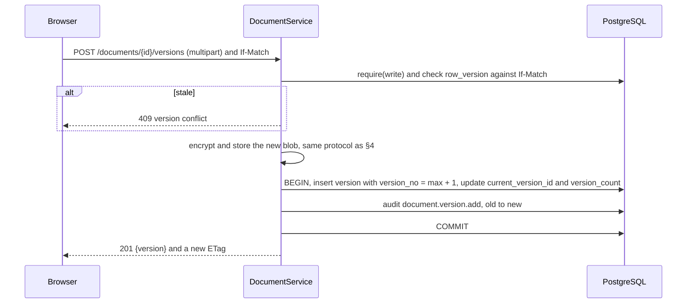

**Do not miss:** the previous version's row is never touched. `document_versions` rejects updates
to everything except `note` and `purged_at` (`04` §5).

## 6. Editing metadata from two clients

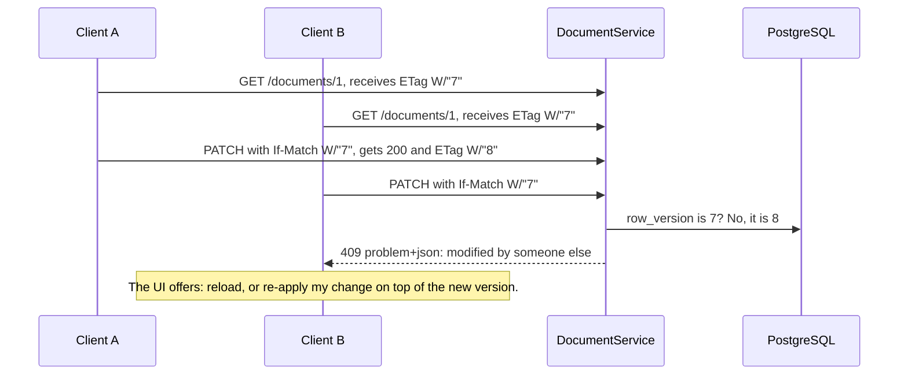

**Do not miss:** there is no last-write-wins. Silent metadata overwrites are how records end up
with the wrong PAN.

## 7. Granting access to a document

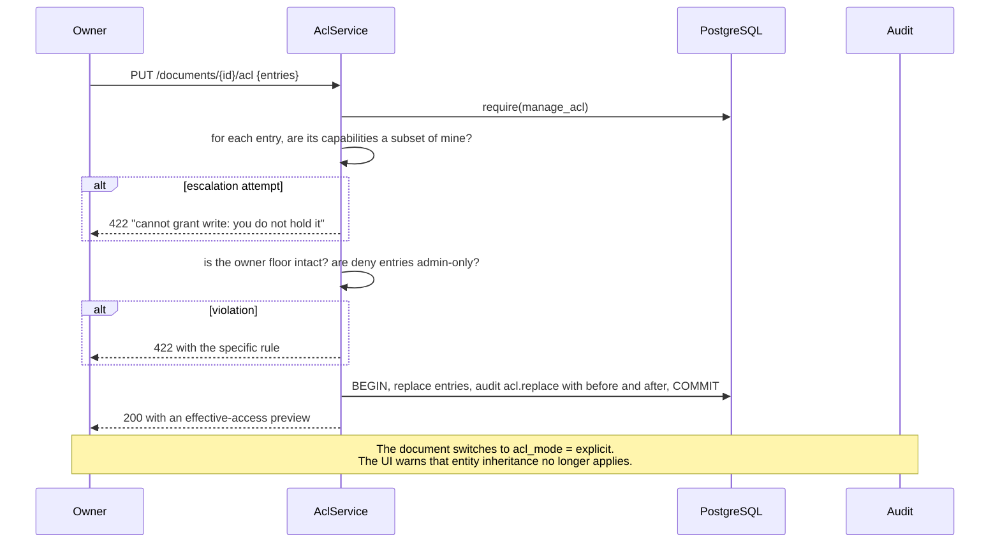

**Do not miss:** hard denies are admin-only, and the owner's floor cannot be removed. Otherwise a
document could be made invisible to everyone, including the person accountable for it.

## 8. Listing and searching

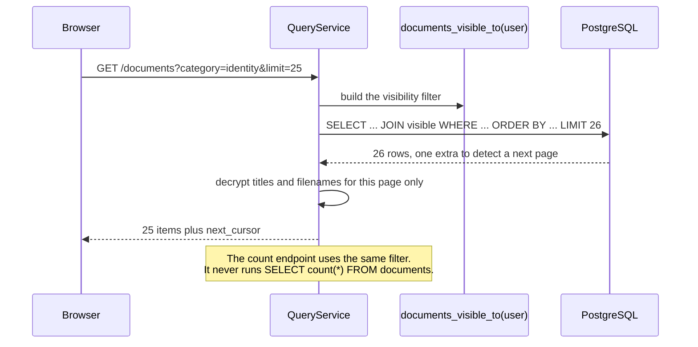

**Do not miss:** decryption happens per page, not per row set. The extra row avoids a second count
query, which would be a second place to get permissions wrong.

## 9. Downloading

```mermaid
sequenceDiagram
  participant B as Browser
  participant D as DocumentService
  participant DB as PostgreSQL
  participant FS as vault/blobs
  B->>D: POST /documents/{id}/versions/2/download-ticket
  D->>DB: require(read) and insert a ticket (token hash, user, IP, 60 seconds)
  D-->>B: {url: /api/v1/downloads/&lt;token&gt;, expires_at}
  B->>D: GET /api/v1/downloads/&lt;token&gt; with the session cookie
  D->>DB: ticket is valid, unused, matches user and IP, and has not expired
  alt any check fails
    D-->>B: 410, with no detail about which check failed
  end
  D->>DB: mark used_at
  D->>FS: open the blob, decrypt the header, unwrap the FK
  D->>D: stream-decrypt and verify the tag at the end
  D-->>B: 200 stream, attachment, no-store
  D->>DB: audit document.download with size and version
```

**Do not miss:** the ticket is consumed *before* streaming, so a mid-download failure needs a new
ticket. That is deliberate, to prevent retry abuse. A failed tag check aborts the response; the
client receives a truncated file, and the audit records the error.

## 10. Denied access: two different answers

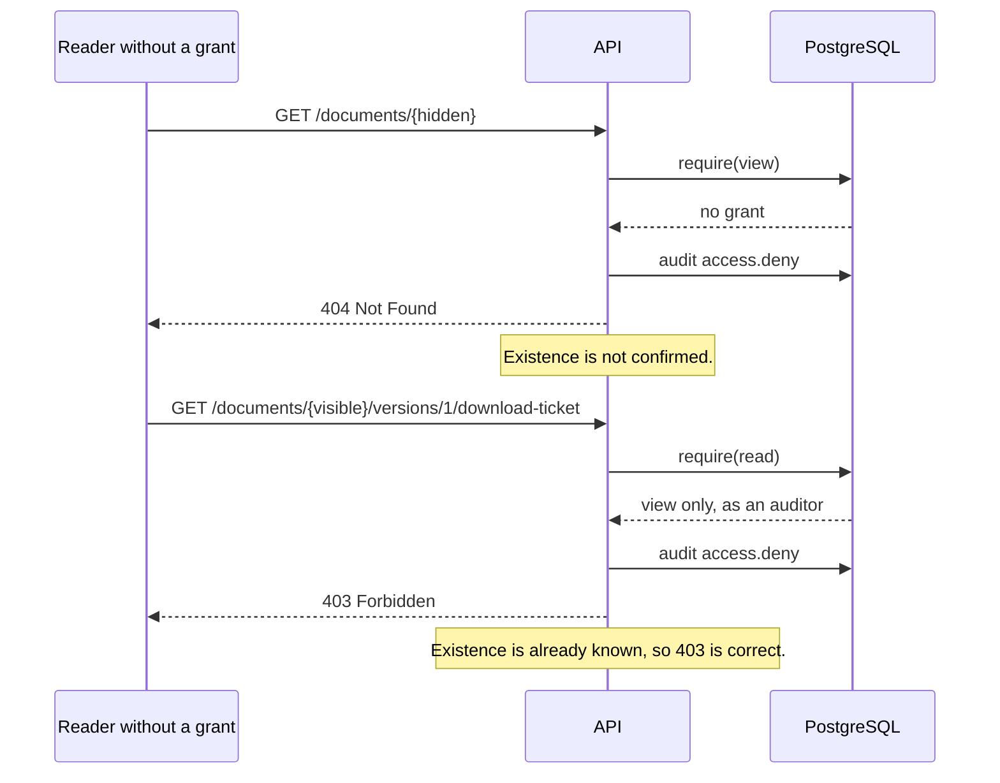

**Do not miss:** `deny` events are audited too. A pattern of 404s from one user is the earliest
sign that someone is probing.

## 11. Break-glass read

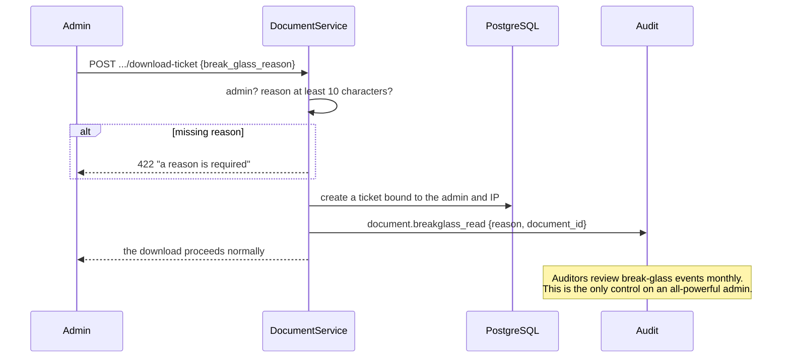

**Do not miss:** break-glass covers *content*. Admin metadata access is unrestricted, because
administering a vault means seeing what is in it.

## 12. Delete, restore, purge

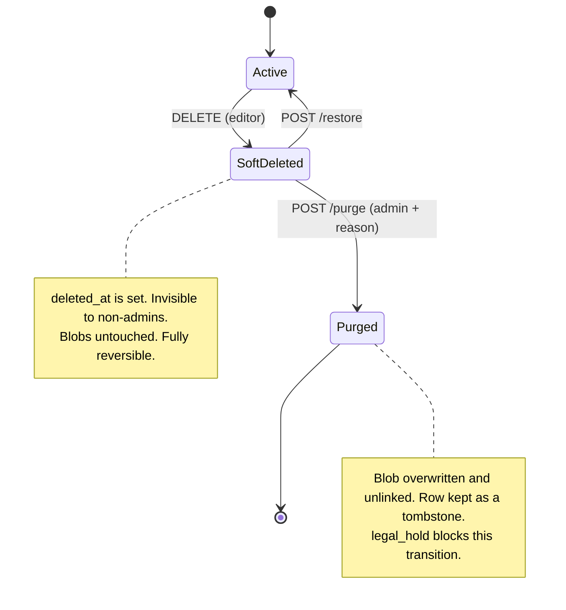

The purge sequence:

1. `require(admin)`, `reason` mandatory, `legal_hold = false`, and `deleted_at IS NOT NULL`.
2. Refuse if a retention obligation still applies (`purge_after` in the future).
3. For each version: overwrite the blob with random bytes, `fsync`, unlink.
4. Mark the versions and the document purged. Keep the tombstone row and the audit trail.
5. Write `document.purge` with the reason and a count.

> **Honest limitation:** overwriting is best effort. Copies in earlier backups remain readable
> with the passphrase. Backup retention is the only real control (ADR-011, R-2).

## 13. Nightly jobs

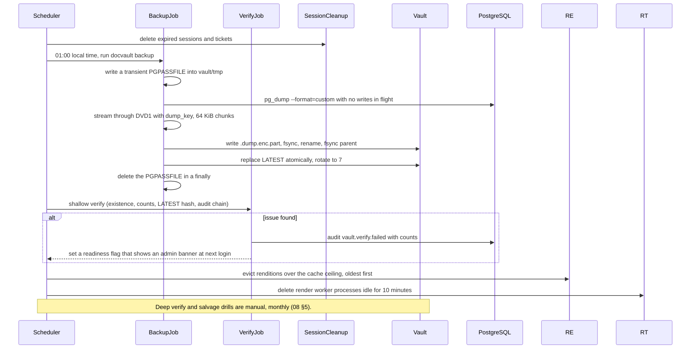

**Do not miss:** the dump is encrypted as it is produced, so the plaintext never lands in the
vault. `LATEST` is replaced only after the new file is complete and fsynced, so a failed backup
leaves the previous dump intact (`03` §9.2). The `PGPASSFILE` is deleted even when `pg_dump`
fails, because a credential left in `vault/tmp/` is worse than a failed backup.

---

## 14. Previewing and editing

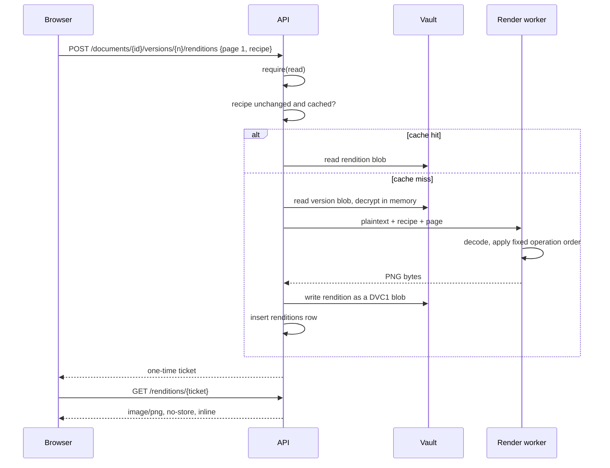

Saving the recipe is a separate, small write:

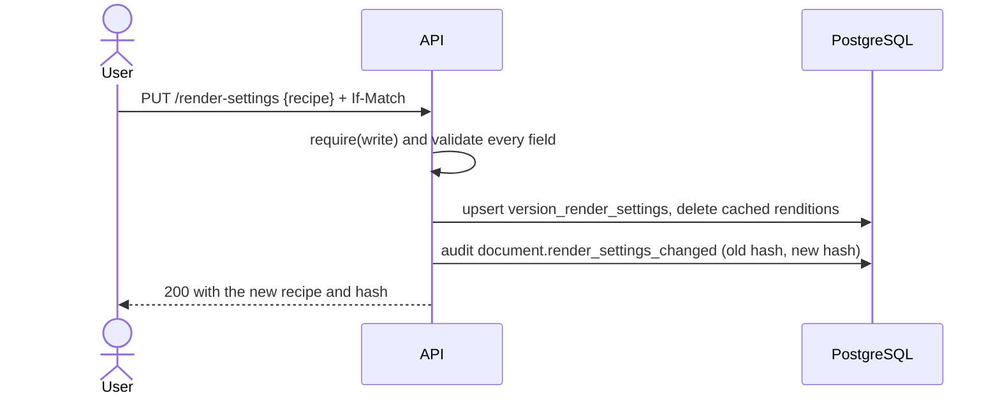

**Do not miss:** the recipe never touches the blob, `blob_addr` never changes, and
`version_count` stays as it was. That is the whole point of ADR-036. A user who brightens a scan
has not created a new document, and the history should not pretend otherwise.

### What happens if the recipe is wrong

Every edit is reversible, because the original bytes are untouched. `DELETE /render-settings`
returns the version to "as stored". This is the reason the editor can be offered to non-experts:
the worst outcome is an ugly preview, not a damaged record.

### Rendition failure

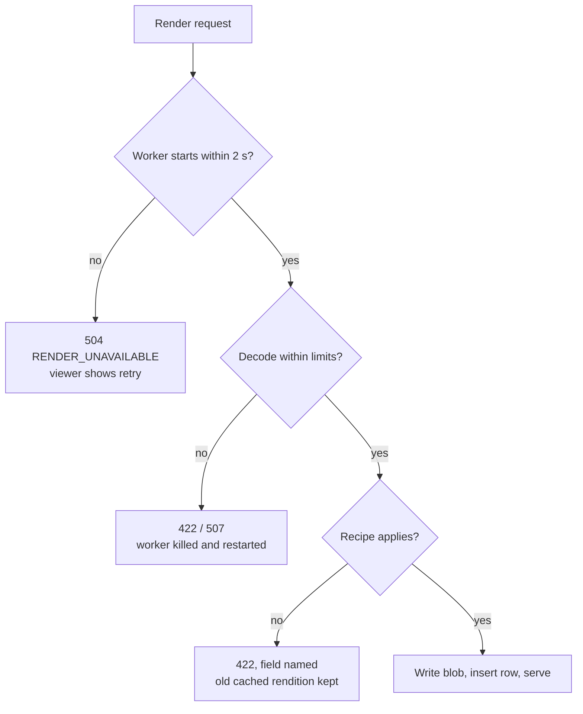

A failed render never deletes an existing cached rendition, so a bad edit cannot make a previously
working page disappear.

---

## 15. Printing a selection

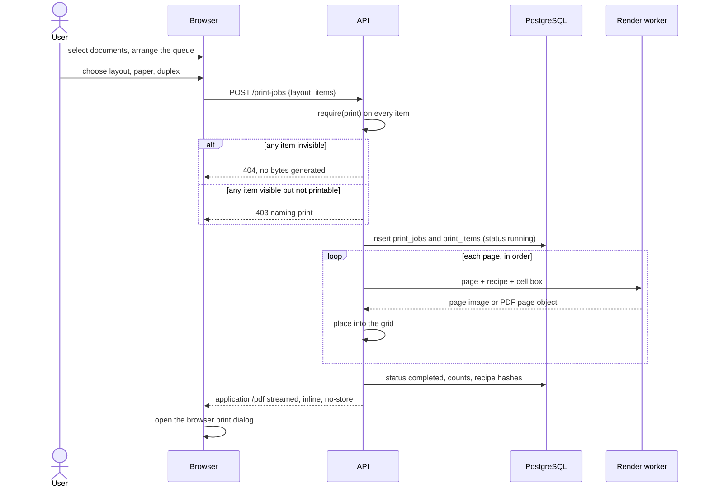

**Do not miss:** the job row is written **before** any rendering, so a crash still leaves a
record. Nothing is written to the vault. The PDF exists in the API's response stream, in the
browser's memory, and then on paper.

### When authorisation is checked

Once, at job creation. If a permission is revoked while a 200-page job is rendering, the job
finishes. The alternative — re-checking per page — produces a half-printed packet, which is worse
than a print that was authorised when it started. This is stated in `12` §11 rather than left
implicit.

### What the user can fix without the app

| Problem | Fix |
|---|---|
| Output scaled down | Set scaling to 100 % in the printer dialog |
| Single-sided | Set duplex in the printer dialog |
| Wrong paper | Change the tray, or change the paper size in the dialog |
| Landscape rotated wrongly | Choose the flip edge in the dialog, not the printer |
| Blank back pages | Expected when the page count is odd (`12` §5) |

---

## 16. Failure matrix

| Failure point | State on disk | State in database | Recovery |
|---|---|---|---|
| Client aborts an upload | `.part` removed | Nothing | None needed |
| Process killed after rename, before commit | Orphan blob | Nothing | `verify` lists it; harvest or ignore |
| Process killed mid-commit | Blob present | Rolled back | Orphan, as above |
| Power loss after blob `fsync` | Blob intact | Rolled back | Orphan |
| Power loss before `fsync` | Possibly truncated blob | Nothing | Orphan, detected by address mismatch |
| PostgreSQL not running | Vault intact | Unavailable | Service fails to start with `DB_UNAVAILABLE`. Start PostgreSQL; do not retry in a loop. |
| PostgreSQL disappears during a request | Vault intact | Connection lost | The transaction rolls back. Return `503`. No partial write. |
| Disk full during a dump | Previous `LATEST` intact, `.part` removed | Unchanged | Free space and retry. Never overwrite `LATEST` until success. |
| Process killed during a dump | Previous `LATEST` intact, stale `.part` swept | Unchanged | The previous dump is still valid. |
| Dump chunk fails its tag | That `.enc` is unusable | Unchanged | Fall back to the previous dump. Truncation is detected, not repaired. |
| Process killed during a restore | Partial database | Partial | Drop and recreate the database, then retry from `LATEST`. The vault is untouched. |
| Database corrupt | Blobs intact | Lost | `restore` from `LATEST`; the journal explains the gap |
| Render worker crashes mid-preview | Cache unchanged | Nothing | Next request restarts the worker. The document is untouched. |
| Render worker killed by its memory ceiling | Cache unchanged | Nothing | Typed `507`; the page is skipped, other pages still render |
| Process killed while writing a rendition | `.part` swept later | Rendition row not committed | Cache miss on next request. No data loss. |
| Process killed mid-print | No print artifact | Job stays `interrupted` | Next service startup marks it `failed` and appends the terminal audit event. |
| Print client closes the tab mid-stream | Nothing written | Job `completed` with bytes sent | The user prints again. Two jobs, two records. |
| Rendition cache deleted entirely | Documents and dumps intact | `renditions` rows dangle | Harmless. Rebuilt on demand. `verify` reports 0 problems. |
| Vault folder lost | — | Intact | Metadata is useless without content. Restore the folder from backup. |
| Both lost | — | — | Total loss. Only a physical backup copy can help. |
