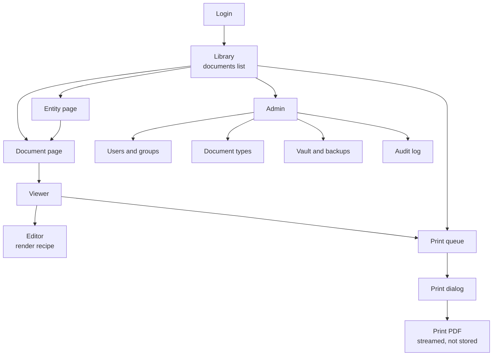
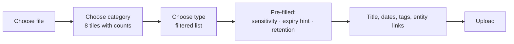
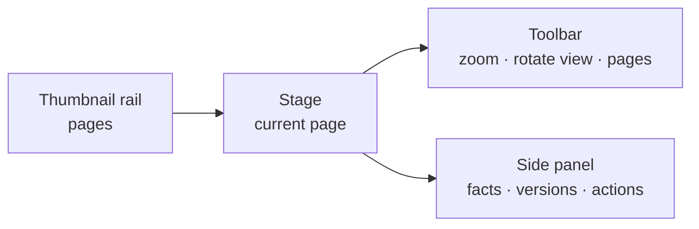

# 11 — Frontend and Viewer

> **In plain words:** This is the screen-by-screen design of the thing people actually touch. The
> job it has to beat is "open the file, paste it into Word, resize it, print it, repeat forty
> times". Every screen here exists to make that loop shorter, without making the vault weaker.
>
> **Read this if:** you are building the React app, you are deciding what goes on a screen, or you
> need to know what a clerk can and cannot do from the browser.
>
> **Using it rather than building it?** `16-user-guide.md` is the task-oriented version of this
> page, written for staff.

---

## 1. The job the screens have to do

A clerk has a client's paperwork in front of them and a deadline. Three tasks, in order of how
often they happen:

| Task | How often | Today | What it must become |
|---|---|---|---|
| **Store** a document someone just handed over | Daily | Copy into a folder, name it badly | Drop a file, confirm name and type, done |
| **Find** a document again | Daily | Ask a colleague, search folders | Type an entity name, see the list |
| **Print** a set of documents | Weekly, in bursts | Paste into Word, resize, print, repeat | Select, arrange, choose a grid, print |

Everything else — permissions, audit, versions — has to be present but quiet. A records system
that makes the clerk think about ACLs will be worked around.

### The one rule that shapes every screen

> **The browser never computes what gets printed.**

The server renders the image, applies the edit recipe, and builds the print PDF. The browser
shows the result and asks for changes. If the browser did the rendering, what a person sees and
what the printer receives could drift apart, and nobody would notice until a client complained
about a document that "looked fine on screen".

## 2. The screen map



Nine screens, no more. A screen that does not map to one of the three tasks in §1 has to justify
itself.

## 3. Design rules

| # | Rule | Why |
|---|---|---|
| F-1 | **Density over decoration.** Tables, compact rows, no hero images. | This is a records tool used all day. |
| F-2 | **Keyboard first.** Every frequent action has a shortcut (`11` §11). | Mouse round-trips are the hidden cost in the old workflow. |
| F-3 | **Nothing is saved without saying so.** Every mutation ends in a visible, named state. | Silent saves are how people lose work. |
| F-4 | **No optimistic rendering of content.** Show the server's rendition, even if it costs 150 ms. | Preview must equal print. |
| F-5 | **State is in the URL.** Filters, page, selection, open document. | A clerk must be able to send a colleague a link to what they are looking at. |
| F-6 | **Destructive actions name what they destroy.** "Delete 3 documents", not "Delete". | Speeds up the common case and slows down the dangerous one. |
| F-7 | **The app never guesses.** No auto-grouping, no auto-naming, no auto-pairing. | Stated requirement: the app does not invent its own logic. |
| F-8 | **Every blocked action says which permission was missing.** | "You need print access on this document", not a bare 403. |

Rule F-8 has one exception: a user who cannot `view` a document gets `404`, not an explanation.
Existence itself is protected (`06` §7).

## 4. Library — the home screen

The default landing page after login. It answers "what did I just do, and what do I need next".

| Region | Content |
|---|---|
| Top bar | Search box (entity, title, document number), user menu, vault status badge |
| Filter rail | **Category** (eight, with counts), then document type inside the chosen category; entity type, status, sensitivity, expiry window, tags, "only mine" |
| Results | Virtualised table: title, entity, type, date, versions, confidentiality badge |
| Right panel | Opens on selection: quick facts, open, download, print, add to queue |
| Footer bar | Selection count and batch actions |

The category list is the primary filter because it is the question a clerk actually asks: "where
are the property papers?" It is rendered as eight rows with counts, not a dropdown, so the shape
of the archive is visible at a glance (`13` §8). Choosing a category narrows the type list
underneath it; choosing a type is optional.

Columns are fixed to six. More columns make the table unusable at 1366 px, which is the smallest
screen we support.

### Batch selection

- Click selects one. `Ctrl`/`Cmd`-click toggles. `Shift`-click extends from the anchor.
- `Ctrl+A` selects the whole **filtered set**, not the visible page.
- The footer always states the true count: "37 selected (all on this filter)".
- Batch actions available: **add to print queue**, **tag**, **change document type**, **delete**.
  Not available in bulk: rename, change ACL. Those are per-document decisions.

### Empty and loading states

| State | What is shown |
|---|---|
| No documents at all | One sentence and a "Add the first document" button |
| Filter matches nothing | What was filtered, plus a "clear filters" link |
| Loading | Skeleton rows, never a spinner over a blank page |
| Partial failure | The rows that loaded, plus a retry banner naming what failed |

### 4.1 Upload dialog

Classification is the first step, because it decides the defaults for everything after it.



| Field | Behaviour |
|---|---|
| Category | Required before the type list unlocks. Eight fixed choices (`13` §4). |
| Type | Required. The only field that determines the category; there is no separate category column to disagree with it. |
| Sensitivity | **Never blank.** Pre-filled from `doc_types.default_confidentiality`; the user may raise it. Lowering it is admin-only and the control is disabled with a reason otherwise. |
| Expiry date | Shown and required when the type has `requires_expiry`. |
| Entity links | Pre-filled when the dialog is opened from an entity page. |

The dialog posts `doc_type_id` and an optional `confidentiality`; the server resolves the default
so a client bug cannot create a document with no classification (`07` §5.1).

## 5. Entity page

Two columns. Left: identity — legal name, type, identifiers, registered address, contact. Right:
**Documents**, grouped by **category**, then by type inside it, with the count and the newest
date.

Above the document list, three actions:

| Action | Result |
|---|---|
| **Add document** | Opens the upload dialog with the entity pre-linked |
| **Add to print queue** | Adds every document of the entity, in category then type order (`13` §8) |
| **Print packet** | Opens the print dialog with the whole set pre-loaded (`12` §10) |

"Print packet" is the due-diligence workflow in one click. It is not a merge and it changes
nothing: it is a pre-filled print queue.

## 6. Document page

Shows one document. Sections, in this order:

1. **Header** — title, entity links, **category › type**, status badge, confidentiality badge.
2. **Preview strip** — the current version's first page as a thumbnail. Click to open the viewer.
3. **Facts** — issue date, expiry date, document number, issuer, tags.
4. **Versions** — a list, newest first: version number, date, uploader, size, format, note.
5. **Permissions** — who can see, read, print, edit, delete; whether it inherits from the entity
   or is explicit.
6. **History** — audit entries for this document.

Actions in the header: **Open**, **Print**, **Add version**, **Edit**, **Delete**. Each is hidden
or disabled with a reason, per F-8.

The permissions panel states inheritance in words, not icons:

> This document follows **Acme Pvt Ltd**'s permissions. 4 people can read it, 2 can print it.

## 7. The viewer

The viewer is a full-width overlay, not a new page. `Esc` closes it and returns to the exact list
scroll position.

### Layout



### Behaviour

| Feature | Detail |
|---|---|
| Zoom | 25 % to 800 %, `+`/`-`, `0` to fit, `1` for 100 % |
| Pan | Drag when zoomed past the stage; no scrollbars inside the stage |
| Page navigation | `PageUp`/`PageDown`, arrow keys, thumbnail rail |
| Fit modes | Fit page, fit width, actual size |
| Rotate view | 90° steps, **view only** — saved rotation belongs in the recipe (§8) |
| Multi-page | PDF shows one page at a time with a thumbnail rail |
| Formats | JPEG and PNG: direct. PDF: PDF.js canvas. Office: the stored PDF conversion. |
| Watermark | The viewer shows a diagonal user-ID overlay by default (R-7) |

### Why the server renders PDF pages

Browsers cannot be trusted to render a PDF the same way twice, and a client-side renderer would
put a third-party parser inside every browser session. The server rasterises the page and returns
a PNG, so there is one decoder implementation, in the sandboxed worker, and what is on screen
matches what will be printed.

### Rendition requests

Previews come from the rendition endpoint (`07` §5.4), not from the blob:

- The URL carries a one-time ticket, valid 60 seconds, single use.
- The response is `Content-Disposition: inline` and `Cache-Control: no-store`.
- The browser therefore cannot serve a preview from its disk cache after the session ends.
- A rendition is generated on demand on the first request and then cached, encrypted.

## 8. The editor

The editor changes **how a version is rendered and printed**. It never changes the stored bytes.

### Controls

| Group | Controls | Notes |
|---|---|---|
| Geometry | Rotate left / right, straighten ±15°, crop | Applied in that order, always |
| Tone | Brightness, contrast, gamma | Range −100 to +100 |
| Colour | Grayscale, invert | Toggles |
| Scan cleanup | Threshold (bilevel), despeckle | For fax-quality and photocopied scans |
| Framing | Auto-trim white border, margin trim | Crops uniform page edges |

### How it works

1. The client sends the recipe as JSON to the rendition endpoint.
2. The server renders a low-resolution preview (longest edge 1200 px) in the worker.
3. Slider changes are debounced by 150 ms; the previous request is cancelled.
4. **Save** writes the recipe to `version_render_settings` and requires `write`.
5. **Reset** restores the neutral recipe. It never touches the blob.

The order of operations is fixed and applied server-side:

```text
rotate -> straighten -> crop -> grayscale -> invert -> brightness
       -> contrast -> gamma -> threshold -> despeckle -> auto-trim
```

A fixed order matters: brightness before threshold and after threshold give different results,
and the recipe has to mean the same thing forever.

### What the editor deliberately does not do

| Not built | Why |
|---|---|
| **Redaction** | A black rectangle drawn in the browser is a lie: the pixels are still underneath, in the blob and in any rendition cache. Real redaction means new bytes and a destroyed original. That is a different feature with a different audit story. |
| **Annotation, signatures, stamps** | These are new content, not a rendering choice. They would need versioning and a provenance story. |
| **Merging pages** | Out of scope. One document is one file. |
| **Saving as a new version** | Not automatic. If someone wants a cleaned-up file as a new version, they export, then upload it as version *n+1*. That is explicit and auditable. |

### Why the recipe is not a version

Brightness and crop do not change what the document *is*. Versioning them would produce a sagging
history of near-identical entries and make "which file did we store" ambiguous. The rule is
simple: **the recipe changes the picture, never the record.**

The cost is stated plainly in `10` ADR-036: a printout produced before a recipe change cannot be
reproduced exactly afterwards. The print job stores the recipe hash so the difference is provable,
not invisible.

### Honest limitation: threshold and quality

Threshold and despeckle can make text unreadable if pushed too far. The preview is the warning,
and the blob is untouched, so **Reset always recovers the original**. This is a strong argument
for the recipe model over destructive editing.

## 9. The print queue

The queue is a **flat, ordered list**. Not a tree, not a set of groups, not a packet with sections.
Order is the only structure, and the user controls it.

| Column | Content |
|---|---|
| # | Position, drag handle |
| Thumbnail | First page of the version |
| Document | Title and entity |
| Version | Which version, with a warning if it is not current |
| Pages | Page count, editable range (`12` §7) |
| Actions | Up, down, remove, duplicate |

### Rules

| Rule | Reason |
|---|---|
| **Every item is one version of one document.** | No page-level picking across documents. Page ranges stay inside one document. |
| **The queue survives navigation.** It lives in a store keyed by session, not in the page. | A clerk adds items from three different entity pages. |
| **A version that is not current is flagged.** | Printing an old version is legitimate, but must be deliberate. |
| **Removing an item never deletes a document.** | The queue is a plan, not a container. |
| **The queue is not saved server-side before printing.** | It is a client-side plan until "Print" creates a job. |

Reordering: drag and drop, plus `Alt+↑` / `Alt+↓` for keyboard users. Order is preserved exactly.

### Why no grouping

A clerk printing PAN fronts and backs has two documents and wants them adjacent. With a flat list
that is `Alt+↑` twice. A grouping model would need rules for what a group is, what happens when
someone drags into the middle of one, and how groups map onto sheets — and every one of those
rules is a decision the app should not be making for the user.

## 10. The print dialog

One dialog, three tabs: **Layout**, **Paper**, **Preview**.

| Tab | Controls |
|---|---|
| Layout | Cells per side (1, 2, 4, 6, 9), simplex or duplex, flip edge, fill order |
| Paper | Paper size, orientation, margins, fit mode (contain or fill cell) |
| Preview | Page-through of the actual generated PDF, sheet and side numbers shown |

The preview is the generated PDF rendered by the same PDF.js build, so what is paged through is
literally the file that will be printed. There is no separate preview renderer to drift.

The dialog shows the computed totals before printing:

> 37 pages · 4 per side · duplex · 10 sides · **5 sheets**

If the numbers look wrong, the clerk sees it before the paper is spent. That single line replaces
most of the trial-and-error printing in the old workflow.

The footer carries the one instruction the app cannot enforce:

> In your printer dialog choose **Duplex: flip on long edge**, **Actual size**, and **no scaling**.

Browsers and printer drivers override each other on scaling, so the app says it once, loudly,
rather than pretending it controls the printer.

## 11. Keyboard map

| Key | Action |
|---|---|
| `Ctrl+K` | Search |
| `Ctrl+A` | Select all in the filtered set |
| `Space` | Toggle selection of the focused row |
| `Enter` | Open the focused document |
| `Esc` | Close overlay, clear selection |
| `←` / `→` | Previous / next page in the viewer |
| `+` / `-` | Zoom in / out |
| `0` | Fit page |
| `1` | Actual size |
| `R` / `Shift+R` | Rotate view clockwise / anticlockwise |
| `E` | Open the editor |
| `Q` | Add selection to the print queue |
| `Ctrl+P` | Open the print dialog (**not** the browser print dialog) |
| `Alt+↑` / `Alt+↓` | Move the focused queue item |
| `Delete` | Soft-delete the selection, after naming it |

Shortcuts are disabled while a text field has focus. `Ctrl+P` is intercepted deliberately: the
browser's own print would print the screen, not the document.

## 12. Loading, failure, and honesty

| Situation | Behaviour |
|---|---|
| Rendition taking longer than 1 s | Progress indicator on the stage, with the page number |
| Rendition failed | The page shows "Could not render" and a retry; it never shows a blank white page |
| Document deleted while viewing | A banner: "This document was deleted by <name>", viewer closes on dismiss |
| Permission revoked while viewing | Next request returns `404`; the viewer closes with an explanatory message |
| Session expired | Modal re-login, then the same request is retried once |
| Vault locked | Full-screen notice; no partial UI that looks usable |
| Print job too large | Named limit, with the number of pages that exceeded it (`12` §11) |

A blank page is never a valid state. It is indistinguishable from a rendering attack or a
corrupted file, so the UI always says which one it is.

## 13. Accessibility and screen sizes

- Full keyboard operation, visible focus rings, no keyboard traps in overlays.
- Colour is never the only signal: badges carry text.
- Minimum supported viewport: 1280 × 720. The layout is designed at 1366 × 768.
- Contrast meets WCAG 2.2 AA for text; the density rules in §3 do not override this.
- The viewer works at 200 % browser zoom without horizontal scrolling.

## 14. Performance budget

| Interaction | Budget |
|---|---|
| Library first paint | 400 ms on LAN |
| Row scroll | 60 fps with 10,000 rows in the filtered set (virtualised) |
| Thumbnail load | 200 ms each, lazy, six ahead of the viewport |
| Viewer page change | 250 ms for an already-cached rendition |
| Editor slider feedback | 150 ms after debounce, at 1200 px |
| Print dialog preview, first sheet | 1 s |

Budgets are measured on the production host with a client on the same switch. If a budget is
missed the feature is wrong, not the network.

## 15. What the frontend must never do

| Never | Why |
|---|---|
| Hold a key, passphrase, or derived key | There is no reason, and it widens the blast radius of a browser compromise |
| Render a document the API did not authorise | The server decides; the UI only displays |
| Cache document bytes in `localStorage` or IndexedDB | It survives logout and is not covered by `no-store` |
| Build the print PDF client-side | Preview and output would diverge |
| Hide a permission failure behind a generic error | F-8: name the missing permission |
| Implement its own permission logic | One gate, server-side (`06` §6) |

The only client state that persists across reloads is UI preference: theme, column widths, last
filter. Selection and the print queue live in `sessionStorage` and are cleared on logout.

## 16. Screens we are not building in v1

| Screen | Why not |
|---|---|
| Dashboard with counts and charts | Nobody's job is "look at a dashboard". The library is the home screen. |
| Folder tree | Documents inherit from entities, not folders (ADR-018). |
| Drag-and-drop filing between entities | One drag must not silently re-scope permissions. |
| Bulk metadata editor | Bulk rename is how records get wrong. |
| Mobile layout | The host is a desktop; phones are not part of the workflow. |
| Document chat or comments | Not a requirement, and a second content surface to protect. |
