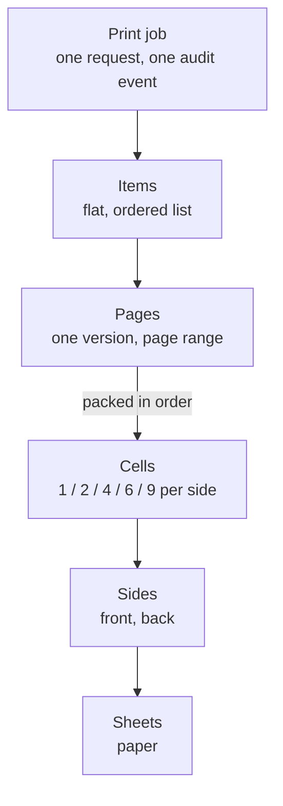
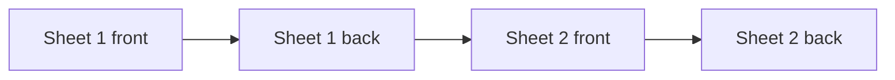
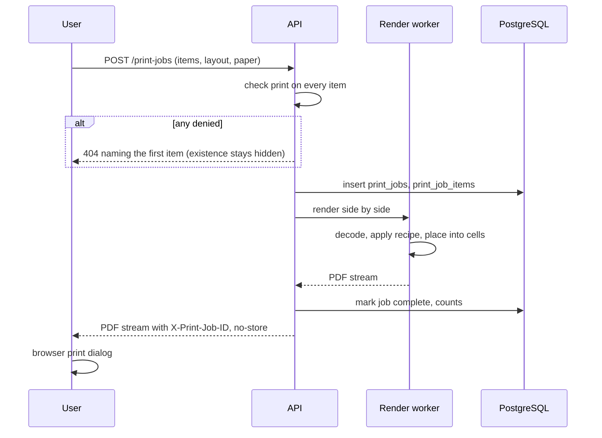

# 12 — Printing

> **In plain words:** This is how a pile of stored documents becomes paper. You choose documents,
> put them in the order you want, say how many go on a page, and the server builds a print-ready
> PDF. You print it from your own computer to your own printer. The app never touches the printer
> and never keeps the PDF.
>
> **Read this if:** you are building the print composer, you are choosing layout defaults, or you
> need to know why a printout came out the way it did.

---

## 1. What printing means here

| Decision | Value |
|---|---|
| Where the paper comes out | **The user's own desk**, from their own printer |
| Who can print | Anyone with the `print` capability on every document in the job |
| What the server produces | One print-ready PDF |
| Where the PDF lives | In memory and in the user's browser. **Never on disk, never in the vault.** |
| Does the app control the printer | **No.** No spooler, no driver, no printer discovery, no tray selection |
| Is the output audited | Yes, as an event with document IDs and counts (`12` §12) |

This is the whole reason the feature is safe to build: the server never needs to know what printer
exists, and there is no new plaintext artifact to purge.

### Why client-side rather than host-side

The host is one desktop in an office. If the app sent jobs to the host's spooler, it would need
the host to reach every printer in the building, would inherit a much larger attack surface, and
would break the moment someone's printer was on a different subnet. Letting each clerk print to
their own printer is both simpler and closer to how the office already works.

## 2. The model

Five levels, and only one of them is compositional.



| Level | Meaning | Who controls it |
|---|---|---|
| **Job** | One print request with fixed settings | The user, at the print dialog |
| **Item** | One version of one document | The user, by adding to the queue |
| **Page** | One page of that version, inside a range | The user, by editing the range |
| **Cell** | One slot on a side | The grid setting |
| **Side** | One printable face of a sheet | `cells_per_side` × page count |
| **Sheet** | One piece of paper | Duplex on or off |

**The only composition is the grid.** The app does not merge documents, does not reorder across
documents, and does not decide what belongs together. It fills cells in the order given.

```text
pages_per_side  = cells_per_side
pages_per_sheet = cells_per_side × (2 if duplex else 1)
sheet_count     = ceil(total_pages / pages_per_sheet)
```

## 3. Grid layouts

| Cells | Grid | Reading order | Typical use |
|---:|---|---|---|
| 1 | 1 × 1 | — | A contract, a deed, one page per sheet |
| 2 | 1 col × 2 rows | top, bottom | Two A5 halves of one A4 sheet |
| 4 | 2 × 2 | top-left, top-right, bottom-left, bottom-right | ID cards, four to a sheet |
| 6 | 2 cols × 3 rows | as above, row by row | Small certificates |
| 9 | 3 × 3 | as above, row by row | Thumbnails and contact sheets |

Reading order is **left to right, then top to bottom**, always. There is no "column-first" mode in
v1: it is a second option that confuses more people than it helps.

### Cell geometry

```text
page_box  = paper − margins (all four sides)
col_width = (page_box.width  − gutter × (cols − 1)) / cols
row_height= (page_box.height − gutter × (rows − 1)) / rows
cell      = grid position (col, row) at that size
```

| Setting | Default | Range |
|---|---|---|
| Gutter between cells | 4 mm | 0–12 mm |
| Page margin | 5 mm | 0–25 mm, in 5 mm steps |
| Fit mode | **Contain** | Contain (whole page visible) or Fill (crop to cell) |

**Contain is the default on purpose.** Fill crops, and cropping a document in a print job is
exactly the kind of silent decision that produces a complaint six months later. If a clerk wants
Fill they choose it, and the preview shows the crop.

## 4. Fit and resolution

```text
scale = min(cell.width  / page.width,
            cell.height / page.height)
```

| Rule | Detail |
|---|---|
| **Never upscale past 100 %** | A 300 dpi PAN card scan is not stretched to fill an A4 cell. Blurring a record to fill space is a downgrade. |
| Scale down freely | A large page shrinks to fit; the preview shows the result |
| Centre in the cell | No top-left alignment; margins look accidental |
| Preserve aspect ratio | Always, in both fit modes |
| Black and white stays black and white | A scanned bilevel page is not converted to 24-bit colour, and stays small |

### Resolution targets

| Source | Rule |
|---|---|
| Raster image at ≥ 300 dpi for its printed size | Embedded as-is, no resampling |
| Raster image above 600 dpi | Downsampled to 600 dpi for the job. 600 dpi is already past what a laser printer resolves. |
| Raster image below 150 dpi | Printed as-is, with a warning in the dialog naming the page |
| PDF page | Page objects transformed, **never rasterised**. Vectors and text stay vectors. |

A 4-up A4 cell is roughly 105 × 148 mm. At 300 dpi that is about 1240 × 1750 px. A phone photo of
a PAN card is usually 3000 px wide, so it is comfortably inside the no-upscale rule.

## 5. Sides and duplex



The generated PDF is a **flat sequence of sides in printer order**: front, back, front, back. That
is the order a duplex printer expects from a single PDF.

| Job setting | Generated PDF | Printer setting the user must choose |
|---|---|---|
| Simplex | One page per sheet, no blank backs | Single-sided |
| Duplex, long edge | front, back pairs | Duplex, **flip on long edge** |
| Duplex, short edge | front, back pairs | Duplex, flip on short edge |

**Long edge is the default** because it is the correct choice for portrait documents, which is
almost all of them. The dialog shows the required printer setting in words (`11` §10) because the
PDF cannot carry it. A PDF is a document, not a job ticket.

### Odd page counts

If the last sheet has only one side's worth of pages, the other side is left unpaginated and
prints blank. The app does not add a blank filler page — an empty page in the PDF is a page the
user did not ask for, and some drivers will still count it.

### Front and back as separate documents

A PAN card front and back are two documents, each with its own type, owner, and permissions. To
print them as one sheet's two sides:

1. Add both items to the queue, front first.
2. Choose **1 per side, duplex**.
3. The front becomes sheet 1 front, the back becomes sheet 1 back.

There is no pairing rule, no validation that a front has a back, and no automatic adjacency. The
document type may carry a `side` hint (`front`, `back`, or blank), which is used only to sort a
pre-filled queue. It enforces nothing (`04` §5).

## 6. Source formats

| Format | How it reaches the page | Notes |
|---|---|---|
| **JPEG** | Embedded directly as `DCTDecode` | No recompression. A re-encoded JPEG loses quality every time. |
| **PNG** | Embedded losslessly | Alpha flattened onto white; a transparent page prints white. |
| **PDF** | Page objects imported and placed | Vector content preserved; no rasterisation. Multi-page native. |
| **Office (DOC, DOCX, ODT)** | The version's stored PDF conversion | Converted once at ingest (`10` ADR-038), never at print time |

Everything is embedded **after** the version's render recipe is applied, so what is printed is
what the viewer showed.

### Why PDF pages are transformed, not rasterised

Rasterising a PDF page to fit it into a cell would turn crisp text into a 300 dpi image of text. It
would also mean feeding the page through two renderers instead of one, doubling the parser surface
for no gain. Transforming the page's placement matrix is both sharper and cheaper.

## 7. Page ranges

A range is set per item, in the queue.

```text
syntax   := part ("," part)*
part     := page | page "-" page | page "-" | "-" page
page     := positive integer
```

| Input | Means |
|---|---|
| `all` or empty | Every page |
| `3` | Page 3 only |
| `2-5` | Pages 2 through 5 |
| `4-` | Page 4 to the end |
| `-2` | Pages 1 and 2 |
| `1,3,7-9` | Page 1, page 3, pages 7 to 9 |

Rules:

- Pages are 1-based as displayed to the user.
- Out-of-range pages are a `422` naming the item and the bad part. Never silently clamped —
  clamping means printing the wrong page and not knowing.
- The page count shown in the queue updates as the range changes.
- A range does not change the stored document. It is a view onto the version.

## 8. What the generated PDF contains

| Property | Value |
|---|---|
| Producer | The app, with its version |
| Pages | One per **side**, in printer order |
| Metadata | No title, no author, no subject, no keywords, no XMP |
| Fonts | Only fonts from embedded vector content; none added |
| Bookmarks | None |
| Forms, JavaScript, attachments | Never. Rejected at generation, not just ignored. |
| Encryption | **No.** The PDF is plaintext by necessity — it is about to be printed. |

No document metadata is written into the PDF, because PDF metadata rides into print spool files
and email attachments long after the job is done.

## 9. Generation



- The PDF is streamed as it is produced, so a 200-page job does not wait for the last page.
- Nothing is written to the vault. There is no print output blob and no rendition of the job.
- The job row exists so the print is auditable and reproducible from its inputs.

If the stream breaks mid-transfer, the browser gets a truncated PDF and the printer will refuse
it. That is a failure the user can see, which is the safe direction.

## 10. Presets and the entity packet

### Presets

A preset stores layout and paper settings only: cells, duplex, flip edge, paper size,
orientation, margins, gutter, fit mode. It never stores documents, and it is not private —
presets are shared so an office can agree on "4-up duplex A4".

| Built-in preset | Settings |
|---|---|
| **Single page, A4** | 1-up, simplex, 5 mm margin |
| **Two up, A4** | 2-up, simplex, 5 mm margin |
| **ID cards, 4-up duplex** | 4-up, duplex long edge, 5 mm margin, 4 mm gutter |
| **Packet, 2-up duplex** | 2-up, duplex long edge, 10 mm margin, 5 mm gutter |

### The entity packet

"Print packet" on an entity page pre-fills the queue with every document of that entity, sorted
by **category**, then document type, then `side` (front before back), using the
**Packet, 2-up duplex** preset.

The category order is the seeded `sort_order`: identity, property, legal, corporate, financial,
employment, insurance, other (`13` §4). That order is deliberate — it is roughly the order in
which a due-diligence file is checked, so a bundle comes out the way a reviewer reads it. Within a
category, types sort by their own `sort_order`, then `code`.

It is a shortcut for filling the queue. It is not a merge, it does not create a document, and the
user can reorder or remove anything before printing. If the entity has no documents the action is
disabled with the reason shown.

A `restricted` document in the packet carries a red `RESTRICTED` marker in the queue. If the user
lacks an explicit grant, the item is shown as blocked with the reason, rather than silently
dropped, so the user can ask for the grant instead of printing an incomplete bundle (`13` §6).

### Reprinting

A completed job can be re-run from the audit history. It re-runs from the **current** recipes and
the stored page ranges, not from the bytes that were printed. The record proves which recipe was
used, but a recipe change afterwards means the paper will not be identical (`10` ADR-036).

## 11. Limits and failure modes

| Limit | Value | Error |
|---|---|---|
| Items per job | 100 | `422` |
| Pages per job | 500 | `422` |
| Generation time | 120 s | `504`, job marked failed |
| Worker memory | 512 MB | `507`, job marked failed |
| Input page size | 200 × 200 mm to 2000 × 2000 mm | `422` |

| Failure | What the user sees | What is recorded |
|---|---|---|
| Missing `print` on one item | `404`, no indication of which document | `print.denied`, with the item index |
| Unsupported format in a version | `415` naming the document | Audit event, job failed |
| Corrupt source blob | `422` naming the document; other items are not printed | Audit event, job failed |
| Worker timeout | `504` with the page count reached | Audit event, job failed |
| Stream interrupted | Browser cannot open the PDF | The job remains `completed` because generation finished before the response began; the user may print again |
| Permission revoked mid-job | Job completes for what was authorised at start | Documented: authorisation is checked once, at creation |

A failed job never prints a partial packet silently. Either the whole PDF arrives or the user sees
an error.

## 12. Audit and the honest limits of `print`

Every completed or failed job writes one terminal `print_job.create` event:

| Field | Content |
|---|---|
| Actor | User ID |
| Items | Document IDs and version IDs, in order |
| Ranges | The page ranges used |
| Layout | Cells, duplex, paper, margins |
| Counts | Pages, sides, sheets |
| Recipe hashes | One SHA-256 per item, over the recipe used |
| Outcome | `completed` or `error`; `detail.status` is `completed` or `failed` |

Titles, filenames, and content are **not** recorded. IDs and counts are enough to reconstruct what
happened, and they do not put a document's name into the audit file, which is a documented
plaintext leak (`01` §6).

### What `print` does and does not stop

| It stops | It does not stop |
|---|---|
| Printing without the capability, through the app | Printing a downloaded file with another program |
| Printing documents you can only `view` | Photographing the screen |
| Bulk printing without a record | Someone with `read` and a printer |

`print` is a **policy control layered on `read`**, not a boundary. Anyone who can read a document
can already take its bytes and print them elsewhere. The capability exists so the office can say
"this person may look but not produce copies", and so every copy that goes through the app leaves
a trace. `01` R-11 states this rather than implying otherwise.

## 13. What we do not build

| Not built | Why |
|---|---|
| Host-side spooler integration | Larger surface, printer reachability, and the wrong place for the paper to appear |
| Stored print files | A new plaintext artifact to purge, for no benefit |
| Watermarks on print | A watermark would be removed by the first photocopy, and it degrades the record |
| Booklets, signatures, imposition | A different product, with real edge cases |
| Cover sheets in v1 | Valuable, but it needs a template and a decision about what belongs on it. Phase C. |
| Page-level picking across documents | Breaks the "one item = one version" rule and invites accidental reordering |
| Auto-layout by document type | The app would be inventing rules the user did not ask for |

## 14. Tests that must exist

1. **Grid maths** — every cell count at every paper size produces cells that fit inside the page
   box, with no negative dimensions.
2. **No upscale** — a 600 px image at 4-up A4 is placed at its natural size and centred.
3. **Duplex ordering** — a 10-page job at 4-up duplex produces 3 sides, in the order front, back,
   front.
4. **Odd backs** — a 3-page job at 1-up duplex produces 2 sides, the second containing one page.
5. **Ranges** — every form in §7 parses; `0`, `5-3`, and `999` on a 3-page document are `422`.
6. **Denied item** — a job containing one unauthorised document returns `404` and creates no row
   that reveals the denied ID to the caller.
7. **No residue** — after a job completes, no file under the vault has changed except the audit
   file and the `print_jobs` row.
8. **Metadata** — the generated PDF contains no title, author, or XMP.
9. **Format fidelity** — a JPEG embedded at 1-up is byte-identical to the source's JPEG stream.
10. **Recipe** — the same recipe produces the same rendered page hash on two different days.
