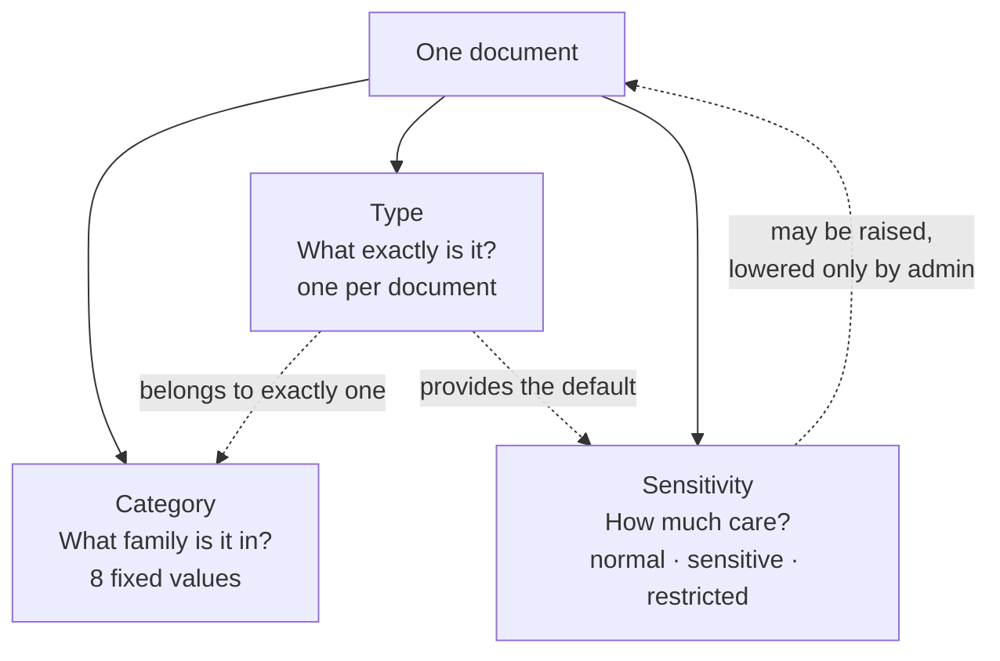
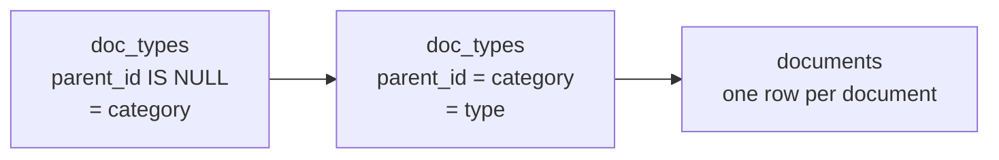
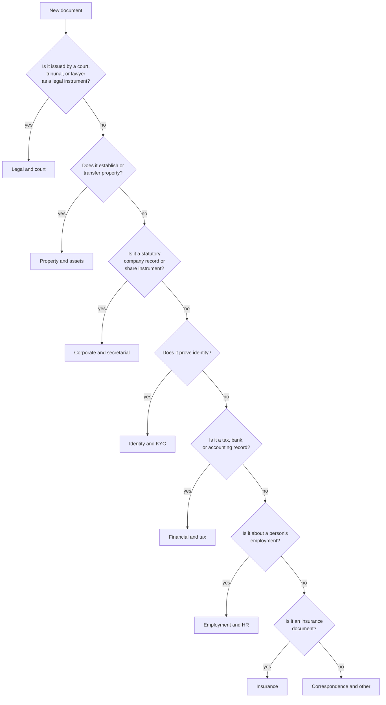
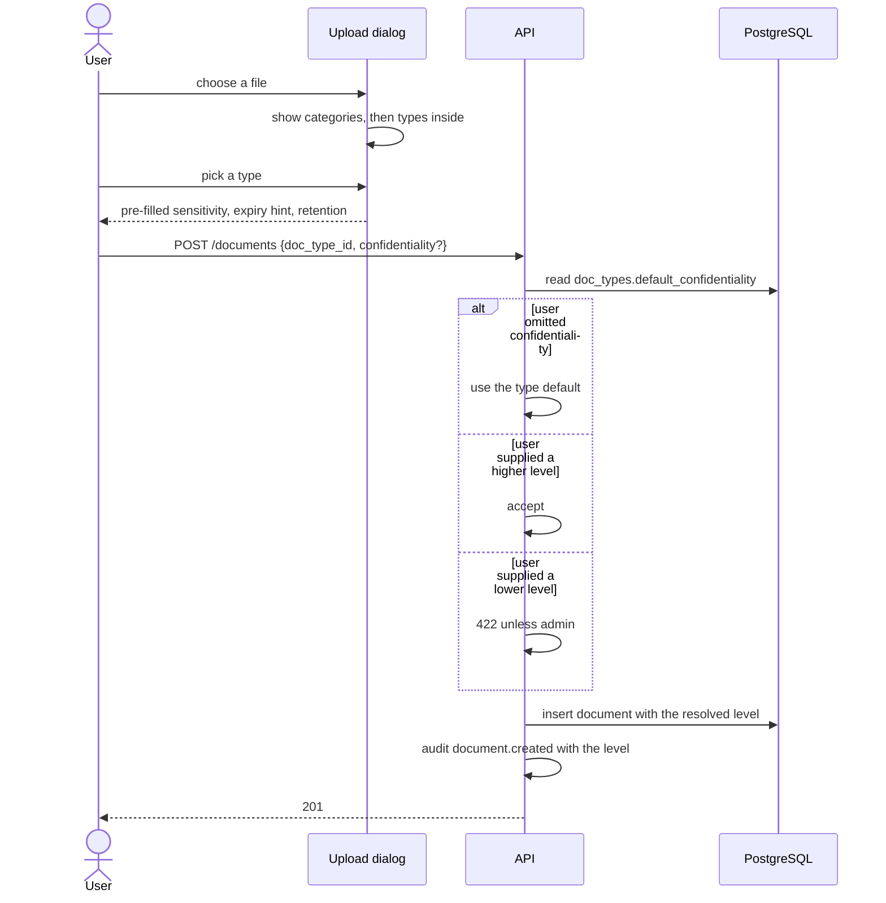

# 13 — Categories, Document Types, and Sensitivity

> **In plain words:** Every document belongs to one **category** (identity papers, property
> papers, legal papers, company papers, tax papers…) and one **type** inside it (a PAN card, a
> sale deed, a share certificate). Each type also carries a **sensitivity** level, which decides
> how carefully the app treats documents of that kind. This is how you find things, and how the
> app knows that a share certificate deserves more care than a courier receipt.
>
> **Read this if:** you are deciding where a document goes, adding a new document type, or you
> want to know what "restricted" actually changes.

---

## 1. Why categories exist

A records office holds four very different kinds of paper, and they are not interchangeable:

| What you hold | Example | What makes it different |
|---|---|---|
| **Identity** | PAN card, passport, Aadhaar | Personal data, often needed as a copy for someone else |
| **Property** | Sale deed, encumbrance certificate | High value, needed decades later, often in a court bundle |
| **Legal** | Power of attorney, court order | Privileged, often restricted to a few people |
| **Corporate** | Share certificate, board resolution | Negotiable instruments, statutory registers, audit-sensitive |

If everything sits in one undifferentiated list, two things go wrong. Finding a document takes
longer than it should, and high-value paper gets the same treatment as low-value paper.

Categories fix the first. Sensitivity fixes the second.

## 2. The three axes

A document has exactly three classification facts. They answer different questions and must not
be confused with each other.



| Axis | Answers | Cardinality | Changes how often |
|---|---|---|---|
| **Category** | Which shelf does it belong on? | One per document, via its type | Almost never |
| **Type** | What is this specific paper? | Exactly one per document | Rarely |
| **Sensitivity** | How careful must we be? | One per document | Occasionally, upwards |

Tags sit outside all three. A tag is a cross-cutting label such as `pending-verification` or
`original-seen`. It never affects permissions and never affects storage.

### There are no folders

The entity is the hierarchy. A document hangs off the person or company it belongs to, and its
category describes what it is. There is no folder tree, and no document lives inside another
document. `06` §4 explains why: folders would need their own inheritance rules on top of the
entity rules, and two inheritance systems produce permissions nobody can explain.

## 3. How the two levels are stored

Categories and types are the **same table**, `doc_types`, at two levels (`04` §5):



| Rule | Detail |
|---|---|
| A category is a `doc_types` row with `parent_id = NULL` | No separate table, no third level |
| A type is a `doc_types` row whose parent is a category | Two levels, maximum, enforced by a trigger |
| A document has exactly one type | `documents.doc_type_id` is `NOT NULL` |
| Therefore a document has exactly one category | Derived from the type, never stored twice |
| Seeded rows cannot be deleted | `is_system = true`; they can be renamed |
| A type in use cannot be deleted | `409`, and the documents are listed |

Because the category is derived, it can never disagree with the type. That is the whole reason
for not adding a second column.

**Why not a separate `doc_categories` table?** It would be a one-to-one duplicate of the parent
row, with its own name encryption, its own seed script, and its own join. The two-level tree
already expresses it, and the interface already had "two levels maximum" as a rule.

## 4. The seeded catalogue

These are created by `docvault init` and are the starting point, not a cage. An office can rename
a type, add one under any category, or delete one that is unused.

**Sensitivity** is the default for documents of that type. `Expiry` means the type expects an
end date, so the interface asks for it and the expiry badge works.

### 4.1 Identity and KYC — `identity`

Personal identification. Almost always personal data under the DPDP Act.

| Type code | Name | Sensitivity | Expiry |
|---|---|---|---|
| `pan_card` | PAN card | sensitive | no |
| `aadhaar` | Aadhaar | sensitive | no |
| `passport` | Passport | sensitive | **yes** |
| `voter_id` | Voter ID | sensitive | no |
| `driving_licence` | Driving licence | sensitive | **yes** |
| `photograph` | Photograph | sensitive | no |
| `signature_specimen` | Signature specimen | restricted | no |
| `address_proof` | Address proof | sensitive | no |
| `pan_card_front` | PAN card (front) | sensitive | no |
| `pan_card_back` | PAN card (back) | sensitive | no |
| `aadhaar_front` | Aadhaar (front) | sensitive | no |
| `aadhaar_back` | Aadhaar (back) | sensitive | no |

The four `*_front` / `*_back` types carry the `side` hint. They are ordinary types and ordinary
documents (`10` ADR-037); the hint only sorts a pre-filled print queue.

### 4.2 Property and assets — `property`

The long-lived paper. These are usually needed a decade later, for a sale, a loan, or a dispute.

| Type code | Name | Sensitivity | Expiry |
|---|---|---|---|
| `sale_deed` | Sale deed | restricted | no |
| `purchase_agreement` | Agreement to sell | sensitive | no |
| `lease_deed` | Lease deed | sensitive | **yes** |
| `rent_agreement` | Rent agreement | normal | **yes** |
| `encumbrance_certificate` | Encumbrance certificate | sensitive | **yes** |
| `mutation_record` | Mutation record | sensitive | no |
| `land_record` | Land record (khata / 7-12 extract) | sensitive | **yes** |
| `property_tax_receipt` | Property tax receipt | normal | **yes** |
| `floor_plan` | Floor plan or drawing | normal | no |
| `possession_letter` | Possession letter | sensitive | no |
| `mortgage_deed` | Mortgage deed | restricted | no |
| `property_noc` | NOC (society or municipal) | normal | **yes** |
| `valuation_report` | Valuation report | sensitive | **yes** |

### 4.3 Legal and court — `legal`

Privileged material. Restricted by default, because a legal file is normally shared with two
people and nobody else.

| Type code | Name | Sensitivity | Expiry |
|---|---|---|---|
| `power_of_attorney` | Power of attorney | restricted | **yes** |
| `affidavit` | Affidavit | restricted | no |
| `indemnity_bond` | Indemnity bond | restricted | no |
| `court_order` | Court order | restricted | no |
| `legal_notice` | Legal notice | restricted | no |
| `plaint` | Plaint or petition | restricted | no |
| `written_statement` | Written statement | restricted | no |
| `settlement_agreement` | Settlement agreement | restricted | no |
| `arbitration_award` | Arbitration award | restricted | no |
| `will` | Will or testament | restricted | no |
| `trust_deed` | Trust deed | restricted | no |
| `partnership_deed` | Partnership deed | restricted | no |

### 4.4 Corporate and secretarial — `corporate`

Statutory registers and instruments. These are the ones an auditor will ask for by name.

| Type code | Name | Sensitivity | Expiry |
|---|---|---|---|
| `certificate_of_incorporation` | Certificate of incorporation | sensitive | no |
| `moa` | Memorandum of association | sensitive | no |
| `aoa` | Articles of association | sensitive | no |
| `share_certificate` | Share certificate | restricted | no |
| `share_transfer_form` | Share transfer form (SH-4) | restricted | no |
| `board_resolution` | Board resolution | sensitive | no |
| `agm_minutes` | AGM or EGM minutes | sensitive | no |
| `register_of_members` | Register of members | restricted | no |
| `director_change` | Director change (DIR-12) | sensitive | no |
| `auditor_appointment` | Auditor appointment | sensitive | **yes** |
| `charge_registration` | Charge registration (CHG-1) | sensitive | **yes** |
| `annual_return` | Annual return (MGT-7) | normal | **yes** |

### 4.5 Financial and tax — `finance`

| Type code | Name | Sensitivity | Expiry |
|---|---|---|---|
| `itr_acknowledgement` | ITR acknowledgement | sensitive | **yes** |
| `form_26as` | Form 26AS | sensitive | **yes** |
| `balance_sheet` | Balance sheet | sensitive | **yes** |
| `profit_and_loss` | Profit and loss statement | sensitive | **yes** |
| `bank_statement` | Bank statement | sensitive | **yes** |
| `cheque` | Cheque | restricted | no |
| `loan_sanction` | Loan sanction letter | sensitive | **yes** |
| `gst_registration` | GST registration (REG-06) | sensitive | no |
| `gst_return` | GST return | sensitive | **yes** |
| `tds_certificate` | TDS certificate (16 / 16A) | sensitive | **yes** |
| `invoice` | Invoice | normal | no |

### 4.6 Employment and HR — `employment`

| Type code | Name | Sensitivity | Expiry |
|---|---|---|---|
| `appointment_letter` | Appointment letter | sensitive | no |
| `employment_contract` | Employment contract | sensitive | **yes** |
| `relieving_letter` | Relieving letter | normal | no |
| `experience_letter` | Experience letter | normal | no |
| `salary_slip` | Salary slip | sensitive | **yes** |
| `pf_record` | PF statement | sensitive | **yes** |
| `form_16` | Form 16 | sensitive | **yes** |

### 4.7 Insurance — `insurance`

| Type code | Name | Sensitivity | Expiry |
|---|---|---|---|
| `policy_document` | Policy document | sensitive | **yes** |
| `premium_receipt` | Premium receipt | normal | **yes** |
| `claim_form` | Claim form | sensitive | no |

### 4.8 Correspondence and other — `other`

The escape hatch. If a document lands here often, that is a signal to add a type.

| Type code | Name | Sensitivity | Expiry |
|---|---|---|---|
| `correspondence` | Letter or email printout | normal | no |
| `courier_receipt` | Courier or post receipt | normal | no |
| `miscellaneous` | Miscellaneous | normal | no |

## 5. Choosing the right category

The one question that resolves most confusion:

> **Classify by what the paper *is*, not by what it is *about*.**

A sale deed is about property, but it is a deed — so it goes under **Property**, where a clerk
will look for it. A court order that freezes a property is a court order — so it goes under
**Legal**. An NOC from a society about a flat is a property document, because that is where it
will be needed.



When a document genuinely fits two, pick the one where the person asking for it would look first.
If that is still unclear, the category is a navigation aid, not a legal opinion, and `other` is an
honest answer.

## 6. What sensitivity actually changes

**Sensitivity does not change how a document is stored.** Every version, every rendition, and
every derived PDF is AES-256-GCM ciphertext, always, with no exceptions and no "unencrypted
tier" (`03` §1, `05` §2).

This deserves stating plainly because it is a common request: **there is no setting that stores a
document as a readable file.** A second, plaintext storage path would double the code, double the
audit rules, and become the one place a leak happens. If a document is in the vault, it is
ciphertext on disk.

What sensitivity changes is **who can do what, and how loudly the app says so**.

| Effect | `normal` | `sensitive` | `restricted` |
|---|---|---|---|
| Storage | ciphertext | ciphertext | ciphertext |
| ACL at upload | inherits from entity | inherits | inherits |
| **Printing** | role default | role default | **explicit grant required** |
| Viewer overlay | user ID | user ID + time | user ID + time + `RESTRICTED` |
| Badge in lists | none | amber | red |
| Purge | per retention | per retention | never automatic; admin action only |
| Audit detail | standard | standard | includes the confidentiality level |
| Who may lower it | admin | admin | admin |
| Who may raise it | any `write` holder | any `write` holder | — |

### The printing rule for `restricted`

A `restricted` document is printable only when the user holds `print` **from an explicit entry on
that document**, not merely through a role or the entity. Admins are exempt, because they must be
able to run the office, and every admin print is audited.

```text
require_print(user, document):
    caps = effective_caps(user, document)          # 06 §5
    if not (caps & PRINT):        -> 403 PRINT_REQUIRED
    if document.confidentiality == RESTRICTED
       and not explicit_allow(document, user, PRINT)
       and not is_admin(user):   -> 403 PRINT_RESTRICTED
    return ok
```

Why this exists: the default roles give `print` to readers and editors. Without this rule,
marking a document `restricted` would change its badge and nothing else. With it, a share
certificate cannot leave the building on paper until someone deliberately says it may.

The cost is real and accepted: restricted documents need one extra sharing step before they can
be printed. That is the friction the classification is for.

### Lowering sensitivity

Sensitivity may always be **raised**, by anyone with `write`. It may only be **lowered** by an
admin, and the change is audited with the old and new level. Otherwise the first clerk in a hurry
turns a share certificate into `normal`, and the classification becomes decoration.

## 7. How a document gets its classification



The dialog never shows a blank sensitivity field. The type always supplies a default, so the
common path is two clicks: type, save.

### One document, one type

There is no multi-type document and no "primary type plus secondary type". A file that is both an
agreement and a tax record is two documents, or one document with a tag. Multi-type documents
would break filtering, break the retention rule, and give two answers to "how sensitive is this".

## 8. In the interface

| Where | What appears |
|---|---|
| Library filter rail | The eight categories, with counts (`11` §4) |
| Upload dialog | Category tabs, then types; sensitivity pre-filled and editable |
| Document page | Category and type in the header, sensitivity as a badge |
| Entity page | Documents grouped by category, then type |
| Print dialog | A `RESTRICTED` marker on any restricted item in the queue (`12` §10) |
| Admin → Document types | The two-level tree, add, rename, set default sensitivity |

The category is also the default sort for an entity packet, so a printed bundle comes out in a
predictable order: identity, property, legal, corporate, financial, employment, insurance, other
(`12` §10).

## 9. Adding and changing types

| Action | Who | Notes |
|---|---|---|
| Add a type under a category | Admin | Requires a code, a name, and a default sensitivity |
| Rename a type or category | Admin | Audited; the code does not change |
| Change a default sensitivity | Admin | Applies to **future** documents only, never retroactively |
| Change a document's sensitivity | `write` to raise, admin to lower | Audited either way |
| Delete an unused type | Admin | Refused if any document uses it |
| Delete a seeded type | Nobody | `is_system = true`; rename instead |
| Add a new category | Admin | Rare. If you need a ninth, ask whether it is really a type |

**Changing a default is not a migration.** A type default of `sensitive` today does not rewrite
yesterday's `normal` documents. Retroactive changes would silently alter who can print what, with
no audit trail connecting cause to effect.

## 10. What this deliberately is not

| Not built | Why |
|---|---|
| Free-form categories typed by users | Two spellings of "Property" means two filters and no counts |
| A third level of nesting | Every level needs interface rules and inheritance rules, for a marginal gain |
| A folder tree | The entity is the hierarchy (`06` §4) |
| Sensitivity as a storage tier | There is no plaintext tier. See §6. |
| Automatic classification by content | It would need OCR and a guess, and a wrong guess about a share certificate is worse than a manual choice |
| Per-category permissions | Permissions belong to documents and entities. Categories are a navigation and defaulting device, not an ACL scope |
| Mandatory tags | Tags are optional and orthogonal; requiring them produces `misc`. |

## 11. Tests that must exist

1. **Seed** — a fresh vault contains exactly eight categories and the types in §4, all
   `is_system`.
2. **Tree depth** — inserting a third level is rejected by the trigger.
3. **One category per document** — every document resolves to exactly one category through its
   type.
4. **Default applies** — uploading without a `confidentiality` field copies the type default.
5. **Raise allowed, lower refused** — a reader cannot lower `restricted` to `normal`; an admin
   can, and the audit row names both levels.
6. **Print gate** — a `restricted` document granted `print` only through the entity returns
   `403 PRINT_RESTRICTED`; after an explicit document grant it prints.
7. **Admin exemption** — an admin can print a restricted document, and the audit row says so.
8. **Delete refusal** — deleting a type in use returns `409` and names the document count.
9. **Renamed type, stable code** — renaming does not change `code`, and existing links still
   resolve.
10. **No retroactive change** — changing a type default does not alter any existing document's
    `confidentiality`.
