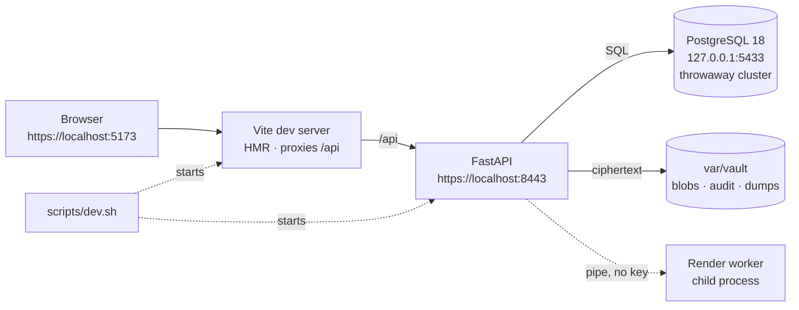
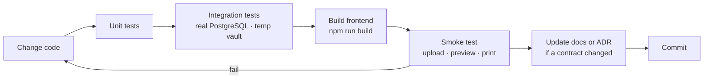

# 14 — Development Setup

> **In plain words:** This page takes a new machine from "nothing installed" to "the app runs on
> my laptop, with test data, and I can change the code". It also explains how to add an AI coding
> skill or an MCP server without turning your editor into an unvetted supply chain.
>
> **Read this if:** you are about to write code for DocVault, or you have just joined the project.

---

## 1. What a development environment is

There are two different installations of the same application:

| | Development | Production |
|---|---|---|
| **Purpose** | Change the code and see the result | Keep the office's real records |
| **Host** | Your laptop or desktop | The one office computer (`15`) |
| **Data** | Synthetic fixtures, disposable | Real documents, encrypted, backed up |
| **Vault** | `./var/vault`, deleted freely | `D:\Vault`, never deleted casually |
| **Database** | A throwaway PostgreSQL cluster on port 5433 | The office PostgreSQL service on 5432 |
| **Users** | Whoever is testing | Named staff with real roles |
| **HTTPS** | A development certificate you trust once | The office certificate trusted by every client |

The two must never share a vault, a database, or a passphrase. Development is allowed to be
careless with its own data. Production is not careless with anything.

## 2. What you need

| Tool | Version | Why |
|---|---|---|
| **Git** | Current | Source control |
| **Python** | **3.14.x** (3.14.10 at the time of writing) | Backend. The same minor as production. |
| **Node.js** | **24.x** (24.22.1) | Frontend build and dev server only; not needed on the production host |
| **npm** | **11.x**, bundled with Node 24 | Frontend dependencies. Do not install it separately. |
| **PostgreSQL** | **18.x**, including `initdb`, `pg_ctl`, `pg_dump`, `pg_restore` | Same major as production (`02` §6.3) |
| **LibreOffice** | Optional, current | Only to test DOC/DOCX/ODT intake |
| **uv** | Optional, current | Runs Python tools without polluting the venv (`§9`) |
| **pipx** | Optional, current | Installs long-lived Python CLIs in isolation (`§9`) |

Disk: about 3 GB for toolchains and dependencies, plus room for the development vault and its
cache. RAM: 8 GB is comfortable, 16 GB if you also run a browser with many tabs.

**No Docker, no SQLite, no substitute database.** The schema uses `citext`, `jsonb`, partial
indexes, and triggers. Testing against SQLite would test a different system (`10` ADR-043).

## 3. The shape of the environment



Three long-lived processes, one of which (the worker) the API starts and restarts itself. The
database is a cluster you created, not the system one.

## 4. One-time setup

The commands below are for Linux, which is the tested development platform. Windows notes follow
in §4.7.

### 4.1 Install the tools

Use the versions in `02` §6.1, not "whatever the package manager has today".

```bash
# Debian/Ubuntu example — substitute your distribution's package names
sudo apt install git python3.14 python3.14-venv postgresql-18 postgresql-client-18
psql --version    # 18.x
pg_dump --version # 18.x or newer
```

Check that `pg_dump` is **not older** than the server. A client older than the server is the most
common upgrade failure (`08` §2.2).

**Node.js and npm.** Node is needed for the frontend only. Production serves the already-built
files, so the office host does not need Node at all (`15` §5).

The project pins **Node 24.22.1**, which bundles **npm 11.x**. Pick one installation method:

```bash
# Option A — nvm, per user, no sudo (recommended)
curl -o- https://raw.githubusercontent.com/nvm-sh/nvm/v0.40.8/install.sh | bash
# Open a new shell, then:
nvm install 24.22.1
nvm use 24.22.1
nvm alias default 24.22.1
```

```bash
# Option B — NodeSource, system-wide
curl -fsSL https://deb.nodesource.com/setup_24.x | sudo -E bash -
sudo apt install -y nodejs
```

Option B installs the newest 24.x patch, which may be newer than 24.22.1. Either use nvm for the
exact pin, or record the accepted version and update `02` §6.1 deliberately; do not let two
developers run different patches by accident.

If your policy does not allow piping a remote script into a shell, download it, read it, then run
it. Both scripts run with your privileges.

The repository contains a `.nvmrc`, so after the first install `nvm use` selects the right version
without arguments.

On Windows, install the **24.22.1** MSI from nodejs.org, or:

```powershell
winget install -e --id OpenJS.NodeJS.LTS
```

Tick "Add to PATH" if the MSI offers it, then open a **new** terminal.

Verify the pair together, because a correct `node` with an old `npm` is still a broken setup:

```bash
node --version   # v24.22.1
npm --version    # 11.x
command -v node  # the nvm path if you chose Option A
```

Rules that save time later:

| Rule | Why |
|---|---|
| **Do not install npm separately** | It ships with Node; a second copy drifts from the runtime |
| **Never run `npm` with `sudo`** | Root-owned files in `node_modules` cause permission errors that look like bugs |
| **Use `npm ci`, not `npm install`** | `ci` installs exactly the committed lockfile and never edits it |
| **Keep one Node major** | Vite and TypeScript are pinned to a version that supports 24.x |
| **No Node in production** | The built bundle is static files served by FastAPI (`02` §7) |

If the development machine is offline, populate the npm cache from a connected machine or vendor
the tarballs. The application runtime never needs npm, and the offline test still fails the build
on unexpected egress (`02` §10).

### 4.2 Clone and create the Python environment

```bash
git clone <repository-url> doc_mgmt
cd doc_mgmt
python3.14 -m venv .venv
source .venv/bin/activate
python -m pip install --upgrade pip
pip install -e "backend[dev]"
docvault --help
```

`backend[dev]` installs the runtime dependencies plus `pytest`, `ruff`, and `mypy`. CI installs
from hash-checked lockfiles; a developer venv does not need that ceremony, but it must use the
same pins.

### 4.3 Create a throwaway PostgreSQL cluster

Do **not** use the system cluster. A separate cluster on port **5433** cannot damage anything
else, and deleting `var/pg` resets it completely.

```bash
mkdir -p var
initdb -D var/pg -U postgres --auth=trust --encoding=UTF8 --no-locale
pg_ctl -D var/pg \
  -o "-p 5433 -c listen_addresses=127.0.0.1 -c unix_socket_directories=$PWD/var" \
  -l var/pg.log start
```

`--auth=trust` is acceptable **only** because the cluster listens on loopback and holds synthetic
data. Never copy this setting to production.

Stop it when you are done for the day:

```bash
pg_ctl -D var/pg stop
```

### 4.4 Point the app at the development environment

Configuration is a TOML file. In production it lives in the OS config folder; in development you
choose it with the `DOCVAULT_CONFIG` environment variable. Copy the example and edit the paths:

```bash
mkdir -p config
cp config/dev.toml.example config/dev.toml
export DOCVAULT_CONFIG="$PWD/config/dev.toml"
```

`config/dev.toml` is git-ignored because it contains absolute paths that only make sense on your
machine. It contains **no secrets**.

The important key is:

```toml
environment = "development"
```

The application refuses the development-only commands in §6 unless this is set. Production sets
`environment = "production"` and never changes it.

### 4.5 Create the development vault

```bash
docvault init --vault "$PWD/var/vault"
```

`init` does the same work as in production (`09` §1): it checks the filesystem, creates the
`docvault_app` role and the database inside the cluster on 5433, asks for the PostgreSQL admin
password, asks for a vault passphrase twice, writes the wrapped key, generates a development CA
and certificate, applies the migrations, and seeds the document-type catalogue.

The admin password is prompted for, never stored in the TOML file. Press Enter for a `trust`
cluster like the one in §4.3. To automate the prompt, pass `--admin-dsn` with an admin DSN that
carries the password. Use `--no-database` to create only the vault and TLS, for example when
PostgreSQL is not installed yet; `docvault migrate` provisions nothing, it only needs a role and
database that already exist.

The generated app password is written to `config/docvault-db.cred` with mode `0600`. That file is
git-ignored and is not part of the vault. If it is lost, run:

```bash
docvault init --vault "$PWD/var/vault" --reuse-vault
```

That re-creates the role password and the credential file without touching `manifest.json` or
`keys/kek.wrapped`. Then, after a migration or a version upgrade:

```bash
docvault migrate
```

`migrate` takes the writer lock, unlocks with the passphrase, applies every Alembic revision, and
runs the idempotent seed. Use `--force-lock` only after checking that no service is running: it
takes over a lock older than 30 seconds and audits the takeover.

> **Not yet built:** the first encrypted `DVD1` dump at the end of `init`, and the pre-migration
> dump at the start of `migrate` ([17 §7 S2b](17-implementation.md)). Until then, `index/db/` is
> empty and `docvault backup` does not exist. Do not treat this vault as recoverable from dump;
> keep the database itself for development.

It prints four values worth noting:

| Value | Use |
|---|---|
| `vault_id` | Confirms you are looking at the right vault |
| Key fingerprint | Confirms the passphrase unlocked the expected key |
| TLS directory | `var/tls` in development, printed so you can trust the CA |
| CA fingerprint | Compare it in the browser when you trust the certificate |

**Development passphrase.** Use anything you will remember; it protects a disposable vault. Do
not reuse a production passphrase, and do not put a real passphrase in this repository even in a
comment.

Then seed synthetic data:

```bash
docvault dev-seed
```

This creates two entities and a handful of documents across identity, property, legal, and
corporate categories, including one `restricted` document that exercises the print rule
(`13` §6). The files come from checked-in fixtures under `backend/tests/fixtures/demo/`, so the
seed goes through the real encryption, audit, and classification paths.

### 4.6 Install and start the frontend

```bash
cd frontend
npm ci
cd ..
```

If `node --version` is not `v24.22.1`, run `nvm use` before `npm ci`. `npm ci` uses the committed
lockfile. Do not use `npm install` for a clean setup; it can update the lockfile by accident.

Start the API in one terminal:

```bash
source .venv/bin/activate
export DOCVAULT_CONFIG="$PWD/config/dev.toml"
docvault serve
```

Start Vite in another:

```bash
cd frontend
npm run dev
```

Open **https://localhost:5173**. Vite serves the app over HTTPS using the development certificate
and proxies `/api` to `https://localhost:8443`, so cookies stay first-party and there is no CORS
(`10` ADR-022).

### 4.7 If your development machine is Windows

The shape is identical; the commands differ.

| Task | Windows |
|---|---|
| Python | Install 3.14 from python.org, tick "Add to PATH" |
| Node and npm | Install **24.22.1** from nodejs.org, or `winget install -e --id OpenJS.NodeJS.LTS`; npm is bundled. Open a new terminal afterwards. |
| PostgreSQL | Install 18.x with the EDB installer; note `C:\Program Files\PostgreSQL\18\bin` |
| Throwaway cluster | `initdb -D var\pg -U postgres --auth=trust --encoding=UTF8` then `pg_ctl -D var\pg -o "-p 5433" start` |
| Config | `$env:DOCVAULT_CONFIG = "$PWD\config\dev.toml"` |
| Trust the dev CA | `certutil -addstore -user Root var\tls\ca.crt` |

Windows is the production platform, so test there before calling a change done. Linux-only
success is not enough (`02` §10, quality gate 5).

## 5. Running it every day

| Process | Command | Address | Notes |
|---|---|---|---|
| API + render worker | `docvault serve` | `https://localhost:8443` | The worker is a child process; do not start it separately |
| Frontend | `npm run dev` in `frontend/` | `https://localhost:5173` | Hot reload; proxies `/api` |
| PostgreSQL | `pg_ctl -D var/pg start` | `127.0.0.1:5433` | Start it before the API |
| Worker, standalone | `python -m backend.worker.main` | no port | Only for debugging the pipe protocol (`02` §6.4) |

A convenience script starts the database, the API, and Vite in the right order and stops them on
`Ctrl+C`:

```bash
scripts/dev.sh
```

It is a wrapper, not a fourth implementation. If it fails, run the three commands above by hand
and fix the environment.

**First login.** `init` does not create a user in development. Create one:

```bash
docvault user create --username admin --role admin
```

Use the temporary password printed by the command, then change it at first login. Add a second
user with the `reader` role to test that permissions actually deny things.

## 6. The development vault is disposable

| Command | Effect |
|---|---|
| `docvault dev-seed` | Adds synthetic entities and documents. Refuses outside `environment = "development"`. |
| `docvault dev-reset` | Confirms, then deletes the development vault and database and recreates them empty. Refuses outside development. |
| `rm -rf var/` | The blunt version. You lose only test data. |

Rules that keep this safe:

1. **Never restore a production dump into development.** It brings real personal data into a
   machine with no backup, no disk encryption, and a shared passphrase.
2. **Never reuse a production passphrase** or the production CA.
3. **Do not commit `var/`.** It is git-ignored, and it must stay that way.
4. **Do not develop against the office database over the network.** PostgreSQL is loopback-only
   for a reason (`02` §6.3).

## 7. The change loop



| If you changed… | You must also… |
|---|---|
| A table or column | Add a migration, update `04`, and say whether the dump format changed |
| The vault layout | Update `03` first; it is a compatibility contract |
| An endpoint or payload | Update `07`, and keep `v1` backward compatible |
| A permission rule | Update `06`, and add a row to its test matrix |
| A print layout rule | Update `12`, and add a golden-file case |
| A classification default | Update `13` and the seed catalogue; never rewrite existing documents |

Migrations are append-only. Once a migration is merged, a new migration fixes it; editing the old
one makes two developers' databases disagree and breaks every restored dump.

## 8. Tests and checks

| Command | What it proves |
|---|---|
| `ruff check backend` | Style and obvious bugs |
| `ruff format --check backend` | Formatting is stable |
| `cd backend && ../.venv/bin/mypy app` | Types line up at the module boundaries (the config lives in `backend/pyproject.toml`) |
| `cd backend && ../.venv/bin/pytest tests/unit -q` | Crypto vectors, permission matrix, grid maths |
| `cd backend && ../.venv/bin/pytest tests/integration -q` | Real PostgreSQL, real vault, migrations, dump/restore |
| `cd backend && ../.venv/bin/pytest -q -m "not integration"` | Everything that runs without a database |
| `pytest backend/tests/render -q` | Golden pages and the hostile-input corpus |
| `pytest backend/tests/e2e -q` | Every route as an unauthorised user, plus the happy paths |
| `npm --prefix frontend run typecheck` | TypeScript |
| `npm --prefix frontend run lint` | Frontend style |
| `npm --prefix frontend test` | Component behaviour |
| `npm --prefix frontend run build` | The production bundle compiles |
| `python scripts/check-docs.py` | Cross-references, tables, links, and Mermaid balance |

Target: the full suite finishes in under ten minutes on a laptop. A test that needs a specific
timezone, locale, or network must be fixed, not skipped.

Integration tests create their own database on the same 5433 cluster and drop it afterwards. The
default admin DSN is `postgresql+psycopg://postgres@127.0.0.1:5433/postgres`; override it with
`DOCVAULT_TEST_PG_DSN`. Each test database is migrated from scratch with Alembic, so a migration
bug fails the suite rather than a manual check. If you see `PG_VERSION_UNSUPPORTED`, you pointed
them at the wrong cluster; if they are skipped, the throwaway cluster is not running.

## 9. Adding AI coding skills and tools

An AI coding agent is useful because it can load a **skill** — a small, reviewed instruction file
— or call an **MCP server** — a tool process. Both are code you are inviting into your editor.
Treat them like dependencies, not like browser extensions.

### 9.1 Three different things

| Thing | What it is | Where it lives | Changes the app? |
|---|---|---|---|
| **Skill** | Markdown instructions plus optional scripts and references, loaded on demand | `.opencode/skills/<id>/SKILL.md` | No. It guides the agent. |
| **MCP server** | A separate process exposing tools over the Model Context Protocol | Registered in OpenCode config | No, unless the agent runs one of its tools |
| **Plugin** | Code that hooks into the agent's own lifecycle | `opencode.json` `plugins` | No application code, but broader access |

Start with a skill. Add an MCP server only when the agent needs to *do* something a shell command
cannot do safely and repeatably.

### 9.2 Add a skill to this repository

A project skill is a folder with a `SKILL.md` at its root. Supporting files sit beside it and are
read only when the skill tells the agent to read them.

```text
.opencode/skills/
└── docvault-print-fixtures/
    ├── SKILL.md
    ├── scripts/
    │   └── make-sheets.py
    └── references/
        └── paper-sizes.md
```

```markdown
---
name: DocVault print fixtures
description: Generate and check print-layout fixtures for the DocVault composer
---

## Workflow

1. Read `references/paper-sizes.md` before adding a paper size.
2. Generate the fixture with `scripts/make-sheets.py`.
3. Run `pytest backend/tests/render -q` and compare the golden hashes.
4. Never approve a new golden file without looking at the rendered page.
```

| Rule | Why |
|---|---|
| Write a specific `description` | That sentence is how the agent decides to load the skill |
| One job per skill | A 400-line skill that covers everything is never loaded correctly |
| Keep paths relative to `SKILL.md` | The folder is the skill's private base directory |
| Add `metadata: { opencode/autoinvoke: false }` for risky skills | The skill stays available by ID but is not offered automatically |
| Commit team skills | They are part of how the project is built, and they get reviewed like code |

Where skills are discovered, lowest precedence first:

1. Built-in skills
2. `~/.claude/skills` and `~/.agents/skills` (compatibility)
3. `~/.config/opencode/skills`
4. `.claude/skills` and `.agents/skills` in the project
5. **`.opencode/skills` in the project**
6. Extra directories or HTTP catalogs listed in `opencode.json`

A project skill with the same ID overrides a global one, which is what you want: the repository
decides how it is built, not each laptop.

To use a skill that lives outside the repo, add its directory to the `skills` array in
`opencode.jsonc`. To use a shared catalogue, point at an HTTP URL that serves an `index.json`.
Both are combined with the defaults, not substituted for them.

Mention the skill explicitly when you want it:

```text
@docvault-print-fixtures add a Legal paper size
```

### 9.3 Runners: `npx`, `uvx`, and `pipx`

These three tools run a program without a manual install. They differ in where the package comes
from and how long it lives.

| Runner | Ecosystem | Lifetime | Use it for |
|---|---|---|---|
| `npx -y <pkg>@<version>` | npm | One command | A Node CLI or an MCP server you do not want installed |
| `npm install --save-dev <pkg>@<version>` | npm | Project | Build, lint, and test tools the repo depends on |
| `uvx <pkg>@<version>` | PyPI | One command | A Python CLI or MCP server, in an ephemeral environment |
| `pipx install <pkg>==<version>` | PyPI | Per user | A Python CLI you use every day, isolated from the venv |
| `uv tool install <pkg>@<version>` | PyPI | Per user | The same, if you standardise on uv |

Examples:

```bash
# Run a Node tool once, pinned
npx -y prettier@3.6.2 --check frontend/src

# Run a Python tool once, pinned
uvx ruff@0.14.0 check backend

# Install a long-lived Python CLI in its own environment
pipx install sqlfluff==3.4.0
```

Rules:

1. **Always pin a version.** `@latest` is how a working machine breaks overnight.
2. **Prefer project dependencies** for anything the build or tests need. `npx` is for one-off
   checks and MCP servers, not for reproducing CI.
3. **Do not `npm install -g`.** It hides the version from the lockfile and from your teammates.
4. **Check the package name and owner** before the first run. Typosquatting is common, and an
   agent will happily run what you typed.
5. **Never put a token on the command line.** It lands in shell history and in process lists.

### 9.4 Register an MCP server

Use the CLI, because it edits configuration without disturbing anything else:

```bash
# A local Node server, started on demand
opencode mcp add filesystem -- npx -y @modelcontextprotocol/server-filesystem@<version> "$PWD"

# A local Python server
opencode mcp add fetch -- uvx mcp-server-fetch@<version>

# Check the connection
opencode mcp list
```

The equivalent configuration, if you need options such as a working directory or an environment
variable:

```jsonc
{
  "$schema": "https://opencode.ai/config.json",
  "mcp": {
    "servers": {
      "filesystem": {
        "type": "local",
        "command": ["npx", "-y", "@modelcontextprotocol/server-filesystem@<version>", "."],
        "environment": { "LOG_LEVEL": "info" }
      }
    }
  }
}
```

| Rule | Why |
|---|---|
| Scope it to the project unless you need it everywhere | A global server follows you into every repository |
| Give it the narrowest directory | A filesystem server pointed at `/` can read your SSH keys |
| Pass secrets as `{env:NAME}`, never as literals | Config files get committed and copied |
| Remove servers you are not using | Every tool consumes model context and widens the attack surface |
| Re-check after an upgrade | A new version can add tools you did not approve |

Remote servers use OAuth by default. If `mcp list` says authentication is needed, run `/mcps` in
OpenCode and sign in there; do not paste an API key into a config file.

### 9.5 Safety rules for agentic tools

1. **A skill is code.** Read `SKILL.md` and every script it references before adding it. A skill
   can tell the agent to run a command.
2. **An MCP server is a process with your permissions.** It can read what you can read. Point it
   at a project folder, not your home directory.
3. **No production data, ever.** Agents get the synthetic fixtures from §4.5. This is also why
   development has its own vault.
4. **No vault passphrases, API keys, or real PANs** in a prompt, a skill, or a commit.
5. **Keep tools out of the application.** Nothing under `backend/app` may import an agent tool,
   and the offline test still fails the build on unexpected egress (`02` §10).
6. **Review the diff.** An agent that can run tests can also rewrite a test to pass. Read what
   changed, especially migrations, permission checks, and golden files.

### 9.6 A five-minute checklist for a new skill

| Step | Check |
|---|---|
| 1 | Does an existing skill already do this? Reuse it instead of adding a near-duplicate. |
| 2 | Is the `description` one sentence that names the trigger? |
| 3 | Are scripts and references inside the skill folder, with relative paths? |
| 4 | Does it avoid network access and secrets? |
| 5 | Did you run its example once and confirm it does what it claims? |
| 6 | Is it committed, so the next developer gets the same behaviour? |

## 10. Debugging

| Symptom | Likely cause | What to do |
|---|---|---|
| `PG_VERSION_UNSUPPORTED` | The app found the system cluster, not the dev one | Check the DSN port is `5433` |
| `DB_UNAVAILABLE` | The dev cluster is stopped | `pg_ctl -D var/pg start` |
| `FS_NETWORK_PATH` | The vault path is on a synced or network folder | Move it under `./var/` on a local disk |
| `VAULT_LOCKED` | Another `docvault serve` is running | Stop the other process; the lock is deliberate |
| `EADDRINUSE` on 8443 | An old API process survived | Find the process and stop it, do not change the port |
| Browser warns about the certificate | The dev CA is not trusted | Re-run the trust step in §4.7, or compare the fingerprint |
| Login succeeds but every request is `401` | The cookie was rejected because the page is HTTP, not HTTPS | Use `https://localhost:5173`, not `http://` |
| Vite proxy returns `502` | The API is not running, or it is on another port | Start `docvault serve`; check `config/dev.toml` |
| Preview says "Could not render" | The worker crashed or hit a limit | Read the worker exit reason in the log; the document is intact |
| `SCHEMA_TOO_NEW` | A branch with older code met a newer database | Re-run the branch's migrations, or reset the dev vault |
| Import error after switching branches | The venv has stale editable installs | `pip install -e "backend[dev]"` again |
| `node: command not found` after installing | The shell has not reloaded its PATH | Open a new terminal, or `source ~/.nvm/nvm.sh` |
| Vite refuses to start, or `EBADENGINE` | The wrong Node major is active | `nvm use`; check `node --version` is 24.22.1 |
| `npm ERR! EACCES` | npm was run with `sudo`, or a system Node owns the cache | Use nvm, remove the root-owned `node_modules`, and reinstall without sudo |
| `npm ci` fails with a lockfile mismatch | The lockfile was edited or generated by another npm major | Restore `package-lock.json` from the repository; do not regenerate it casually |
| Frontend types fail only in CI | `node_modules` is stale | `npm ci`, not `npm install` |

When in doubt, `docvault doctor` reports the environment one check at a time, with the fix in the
failure code (`08` §2.2).

## 11. House rules

| Rule | Reason |
|---|---|
| **No SQLite, ever** | It would test a different schema and hide PostgreSQL bugs (`10` ADR-043) |
| **No editing a merged migration** | It breaks other developers and every restored dump |
| **No production data in development** | Development has no backups and no disk encryption promise |
| **No disabled permission checks** | The permission function is the product; a bypass becomes a habit |
| **No secrets in the repository** | Not in TOML, not in a fixture, not in a comment |
| **No `@latest` in scripts or MCP config** | Reproducibility is a security property |
| **No agent-only conventions** | If the build needs a skill, the README must say so too |

## 12. Definition of done

A change is finished when:

1. It works on Linux **and** Windows.
2. Unit and integration tests pass, and a new permission rule has a negative test.
3. A schema change has a migration, an updated `04`, and a dump/restore round trip.
4. The production frontend build works, not only the dev server.
5. The docs that state the rule are updated, and an ADR exists if a contract moved.
6. No new dependency was added without a reason in `10`.
7. The diff contains no secret, no real personal data, and no `var/` file.
