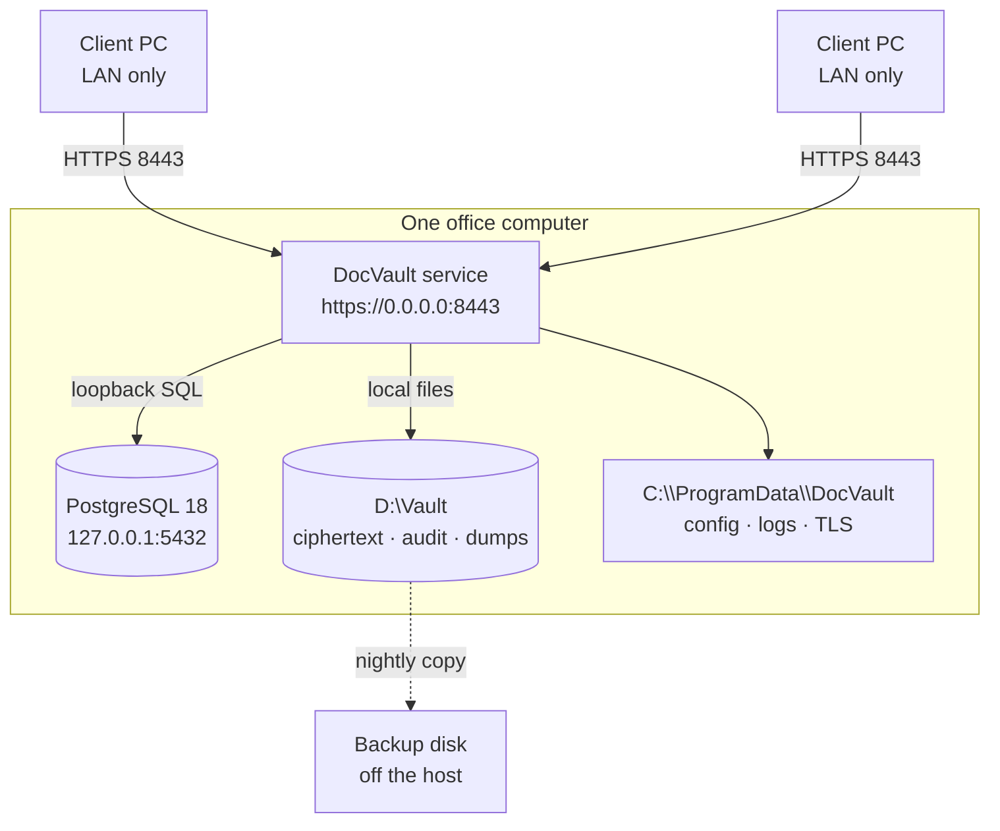
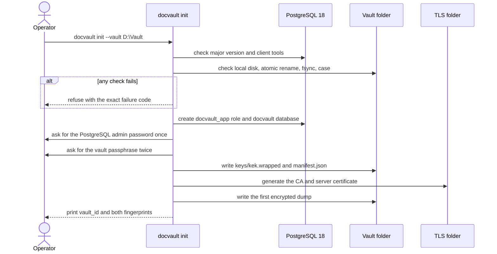

# 15 — Production Setup

> **In plain words:** This page installs DocVault on the one office computer that will hold the
> real records, then checks it from a second computer before anyone trusts it with a document.
> The order matters: PostgreSQL first, the vault second, the network last.
>
> **Read this if:** you are the person installing the system for an office, or you are signing off
> that it is safe to use.

---

## 1. Scope, and how this differs from `08`

`08` is the operator's runbook: backups, restores, verification, upgrades, and disaster recovery.
This document is the **first installation**, in order, with the checks that must pass before
go-live.

| Question | Read |
|---|---|
| How do I install it the first time? | This document |
| How do I back up, restore, verify, or upgrade it? | `08` §3–§6 |
| What is the vault folder allowed to contain? | `03` |
| Why is PostgreSQL separate? | `02` §6.3, `10` ADR-031 |
| What does each screen do? | `11` |
| How do staff use it after installation? | `16` |

## 2. Before you start

Do not begin until every row is true. An installation that stops halfway leaves a vault folder
that looks finished but is not.

| Item | Requirement | Why |
|---|---|---|
| **Host** | A desktop or small server that stays on, on a UPS | Clients lose access when it sleeps |
| **OS** | 64-bit Windows 11 or Windows Server 2022 or later. Linux is supported for development and for an operator who prefers it. | Windows is the tested production platform |
| **Disk** | Local native disk, NTFS on Windows, with at least 2× the expected content size free | Content, cache, dumps, and headroom |
| **Disk encryption** | BitLocker (Windows) or LUKS (Linux) enabled, with the recovery key stored offline | A stolen disk is the most likely physical loss (`01` §3) |
| **Network** | A static LAN address, or a DHCP reservation, plus a name clients can type | Certificates and bookmarks must keep working |
| **PostgreSQL** | **18.x**, with `pg_dump` and `pg_restore` of the same or newer version | The app refuses anything else |
| **Installer** | The signed MSI or package for the exact release | Do not install from a copied folder of loose files |
| **Backup media** | A removable disk or a second machine, kept off the host | A backup on the same disk is not a backup |
| **Passphrase custodians** | Two named people, each able to produce the passphrase | One person is a single point of failure |
| **Office intake** | Decide whether LibreOffice will be installed | Required only for DOC/DOCX/ODT uploads |
| **LAN clients** | Browsers on the same network, no internet access required | The app is never hosted |

**Do not install DocVault on a domain controller**, a laptop that leaves the office, or a machine
that syncs its disk to a cloud folder. A synced folder breaks the filesystem guarantees and copies
ciphertext to a third party (`01` §3, `03` §7).

## 3. The host and its disk



| Choice | Recommended | Why |
|---|---|---|
| Vault location | A dedicated data volume, such as `D:\Vault` | Separates content growth from the OS disk |
| Configuration location | `C:\ProgramData\DocVault` | Standard machine-wide location, survives user changes |
| Logs | `C:\ProgramData\DocVault\logs` | Same reason; rotated automatically |
| TLS material | `C:\ProgramData\DocVault\tls` | Outside the vault, so a vault copy does not carry the server key (`08` §2) |
| PostgreSQL data | The PostgreSQL default data directory | The app never touches it |
| Antivirus | Exclude the vault **only if** your product locks files and breaks atomic rename | Exclusions widen risk; prefer a product that behaves |

**Sizing rule.** Estimate the scanned content, double it for versions and the rendition cache,
add 20 %, and add room for dumps. A 100 GB archive wants roughly 250 GB free. The database itself
is small; the documents are not (`04` §11).

## 4. Install PostgreSQL 18

PostgreSQL is a prerequisite, not part of the DocVault installer (`10` ADR-031).

### 4.1 Windows

1. Run the EDB installer for PostgreSQL **18.x**, or
   `winget install -e --id PostgreSQL.PostgreSQL.18` if your environment allows it.
2. Install the server **and** the command-line tools. Note the `bin` directory, normally
   `C:\Program Files\PostgreSQL\18\bin`.
3. Set a password for the `postgres` superuser and store it in your password manager. `docvault
   init` asks for it once.
4. Keep the default port `5432` and the default data directory.
5. Set the service to start automatically.
6. Confirm the server listens on **loopback only**. The default `listen_addresses = 'localhost'`
   is correct; do not widen it.
7. Verify from an elevated prompt:

```powershell
& "C:\Program Files\PostgreSQL\18\bin\psql.exe" --version
& "C:\Program Files\PostgreSQL\18\bin\pg_dump.exe" --version
```

Both must report 18.x. `pg_dump` must never be older than the server (`08` §2.2).

### 4.2 Linux

```bash
sudo apt install postgresql-18 postgresql-client-18
sudo systemctl enable --now postgresql
psql --version
pg_dump --version
```

Keep the server on `127.0.0.1` or the local socket. The app refuses a non-loopback database unless
an operator explicitly opts out (`02` §6.3).

### 4.3 What the app will check

`docvault doctor` reports each of these separately, so a failure names its own fix:

| Check | Pass condition |
|---|---|
| Server reachable | Connects on loopback within 5 seconds |
| Major version | Exactly 18 |
| Client tools | `pg_dump` and `pg_restore` resolve from `pg_bin_dir` |
| Client version | `pg_dump --version` ≥ server version |
| Address | Loopback |
| Credential | DPAPI (Windows) or keyring (Linux) unwrap succeeds |
| Database identity | `vault_id` matches the manifest |
| Schema | Not newer than the application |

## 5. Install DocVault

### 5.1 Windows

1. Run the MSI **as administrator**, per machine.
2. Accept the default install directory. The service binary is not user-writable, which is the
   point.
3. The installer creates:
   - the `DocVault` Windows service, dependent on the PostgreSQL service;
   - `C:\ProgramData\DocVault` for config, logs, and TLS;
   - a Start Menu shortcut for `docvault`.
4. The service starts **locked**. That is correct; it has no passphrase yet.
5. If your policy requires a dedicated account, change the service logon account now, before
   `init`, then run `init --reuse-vault` after any later account change. DPAPI machine scope
   follows the machine, not the account.

### 5.2 Linux

```bash
sudo apt install ./docvault_<version>_amd64.deb
sudo systemctl status docvault   # installed, not yet configured
```

The package installs the `docvault` service and the `docvault` command. Configuration lives in
`/etc/docvault` and logs in `/var/log/docvault`.

### 5.3 Verify the binary before configuration

```bash
docvault --version
docvault doctor
```

`doctor` will complain that no vault exists yet. That is expected at this point; every other check
should already pass.

## 6. Create the vault and seal the passphrase

```powershell
docvault init --vault D:\Vault
```

```bash
docvault init --vault /srv/vault
```

The sequence is deliberately ordered (`09` §1):



### 6.1 What it asks for

| Prompt | Answer |
|---|---|
| PostgreSQL admin password | The `postgres` password from §4. It is used once and not stored. |
| Vault passphrase | Twice. Long, random, and written down physically before you continue. |
| Store the passphrase for automatic unlock? | **No** unless the host is in a locked room and you accept the trade in §6.3. |

### 6.2 Seal the passphrase

1. Write the passphrase on paper. Do not type it into a ticket, chat, wiki, or email.
2. Seal it in two tamper-evident envelopes.
3. Give one to each custodian; keep one off-site.
4. Record **who** holds each envelope and **when** it was sealed, in the office's own register —
   not in the vault.
5. Before any document is uploaded, have one custodian open an envelope and type the passphrase
   on a test restore. An untested copy is a hope, not a backup.

If every copy is lost, the content is unrecoverable. That is the design (`05` §8.5).

### 6.3 Unlock modes

| Mode | How it behaves | Trade-off |
|---|---|---|
| **Manual (default)** | After every reboot the vault is locked. An admin runs `docvault unlock` on the host and types the passphrase. | The passphrase is not stored anywhere usable. Someone must be present after a restart. |
| **Automatic (opt-in)** | `init` seals the passphrase with DPAPI machine scope for the service account, and the service unlocks at boot. | Unattended recovery after a power cut. Anyone who can administer the host can restart the service and use the key. |

Both modes keep documents encrypted at rest. The difference is whether a usable copy of the
passphrase exists on the host. Record the choice in the office's setup notes.

```bash
docvault unlock     # prompt for the passphrase; stays in memory until restart
docvault lock       # drop it now, without stopping the service
docvault auto-unlock enable|disable
```

While locked, `/readyz` returns `503` and the interface shows a full-screen notice. It does not
pretend to work (`11` §12).

### 6.4 Record what `init` prints

| Value | Where to record it |
|---|---|
| `vault_id` | Setup notes and the disaster-recovery file |
| Key fingerprint | Setup notes; it identifies the key without revealing it |
| Certificate fingerprint | Give it to every client user before they trust the CA |
| Vault path | Setup notes; it is the one absolute path that matters |

## 7. Create the first admin

```powershell
docvault user create --username admin --role admin
```

The command prints a one-time temporary password. The first login must change it (`07` §2). Create
one named account per person; shared logins destroy the audit trail.

Then, at the console, enable a second factor for the admin account if the office has an
authenticator app. TOTP is optional but strongly recommended for admins (`07` §2).

## 8. Start the service and open the network path

### 8.1 Windows

```powershell
sc.exe config DocVault start= auto
sc.exe start DocVault
sc.exe query DocVault
```

Add the firewall rule, restricted to the office subnet:

```powershell
New-NetFirewallRule -DisplayName "DocVault HTTPS" -Direction Inbound `
  -Protocol TCP -LocalPort 8443 -RemoteAddress 192.168.1.0/24 -Action Allow
```

Do **not** open `5432`. PostgreSQL is loopback-only and stays that way.

### 8.2 Linux

```bash
sudo systemctl enable --now docvault
sudo systemctl status docvault
sudo ufw allow from 192.168.1.0/24 to any port 8443 proto tcp
```

### 8.3 Bind address

The default bind is loopback, which is safe but unreachable from other computers. To serve the LAN,
set one of these in `docvault.toml`:

| Value | When |
|---|---|
| `bind = "192.168.1.10"` | The host has a static LAN address. **Preferred.** |
| `bind = "0.0.0.0"` | The address may change. Then the firewall rule is the only boundary. |

Restart the service after changing it.

### 8.4 Check before involving anyone else

```bash
docvault doctor
curl -k https://localhost:8443/healthz     # liveness, no authentication
curl -k https://localhost:8443/readyz      # 503 if locked, database down, or vault missing
```

Both must be healthy before you touch a client machine.

## 9. Trust the certificate on every client

The app uses a private CA generated during `init`. Each client imports the CA **once**. Do not
teach users to click through the warning; a warning that is normal is a warning that stops
working.

| Client | Command |
|---|---|
| Windows | `certutil -addstore -f Root docvault-ca.crt` (admin), or `-user Root` for one account |
| Linux | `sudo cp docvault-ca.crt /usr/local/share/ca-certificates/ && sudo update-ca-certificates` |
| Firefox | Import the CA under Settings → Privacy & Security → Certificates → Authorities |

Copy `docvault-ca.crt` from the TLS folder to the client by removable media. Do not email it as an
attachment; compare its fingerprint with the value printed by `docvault status` instead of trusting
whatever arrived.

Then open `https://<host>:8443` and confirm:

1. No certificate warning.
2. The certificate fingerprint matches the one from §6.4.
3. The login page appears.

## 10. First login and the smoke test

Do this on a **second** computer, not the host. It proves the network path and the certificate at
the same time.

| Step | Expected result |
|---|---|
| 1. Log in as `admin` with the temporary password | Forced password change |
| 2. Set a new password; enrol TOTP if used | Lands on the library |
| 3. Create a test entity, individual or company | Appears in the entity list |
| 4. Upload a two-page PDF as `identity` → `passport` | Preview, versions, category and badge shown |
| 5. Add the document to the print queue; choose 2-up duplex A4 | Totals line shows pages, sides, sheets |
| 6. Open the preview and print | Paper comes out in the right order, at actual size |
| 7. Download the document | File opens and matches the upload |
| 8. Check the audit page | Login, upload, download, and print are recorded |
| 9. Soft-delete the test document, then purge it as admin | Gone from lists; purge recorded with a reason |
| 10. Restart the service | Clients see a short outage, then recover |

If step 6 is wrong, fix it now. Printing is the reason the system exists (`12`).

## 11. Configuration reference

`docvault.toml` holds **no secrets**. The passphrase is never in it, and the database password is
in DPAPI or the keyring (`02` §9).

| Key | Typical production value | Notes |
|---|---|---|
| `environment` | `"production"` | Refuses development-only commands |
| `server.bind` | The LAN address, or `0.0.0.0` | Loopback by default |
| `server.port` | `8443` | Changing it means changing every bookmark and firewall rule |
| `vault.root` | `D:\Vault` | One absolute path; re-pointable (`03` §13) |
| `vault.auto_unlock` | `false` | See §6.3 |
| `database.dsn` | `postgresql://docvault_app@localhost:5432/docvault` | No password in the DSN |
| `database.pg_bin_dir` | `C:\Program Files\PostgreSQL\18\bin` | Holds `pg_dump` and `pg_restore` |
| `limits.max_file_bytes` | Chosen per office | Uploads above it return `413` |
| `render.cache_bytes` | 5 GB or 10 % of the vault | Evictable; safe to lower (`08` §9.1) |
| `office.convert_exe` | Path to LibreOffice, or empty | Empty disables DOC/DOCX/ODT intake |
| `log.level` | `info` | `debug` only while diagnosing, never permanently |

Changing `vault.root` is a deliberate operation: stop the service, move the folder, update the
path, start, and verify (`03` §13). Never point two installations at one vault.

## 12. Backups before you rely on it

A nightly dump is not a backup until it has been restored somewhere else.

| Task | Default | Where |
|---|---|---|
| Encrypted dump into the vault | Nightly at 01:00 by the running service's job scheduler, and before every migration | `docvault backup` for a manual one |
| Copy the vault folder off the host | Weekly, plus monthly off-site | `08` §3 |
| Restore drill | Quarterly, on real hardware | `08` §11 |
| Pre-upgrade dump | Automatic, kept forever | `08` §6 |

The nightly dump is written by the service, because the service is the process that already holds
the vault key. It does not need the passphrase again while it is unlocked. If the vault is in
manual-unlock mode and nobody has unlocked it after a reboot, the dump cannot run; that is one more
reason to choose automatic unlock only when the host is physically controlled (`§6.3`).

Copying the folder off the host needs no key at all, so it can be a plain OS task:

```powershell
robocopy D:\Vault E:\DocVaultBackup /MIR /R:2 /W:5 /LOG:C:\ProgramData\DocVault\logs\copy.log
```

A dump without the blobs restores metadata pointing at nothing; the folder is the unit
(`10` ADR-002). Test the copy by restoring it, not by looking at the file count.

## 13. Upgrades, moves, and rollback

| Operation | Short version | Full procedure |
|---|---|---|
| **Upgrade the app** | Stop, force a dump, copy the vault aside, install, `migrate`, `verify`, start | `08` §6 |
| **Upgrade PostgreSQL** | Install 19 alongside 18, dump and restore, re-point, verify, then remove 18 | `08` §6.1 |
| **Move to a new host** | Install the same version, copy the folder, `restore`, trust the new certificate | `08` §4 |
| **Roll back an upgrade** | Reinstall the old version and restore the pre-migration dump. Downgrades are not supported. | `08` §6 |
| **Rotate the passphrase** | `rotate-passphrase`, re-seal the envelopes, destroy the old copies | `08` §7 |

Test every upgrade on a copy of the vault before the real one. It costs twenty minutes and catches
almost everything.

## 14. Common installation failures

| Symptom | Cause | Fix |
|---|---|---|
| Installer stops immediately | PostgreSQL missing or not 18 | Install 18, then re-run |
| `PG_VERSION_UNSUPPORTED` | Server is 17 or 19 | Install 18; do not edit the check |
| `PG_CLIENT_MISSING` | Only the server was installed | Install the client tools, or set `pg_bin_dir` |
| `PG_CLIENT_TOO_OLD` | A distro `pg_dump` from an older major | Use the client tools next to the server |
| `FS_NETWORK_PATH` | The vault is on a mapped drive, NAS, or synced folder | Move it to a local disk |
| `FS_NO_ATOMIC_RENAME` | Filesystem or permissions | Check NTFS/permissions; run `doctor` |
| `DB_NOT_LOOPBACK` | The DSN points at another machine | Fix the DSN; one host only |
| `DB_CREDENTIAL_UNREADABLE` | The service account changed, or the machine was re-imaged | `docvault init --reuse-vault` |
| `VAULT_KEY_MISMATCH` | Right passphrase, wrong vault folder | Check `vault_id` in `manifest.json` |
| Service runs, `/readyz` is `503` | Vault locked, or the database is down | `docvault unlock`; check the PostgreSQL service |
| Clients cannot connect | Bound to loopback, or firewall closed | Set `server.bind`, add the 8443 rule |
| Certificate warning on a client | CA not imported, or the certificate was regenerated | Import the current CA and compare the fingerprint |
| Login fails after a restore | Restored an older dump over a newer database | Restore a matching vault/dump pair |
| Dump fails with `DISK_FULL` | No room on the vault volume | Free space; `LATEST` still points at the last good dump |

## 15. What this setup does not do

| Not done | Who owns it |
|---|---|
| Install, start, or patch PostgreSQL | The operator (`10` ADR-031) |
| Apply Windows or Linux security updates | The operator |
| Install or patch LibreOffice | The operator, only if Office intake is wanted |
| Install Node.js | Not needed. The installer ships the already-built frontend (`02` §7). |
| Rotate backups or take them off-site | The office |
| Configure disk encryption or store its recovery key | The operator |
| Provide a UPS or test it | The office |
| Monitor disk space and certificate expiry | The operator; `docvault status` and `doctor` help |
| Recover a lost passphrase | Nobody. It is unrecoverable by design. |

## 16. Go-live sign-off

The installation is complete only when every line is true and someone has signed the page.

| # | Check | Evidence |
|---|---|---|
| 1 | PostgreSQL 18 is patched and starts with the host | `psql --version`, service state |
| 2 | `docvault doctor` passes every check | Saved output |
| 3 | The vault is on a local disk, encrypted, and excluded from cloud sync | Disk and policy screenshot |
| 4 | Two custodians hold sealed passphrase envelopes | Register entry |
| 5 | A restore from the first dump succeeded on a test folder | Drill note with date |
| 6 | The service starts automatically after a reboot | Reboot test |
| 7 | `/healthz` and `/readyz` are healthy | Saved output |
| 8 | The firewall allows 8443 only from the office subnet | Rule export |
| 9 | Every client trusts the CA and shows no warning | Check on two clients |
| 10 | The smoke test in §10 passed, including duplex printing | Signed checklist |
| 11 | The nightly dump task ran at least once | Task Scheduler or timer log |
| 12 | The backup copy exists off the host | Backup log |
| 13 | The first admin has a named account and a changed password | Login test |
| 14 | Users know to ask for access rather than share a login | Briefing note |
| 15 | The open product questions in `10` §4 have answers or accepted defaults | Setup notes |

**Installed by:** ____________________  **Date:** ____________

**Accepted by:** ____________________  **Date:** ____________
