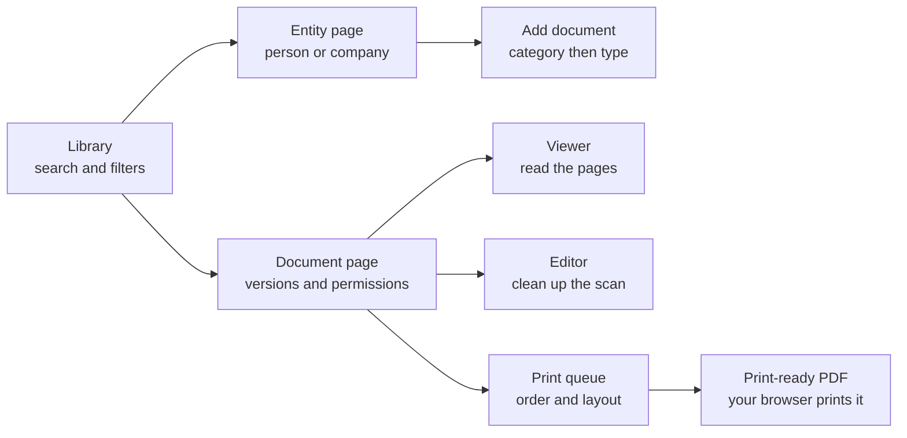
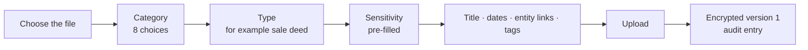

# 16 — Using DocVault

> **In plain words:** This is the guide for the people who use the system every day: how to sign
> in, add a person or company, file a document in the right category, look at it, share it, and
> print it. It assumes the system is already installed (`15`).
>
> **Read this if:** you are a clerk, reviewer, partner, auditor, or administrator using the app —
> not building it.

---

## 1. What the app does

DocVault keeps the office's paperwork in one searchable place.

- An **entity** is a person or a company. Everything belongs to an entity.
- A **document** is one piece of paper: a PAN card, a sale deed, a share certificate.
- A **version** is one uploaded file inside a document. Versions never change.
- A **category** is the shelf: identity, property, legal, corporate, financial, employment,
  insurance, or other. Every document has exactly one type inside one category.
- A **permission** decides who may see, read, change, delete, or print a document.

The app does not merge documents, does not make folders, and does not guess what a paper is. You
choose the category and the type; the app stores and protects it.

## 2. Signing in

1. Open the address your administrator gave you, for example `https://office-pc:8443`.
2. Type your **username** and **password**.
3. If your account uses a second factor, type the six-digit code from the authenticator app.
4. On your first login you must choose a new password. It cannot be the temporary one.

| Situation | What happens |
|---|---|
| Five wrong passwords in five minutes | The account pauses briefly. Wait, then try again. |
| You forgot the password | An admin resets it and gives you a new temporary one. Nobody can read your old password. |
| You are inactive | The session expires. You are asked to sign in again, and your place is kept. |
| You leave a shared computer | Click your name → **Sign out**. Do not just close the tab. |

Never share a login. The audit log records the account, not the person, so a shared login makes
the record useless.

## 3. Finding your way

| Area | What it is for |
|---|---|
| **Library** | The home screen: search, category filter, recent documents |
| **Entities** | The people and companies register |
| **Print queue** | A plan of what to print, in your order |
| **Admin** | Users, groups, document types, vault status, audit — admins only |

The left rail stays visible. The filter and page are in the address bar, so you can send a colleague
a link to exactly what you are looking at (`11` §3).

## 4. Entities

### 4.1 Add a person or a company

1. Choose **Entities → Add entity**.
2. Pick **Individual** or the organisation type: company, LLP, trust, HUF, partnership, society,
   government, other.
3. Enter the legal name exactly as it appears on the paper.
4. Add a shorter display name if people search for that instead.
5. Add identifiers: PAN, Aadhaar, GSTIN, CIN, DIN, passport, and so on.
6. Save.

| Field | Advice |
|---|---|
| Legal name | Copy it from the document, including "Private Limited" |
| Display name | What staff actually type, such as "Acme" |
| Identifiers | One value per row; do not put two PANs in one field |
| Notes | Anything the next person needs to know |

### 4.2 Duplicate warnings

If an identifier already exists, the app **warns** and lets an authorised person accept the
duplicate. It does not block the save. This is deliberate: two people can genuinely share a name,
and a hard block would force staff to invent fake values (`10` ADR-013).

### 4.3 Seeing an ID number

ID values are masked in lists, for example `AA******4B`. A user with `write` on the entity can
reveal the full value; the reveal is recorded in the audit log (`07` §4). Readers cannot harvest
PANs by scrolling a list.

## 5. Adding a document

### 5.1 Capture the paper first

The quality of the stored document is decided before upload.

| Do | Why |
|---|---|
| Scan to **PDF** for anything more than one page | One file, one document, pages in order |
| Use **200–300 dpi** | Enough to read and print, without enormous files |
| Scan in **grayscale** unless colour carries meaning | Smaller, sharper text |
| Straighten the page in the scanner | Less work in the editor |
| Put **one document in one file** | The app does not split or merge files |
| Keep a **letter** and the **envelope** as separate documents | They are different papers |
| Store **front and back as two documents** | The app does not pair them (`10` ADR-037) |

Accepted files are **JPEG, PNG, and PDF**. DOC, DOCX, and ODT are accepted only if Office intake is
enabled; they are converted to PDF once at upload. TIFF is not accepted (`10` ADR-042).

### 5.2 File it

1. Open the entity, choose **Add document**.
2. Choose the **category**. The eight choices are the shelves described in `13` §4.
3. Choose the **type** inside it. If nothing fits, choose the closest type under **Other** and ask
   an admin to add a proper type later.
4. The **sensitivity** is filled in from the type. Leave it, or raise it if this particular paper
   deserves more care. Only an admin can lower it.
5. Type a **title** a colleague would recognise: "Sale deed — Whitefield flat", not "scan001".
6. Add the issue date, expiry date if the type asks for one, the document number, and the issuer.
7. Add tags if they help: `original-seen`, `pending-verification`.
8. Choose the file and upload.

| What happens next | Detail |
|---|---|
| The file is encrypted before it reaches the disk | There is no readable copy on the server |
| Version 1 is created | It can never be overwritten |
| The category and type are stored | The category comes from the type, so they cannot disagree |
| An audit entry is written | Who uploaded what, and when |
| A preview is generated on first open | The first open may take a second; later opens are fast |

### 5.3 Choosing the category

Classify by **what the paper is**, not what it is about. A sale deed is about property, so it goes
under **Property**. A court order that freezes a property is a **Legal** document, because that is
what it is.

| Category | Examples |
|---|---|
| **Identity** | PAN, Aadhaar, passport, voter ID, driving licence |
| **Property** | Sale deed, lease, encumbrance certificate, land record, property tax receipt |
| **Legal** | Power of attorney, affidavit, court order, legal notice, will |
| **Corporate** | Incorporation certificate, MOA, AOA, share certificate, board resolution |
| **Financial** | ITR acknowledgement, bank statement, balance sheet, GST return, cheque |
| **Employment** | Appointment letter, contract, salary slip, Form 16, relieving letter |
| **Insurance** | Policy, premium receipt, claim form |
| **Other** | Correspondence, courier receipt, miscellaneous |

If a document fits two categories, pick the one where the person asking for it would look first.
The full decision tree is in `13` §5.

### 5.4 Sensitivity in one table

| Level | What it means for you |
|---|---|
| **Normal** | Ordinary handling. No badge. |
| **Sensitive** | Amber badge. Treat the content as personal. |
| **Restricted** | Red badge. Printing needs an explicit grant on this document. |

Sensitivity never changes how the file is stored. Everything is encrypted, always (`13` §6).

## 6. Reading a document

1. Open the document from the library or the entity page.
2. Click the preview, or press **Enter**, to open the viewer.
3. Use the thumbnail rail or **←** / **→** to change pages.
4. **+** / **−** zoom, **0** fits the page, **1** shows actual size.

| Thing you will see | Why |
|---|---|
| A faint user ID and time over the page | A photograph of the screen identifies the session (`01` R-7) |
| `RESTRICTED` on some pages | The document's sensitivity is restricted |
| "Could not render" with a retry | The page failed to render. The document is intact; retry, then tell an admin. |
| A deleted banner | Someone deleted the document while you had it open |

**Preview** needs `read`. **Download** also needs `read`. **Print** is a separate permission, so a
user can read on screen without being able to produce paper (`06` §2).

The viewer shows the document; it does not search inside it. v1 searches metadata only.

## 7. Cleaning up a scan

Open the document and choose **Edit**. The editor changes how the page is **shown and printed**; it
never changes the stored file.

| Control | Use it when |
|---|---|
| Rotate | The page is sideways |
| Straighten | The scan is slightly tilted |
| Crop | There is a black border or a second page edge |
| Brightness / contrast / gamma | The scan is too dark or washed out |
| Grayscale | A colour scan of black text is wasting space |
| Threshold / despeckle | A photocopy has grey background or dots |
| Auto-trim | There is a wide white margin |

1. Adjust until the preview is readable.
2. Choose **Save**. The recipe is stored, and printing uses it immediately.
3. Choose **Reset** at any time to return to the original.

**A recipe is not a version.** Saving brightness does not create version 2 and does not change the
file you uploaded. That is deliberate: a document's history should record new paper, not a slider
move (`10` ADR-036).

The editor cannot redact. A black rectangle is not redaction; the pixels are still underneath.
Never use it to hide a number you would not share (`11` §8).

## 8. Versions

A version is one uploaded file. It is immutable.

| You want to… | Do this |
|---|---|
| Replace a bad scan | **Add version**, upload the better file |
| Add a missing page | **Add version** with the complete file, not just the page |
| Keep the old file | Do nothing; it stays as version *n* |
| See what changed | Open the version list; date, uploader, size, and note are shown |

Printing an old version is allowed, but the queue flags it. Printing the wrong version is a
deliberate act, not an accident (`11` §9).

## 9. Sharing and permissions

### 9.1 How sharing normally works

A document **inherits** permissions from its entity. An entity inherits from the vault role. You
only need to act when a particular document must differ.

| Capability | In plain words |
|---|---|
| **View** | See that the document exists in lists and counts |
| **Read** | Open it and download it |
| **Write** | Change metadata, upload a new version, save a recipe |
| **Delete** | Soft-delete and restore |
| **Manage access** | Change who can do what |
| **Print** | Put it in a print job |

`Print` includes `Read`, and `Read` includes `View`. Denying `View` also removes `Read` and
`Print`. Deny always wins over allow (`06` §5).

### 9.2 Share one document with one person

1. Open the document → **Permissions**.
2. Choose **Explicit** instead of **Inherit**.
3. Add the person or group, and tick only what they need.
4. Save.

The panel says the result in words: "This document follows Acme Pvt Ltd's permissions. 4 people
can read it, 2 can print it."

### 9.3 If you cannot see a document

The app returns **"not found"** rather than "forbidden". This protects the existence of documents
you are not allowed to see (`06` §7). Ask an admin to check your access; do not assume the document
was deleted.

### 9.4 Restricted documents

A **restricted** document needs `print` from an **explicit entry on that document**, not just from
your role or the entity. Admins are exempt, and their prints are audited.

If you press Print and see `PRINT_RESTRICTED`, the classification is working. Ask for an explicit
grant on that document (`13` §6).

## 10. Printing

Printing happens at your desk. The server builds one print-ready PDF and your browser sends it to
your printer. The app never chooses a printer and never stores the PDF.

### 10.1 Build the queue

1. Select documents with the checkbox, or open an entity and choose **Add to print queue**.
2. Press **Q** or choose **Print queue**.
3. Put the items in the order you want paper to come out. Drag, or use **Alt+↑** / **Alt+↓**.
4. For each item, set a page range if you do not want every page (`12` §7).
5. Remove anything you do not want. Removing from the queue never deletes a document.

The queue is a flat list. It is not a merge, not a folder, and not a saved packet. It survives
moving between pages, and it is cleared when you sign out (`11` §9).

### 10.2 Choose the layout

| Tab | What to set |
|---|---|
| **Layout** | 1, 2, 4, 6, or 9 cells per side; simplex or duplex; flip edge |
| **Paper** | A4/Letter/Legal, portrait or landscape, margins, gutter, fit mode |
| **Preview** | Page through the actual PDF that will be printed |

The dialog shows the arithmetic before you spend paper:

> 37 pages · 4 per side · duplex · 10 sides · **5 sheets**

If that line is wrong, stop and fix the layout.

### 10.3 Print

1. Choose **Print**. A new tab opens with the PDF.
2. In the browser's print dialog, choose your printer.
3. Set **Duplex: flip on long edge** if you chose duplex.
4. Set **Actual size** or **100 %**, and turn **off** "fit to page".
5. Print, then check the first sheet before printing the rest.

The app cannot set these for you. Browsers and printer drivers override each other, which is why
the dialog says it once, loudly (`12` §10).

| Problem | Cause |
|---|---|
| Paper is single-sided | The printer dialog was left on simplex |
| Everything is slightly smaller | The driver applied fit-to-page; set 100 % |
| Pages are out of order | The queue order was not what you expected; check it before printing |
| Nothing happens | The PDF opened in a background tab; bring the browser forward |
| A restricted item is blocked | You need an explicit print grant (`§9.4`) |

Every print is audited: who, which versions, which layout, how many pages. The PDF itself is not
kept (`12` §12).

## 11. Deleting and restoring

| Action | Who | Reversible? |
|---|---|---|
| **Delete** (soft delete) | Anyone with `delete` | Yes. An admin or the deleter can restore it. |
| **Purge** | Admin only, after a soft delete, with a reason | **No.** The content is overwritten and unlinked. |
| **Legal hold** | Admin | Blocks purge until the hold is lifted |

- Deleting hides the document from normal lists but keeps the files.
- Purging is for mistakes and for data that must go. It is recorded, with the reason.
- A purge cannot reach copies in old backups. That is stated honestly in `01` R-6.
- If a document is under legal hold, purge is refused. Ask the admin who placed the hold.

## 12. Expiry and retention

Documents can carry an **expiry date**: a passport, a lease, an insurance policy. The interface
shows an expiry badge and can filter "expiring in 30 days".

v1 stores the date. It does **not** send reminders (`10` ADR-027). The office should review the
expiring list monthly; the app will not email anyone.

## 13. Admin tasks

| Task | Where | Notes |
|---|---|---|
| Create a user | Admin → Users | Temporary password; the user must change it |
| Reset a password | Admin → Users → Reset | Prints a new temporary password; all sessions end |
| Disable a user | Admin → Users → Disable | Blocks login; the audit history stays |
| Create a group | Admin → Groups | The unit of sharing |
| Change a role | Admin → Users | Admin, editor, reader, auditor |
| Add or rename a document type | Admin → Document types | Code never changes; rename is audited |
| Change a type's default sensitivity | Admin → Document types | Applies to **future** documents only |
| See vault health | Admin → Vault | Size, blob count, last dump, lock state |
| Back up now | Admin → Vault → Backup | Writes an encrypted dump inside the vault |
| Verify the vault | Admin → Vault → Verify | Full hash pass; can take a while |
| Check the audit chain | Admin → Audit → Verify | Reports the first broken entry |

**Break-glass reads.** An admin can read a document they were not granted, but must type a reason.
The read is audited as `document.breakglass_read` (`06` §9). It is for recovery, not curiosity.

**Deleting a document type.** A type that any document uses cannot be deleted; the app returns
`409` and says how many documents use it. Seeded types cannot be deleted at all; rename them
instead (`13` §9).

## 14. Keyboard shortcuts

| Key | Action |
|---|---|
| `Ctrl+K` | Search |
| `Ctrl+A` | Select the whole filtered set |
| `Space` | Toggle the focused row |
| `Enter` | Open the focused document |
| `Esc` | Close an overlay, or clear the selection |
| `←` / `→` | Previous / next page |
| `+` / `−` | Zoom in / out |
| `0` | Fit page |
| `1` | Actual size |
| `R` / `Shift+R` | Rotate the view |
| `E` | Open the editor |
| `Q` | Add the selection to the print queue |
| `Ctrl+P` | Open the print dialog, **not** the browser's |
| `Alt+↑` / `Alt+↓` | Move a queue item |
| `Delete` | Soft-delete the selection, after naming it |

Shortcuts pause while you are typing in a field.

## 15. A worked day

A sale deed arrives for Acme Holdings.

1. **Find the entity.** Search "Acme". Open the company.
2. **Scan.** Two pages plus the registration endorsement → one PDF, 300 dpi, grayscale.
3. **Add the document.** Category **Property**, type **Sale deed**. Title "Sale deed — Whitefield
   flat". Sensitivity is pre-filled as **restricted**; leave it.
4. **Add the dates.** Issue date is the registration date. No expiry.
5. **Tag it.** `original-seen`, because the clerk checked the original.
6. **Upload.** Version 1 is encrypted and audited.
7. **Clean it up.** Two pages are slightly tilted; straighten and save the recipe.
8. **Share.** The partner needs to read it, not print it. Give `read` explicitly; leave `print` off.
9. **Print the packet.** Open the entity → **Print packet**. The queue fills in category order.
   Remove the documents that are not needed, set 2-up duplex A4, check the totals, print.
10. **Verify.** The audit page shows the upload, the recipe change, the share, and the print.

The whole job takes a few minutes, and nobody opened Word.

## 16. Questions people ask

| Question | Answer |
|---|---|
| Can I rename a file before uploading? | The title is what matters. The original filename is kept for reference but is not how you find documents. |
| Can I put two documents in one PDF? | No. One file is one document. Split it before upload. |
| Can I merge two documents? | No. The app does not merge (`12` §13). |
| Can I put a document in two categories? | No. One type, one category. Use a tag for the second idea. |
| Where are folders? | There are none. The entity is the hierarchy; the category is the shelf. |
| Why can't I see the document my colleague mentioned? | It may not be shared with you, or it may be deleted. Ask an admin; the app will not confirm it exists. |
| Why can't I print when I can read? | `print` is separate. Ask for it. |
| Why does `PRINT_RESTRICTED` appear? | The document is restricted and your print right is not explicit on it. |
| Can I edit the PDF itself? | No. You can clean up how it is rendered, or upload a new version. |
| Is the scanned file readable on the server? | No. Every version is encrypted on disk (`13` §6). |
| Can I use it from home? | No. It is LAN-only by design; there is no internet exposure. |
| Where is the print file? | It is never stored. Your browser holds it until you print (`12` §12). |
| Can I recover a purged document? | Not from the app. It may exist in an old backup; the audit shows who purged it and why. |
| Does it remind me before a passport expires? | Not in v1. It shows the date and the expiring filter. |

## 17. What the app will not do

| Not built | Why |
|---|---|
| Merge documents or pages | The app does not invent structure |
| Auto-group or auto-pair fronts and backs | You decide what belongs together |
| Read text inside a document (OCR) | It would need a plaintext copy of everything (`10` ADR-020) |
| Redact | A drawn box hides nothing |
| Edit Office files | They are intake formats, converted once (`10` ADR-038) |
| Send email or notifications | Nothing leaves the network |
| Drive the printer | You print at your desk, from your browser |
| Host on the internet | One office, one network (`00` §7) |
| Recover a lost passphrase | It is unrecoverable by design (`05` §8.5) |

If a task needs one of these, it is a change to the product, not a setting. Raise it with the
person who owns the design (`10` §4).
